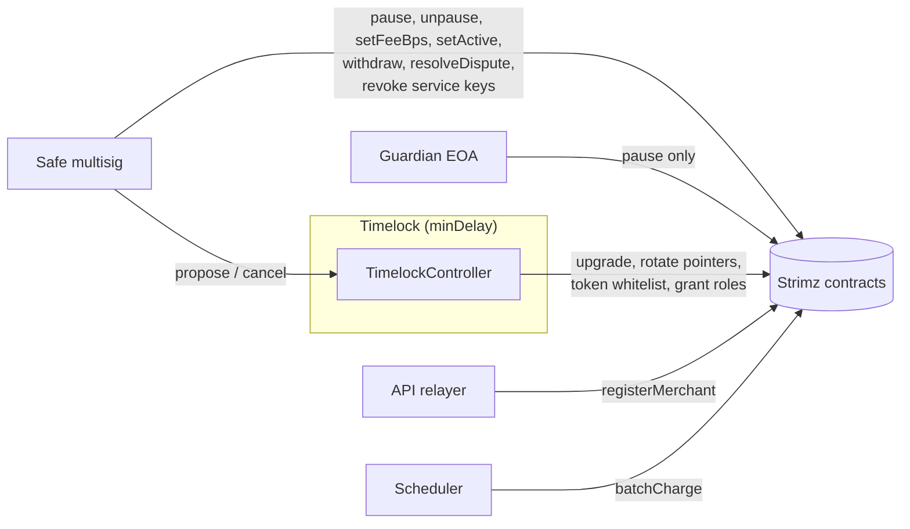

# ADR: Split admin powers on the contracts, put config behind a timelock and hand roles to a Safe

- **Status:** Accepted
- **Date:** 2026-10-10
- **Scope:** `packages/contracts` (a new `PAUSER_ROLE`; dependency rotation moves from
  `ADMIN_ROLE` to `DEFAULT_ADMIN_ROLE`; a handoff library and forge script that deploys an
  OpenZeppelin `TimelockController`, grants the role table below and renounces the
  deployer; the role grant runbook it replaces), `apps/scheduler` (refuses to start when
  its signer is the API relayer), `apps/web` (admin Tier box copy and the on-chain
  architecture docs page name the Safe instead of "the registry admin key"). **Solidity
  change.** `StrimzPayments` and `StrimzSubscriptions` are immutable, so they are
  redeployed; `StrimzAgentEscrow` is upgraded. No Prisma migration. No BullMQ job or
  webhook payload change. No published package change.

## Context

Issue #129, verified against `main` at `d6aa3b3`.

1. **Every role sits on the deployer key.**
   - `DeployCore.s.sol:34-58` and `DeployAgent.s.sol:20-30` pass the deployer EOA as
     `admin` to every constructor and `initialize`, which grant it `DEFAULT_ADMIN_ROLE`,
     `ADMIN_ROLE`, `UPGRADER_ROLE` and each contract's operational role
     (`StrimzRegistry.sol:45-48`, `TokenWhitelist.sol:61-64`, `FeeCollector.sol:59-62`,
     `StrimzPayments.sol:69-70`, `StrimzSubscriptions.sol:92-94`,
     `StrimzAgentRegistry.sol:36-39`, `StrimzAgentEscrow.sol:68-71`).
   - Nothing moves them afterwards. `script/grant-operator-roles.sh` only adds
     `MERCHANT_REGISTRAR_ROLE` for the relayer and `CHARGER_ROLE` for the scheduler, signed
     by the same deployer key. The deployer keeps `CHARGER_ROLE` on Subscriptions
     (`StrimzSubscriptions.sol:94`), `TREASURY_ROLE` on FeeCollector and
     `DISPUTE_RESOLVER_ROLE` on the escrow.
   - The contracts README says upgrades are held by "an OpenZeppelin `TimelockController`
     (48-hour delay on mainnet) controlled by a Safe multi-sig"
     (`packages/contracts/README.md:37-41`). No script or test does that.
2. **One role does both the emergency stop and the dangerous config.** `ADMIN_ROLE`
   gates `pause` and `unpause` (`access/Pausable.sol:11-17`), the dependency pointers
   on Payments and Subscriptions (`setRegistry`, `setFeeCollector`, `setTokenWhitelist`,
   only while paused: `StrimzPayments.sol:91-107`, `StrimzSubscriptions.sol:112-128`),
   the escrow's `setTokenWhitelist` (any time, `StrimzAgentEscrow.sol:82`), and the
   Registry's day-to-day calls `setFeeBps`, `setActive` and `adminCancel*`
   (`StrimzRegistry.sol:123,147,185,231`). The `whenPaused` guard does not slow an
   attacker who holds `ADMIN_ROLE`: pause, rotate the Registry to one that returns their
   own payout address, unpause, all in one block. A timelock on `ADMIN_ROLE` alone would
   also delay the emergency stop and every fee change from #128.
3. **What each service signs today.**
   - API relayer (`KMS_SOFTWARE_PRIVATE_KEY`): `Registry.registerMerchant`
     (`apps/api/src/modules/merchants/registration.ts:46`) needs
     `MERCHANT_REGISTRAR_ROLE`; `payWithAuthorization` and `permitAndCreateSubscription`
     (`relay.service.ts:126,196`) need no role.
   - Scheduler (`SCHEDULER_PRIVATE_KEY`): `Subscriptions.batchCharge`
     (`apps/scheduler/src/infra/chain/chain.service.ts:97`) needs `CHARGER_ROLE`. Its
     escrow calls act as the job's client or assessor and need no role.
   - Nothing stops both services from using one key. The scheduler already knows the
     relayer's address (`RELAYER_ADDRESS`, `apps/scheduler/src/config/env.schema.ts:68`)
     but does not compare it with its own.
4. **Safe on Arc.** Arc's docs say Safe works unmodified with the same factory addresses
   ([Arc docs, Custody](https://docs.arc.io/integrate/exchanges/custody)). On Arc testnet
   (`rpc.testnet.arc.network`, chain `5042002`), Safe v1.4.1's `SafeProxyFactory`
   (`0x4e1D…ec67`), `Safe` (`0x4167…461a`) and `SafeL2` (`0x29fc…C762`) all have code.
   `rpc.arc.network` did not resolve from here, so mainnet is not verified.
5. **Pause scope.** Only Payments, Subscriptions and the escrow are pausable. The
   Registry, TokenWhitelist, FeeCollector and AgentRegistry are not.

### Red, failing on `main` at `d6aa3b3`

- `packages/contracts/test/AdminRoles.t.sol`, 8 tests, 6 fail:
  - `PAUSER_ROLE()` does not exist on Payments, Subscriptions or the escrow (revert);
  - an account with only `PAUSER_ROLE` cannot pause
    (`AccessControlUnauthorizedAccount`, it needs `ADMIN_ROLE`);
  - an account with only `ADMIN_ROLE` can pause (expected a revert);
  - an account with only `ADMIN_ROLE` can rotate all three pointers on Payments and on
    Subscriptions while paused, and the escrow's token whitelist (expected reverts).
  - Pass on `main` and guard the change: the role holder that deploys can still pause and
    rotate while paused; an account with only `PAUSER_ROLE` cannot unpause.
- `apps/scheduler/test/unit/signer-separation.test.ts`, 3 tests, 2 fail: the scheduler
  starts when `RELAYER_ADDRESS` is its own signer's address, in checksum or lower case.
  Different keys start; passes on `main` and guards the change.
- Written first during the build, failing to compile until the library exists:
  `packages/contracts/test/AdminHandoff.t.sol` drives the handoff end to end (below).

## Decision

### 1. Contracts

- `StrimzAccessControl` gains `PAUSER_ROLE = keccak256("STRIMZ_PAUSER_ROLE")`.
  `pause()` requires `PAUSER_ROLE`; `unpause()` keeps `ADMIN_ROLE`. Constructors and
  `initialize` also grant `PAUSER_ROLE` to `admin`, so a fresh deploy behaves as today
  until the handoff.
- Dependency rotation requires `DEFAULT_ADMIN_ROLE`: `setRegistry`, `setFeeCollector`,
  `setTokenWhitelist` on Payments and Subscriptions (still only while paused) and
  `setTokenWhitelist` on the escrow.
- Subscriptions and the Registry make `ADMIN_ROLE` the role admin of `CHARGER_ROLE` and
  `MERCHANT_REGISTRAR_ROLE` (`_setRoleAdmin`), so the Safe can revoke or rotate a leaked
  service key at once instead of waiting out the timelock (H7). Subscriptions does it in
  its constructor. The Registry is a live proxy whose `initialize` will not run again, so
  it gains `initializeRoleAdmins()` with `reinitializer(2)`: called right after
  `initialize` on a fresh deploy, and through `upgradeToAndCall` on the existing testnet
  proxy.
- Nothing else changes: no storage layout change, no event change, no ABI change apart
  from the new `PAUSER_ROLE()` getter and the Registry's `initializeRoleAdmins()`.

### 2. Role table after the handoff

| Role                      | Contracts                                                | Holder                        |
| ------------------------- | -------------------------------------------------------- | ----------------------------- |
| `DEFAULT_ADMIN_ROLE`      | all seven                                                | Timelock                      |
| `UPGRADER_ROLE`           | Registry, Whitelist, FeeCollector, AgentRegistry, Escrow | Timelock                      |
| `TOKEN_MANAGER_ROLE`      | TokenWhitelist                                           | Timelock                      |
| `ADMIN_ROLE`              | Registry, Payments, Subscriptions, Escrow                | Safe and Timelock             |
| `PAUSER_ROLE`             | Payments, Subscriptions, Escrow                          | Safe, Timelock, guardian (H4) |
| `TREASURY_ROLE`           | FeeCollector                                             | Safe                          |
| `DISPUTE_RESOLVER_ROLE`   | Escrow                                                   | Safe                          |
| `AGENT_ADMIN_ROLE`        | AgentRegistry                                            | Safe                          |
| `MERCHANT_REGISTRAR_ROLE` | Registry                                                 | API relayer                   |
| `CHARGER_ROLE`            | Subscriptions                                            | scheduler                     |
| `FEE_ACCRUER_ROLE`        | FeeCollector                                             | Payments and Subscriptions    |
| any role                  | any                                                      | deployer: none (renounced)    |

- **Slow (Timelock):** upgrades, pointer rotation, token whitelist, granting any role.
  A rotation is one timelock batch `[pause, setX, unpause]`, so it executes atomically
  after the delay with no downtime; this is why the Timelock also holds `PAUSER_ROLE`
  and `ADMIN_ROLE`.
- **Fast (Safe, no delay):** pause, unpause, `setFeeBps` (bounded by each merchant's
  own `maxFeeBps`), `setActive`, `adminCancel*`, fee withdrawals, dispute resolution,
  agent reputation, and revoking or rotating the two service keys.
- **Hot keys:** the relayer and the scheduler hold only their one role each.

### 3. TimelockController

OpenZeppelin `TimelockController` (v5, already in `lib/openzeppelin-contracts`):
proposers and cancellers = the Safe; executors = anyone (`address(0)`) so an approved
operation cannot be stranded (H5); admin = none (`address(0)`), so the timelock governs
itself. `minDelay` is a required deploy input (H2).

### 4. Handoff

- `script/utils/AdminHandoff.sol` (library) and `script/HandoffAdmin.s.sol` (forge
  script, signed by the deployer). It reads every contract address, `STRIMZ_SAFE_ADDRESS`,
  `STRIMZ_GUARDIAN_ADDRESS` (optional), `STRIMZ_RELAYER_ADDRESS`,
  `STRIMZ_SCHEDULER_ADDRESS` and `TIMELOCK_MIN_DELAY`, and refuses to run unless:
  the Safe has code and `getThreshold() >= 2`; relayer, scheduler, Safe, guardian and
  deployer are five distinct addresses; the deployer still holds `DEFAULT_ADMIN_ROLE`
  everywhere.
- It deploys the Timelock, grants the table above, renounces every deployer role last,
  then asserts the final table with `hasRole` and reverts on any difference. It appends a
  `handoff` entry to `deployments/<chainId>.json`.
- `script/grant-operator-roles.sh` is deleted: its two grants are part of the handoff,
  and after the handoff the deployer cannot grant anything.
- `test/AdminHandoff.t.sol` (red first) deploys the full suite, a mock Safe and the
  handoff, then checks: the deployer holds no role on any contract; the table above,
  role by role; the Safe can pause, unpause, `setFeeBps`, withdraw and resolve a dispute
  directly; the Safe cannot rotate a pointer or upgrade directly; a Timelock batch
  `[pause, setRegistry, unpause]` reverts before `minDelay` and succeeds after it; the
  Safe can revoke and re-grant `CHARGER_ROLE` with no delay; the handoff refuses a
  1-of-n Safe, a Safe with no code, and a relayer equal to the scheduler.

### 5. Scheduler

`validateEnv` refuses `SCHEDULER_PRIVATE_KEY` whose address equals `RELAYER_ADDRESS`
(case-insensitive), naming `RELAYER_ADDRESS` in the error.

### 6. Web copy

The admin Tier box (`app/(admin)/admin/merchants/[id]/page.tsx:216-221`) and
`content/docs/concepts/on-chain-architecture.mdx` say the Safe sends `setFeeBps` and
describe the slow and fast paths. `packages/contracts/README.md` gets the role table.

## Diagram

## Consequences

- A stolen deployer key controls nothing after the handoff. A stolen relayer or
  scheduler key can only do its one job until the Safe revokes it.
- Changing a fee needs a Safe transaction (2 signers) instead of one key. Slower for
  the admin, and the #128 admin flow now names the Safe.
- Upgrading, rotating a pointer or adding a token takes at least `minDelay`, and anyone
  watching the Timelock's `CallScheduled` events sees it coming. An urgent fix to a
  value-moving contract is: Safe pauses now, then the timelocked fix lands.
- **Testnet migration (H6).** Payments and Subscriptions are immutable, so the new code
  means new addresses. Under the recommended H6 the Registry, TokenWhitelist and
  FeeCollector proxies stay (merchants keep their `onchainMerchantId`), the escrow is
  upgraded, FeeCollector grants `FEE_ACCRUER_ROLE` to the new Payments and
  Subscriptions and revokes it from the old ones, and the env files get the new
  addresses: Lightsail `STRIMZ_PAYMENTS_ADDRESS`, `STRIMZ_SUBSCRIPTIONS_ADDRESS`,
  `PAYMENTS_ADDRESS`, `SUBSCRIPTIONS_ADDRESS`; Vercel
  `NEXT_PUBLIC_STRIMZ_PAYMENTS_ADDRESS`, `NEXT_PUBLIC_STRIMZ_SUBSCRIPTIONS_ADDRESS`.
  Testnet subscriptions created on the old Subscriptions contract stay there and stop
  renewing; the old contract is paused. The Registry proxy is upgraded once to call
  `initializeRoleAdmins()`.
- **Mainnet:** a fresh deploy, then the handoff, before any merchant registers.
- Gas: one deploy of the Timelock and about 40 grant and renounce transactions per
  network, paid in USDC by the deployer.

## Alternatives

- **Timelock holds `ADMIN_ROLE`, no new role.** Lost: the emergency stop and every fee
  change wait out the delay.
- **OpenZeppelin `AccessManager` with per-function delays.** Most precise, but replaces
  `AccessControl` in every contract and changes storage layout of the UUPS proxies; too
  large for launch.
- **Safe only, no Timelock.** Lost: a compromised Safe quorum can upgrade or rotate in
  one block with no public warning.
- **Keep the role grant runbook in bash.** Lost: the handoff must be checked end to end
  in a forge test; a bash script cannot be.

## Decisions for the maintainer

- **H1. Role table.** Recommended: the table above. Alternative: also put `setFeeBps`
  behind the Timelock (every tier change waits out the delay).
- **H2. Timelock delay.** Recommended: 48 hours on mainnet (what the README already
  promises), 5 minutes on testnet. Required input; no default.
- **H3. Safe.** Recommended: 2-of-3, owners on hardware wallets, created by you in the
  Safe web app ("add custom network" for Arc). The handoff refuses a threshold below 2.
- **H4. Guardian.** Recommended: one extra EOA you keep offline that can only pause.
  Alternative: no guardian (pausing then needs two Safe signers).
- **H5. Timelock executor.** Recommended: anyone may execute an operation once its
  delay has passed. Alternative: only the Safe.
- **H6. Testnet.** Recommended: keep the Registry, TokenWhitelist and FeeCollector
  proxies, upgrade the escrow, redeploy Payments and Subscriptions, hand off. Old testnet
  subscriptions stop renewing. Alternative: redeploy everything on testnet (every
  testnet merchant registers again, and `START_BLOCK` moves).
- **H7. Service-key rotation.** Recommended: the Safe is role admin of `CHARGER_ROLE` and
  `MERCHANT_REGISTRAR_ROLE`, so a leaked key is revoked at once. Alternative: only the
  Timelock can, so a leak means pausing until the delay passes.

## Migration, versioning, docs

- **Solidity:** the two contract changes above; `PAUSER_ROLE()` is a new getter.
  Storage layout unchanged; `Upgradeability.t.sol` and the upgrades plugin validate the
  escrow upgrade.
- **No** Prisma migration, changeset, job or webhook change. The indexer reads events
  only; the new Payments and Subscriptions emit the same events.
- **Docs:** `packages/contracts/README.md` (role table, deploy then handoff),
  `on-chain-architecture.mdx`, `infra/lightsail/README.md` (relayer and scheduler must be
  different keys). Release note
  `docs/release-notes/<date>-admin-timelock-handoff.md`, `scenario-impact: updated`
  if a scenario covers deploys, otherwise `needs_automation`.
- **Existing tests:** tests that pause as `admin` keep passing (admin is granted
  `PAUSER_ROLE` at deploy). Rotation tests run as `admin`, who holds
  `DEFAULT_ADMIN_ROLE`. None is weakened.
- **Comments a human must correct** (Directive 6; the agent edits none):
  - `src/access/Pausable.sol:7-8` ("Global kill switch gated by ADMIN_ROLE").
  - `src/access/StrimzAccessControl.sol:11,14,17` (ADMIN "can pause/unpause and change
    contract-level parameters"; UPGRADER "In production this is the Timelock" becomes
    true; CHARGER mentions "agent action endpoints", which no contract gates).
  - `src/core/StrimzPayments.sol:86-89` and `src/core/StrimzSubscriptions.sol:109-110`
    ("a compromised admin"): now `DEFAULT_ADMIN_ROLE`, held by the Timelock.
  - `script/DeployCore.s.sol:18-31` describes the deploy only; it does not mention that the
    deployer still has to run the handoff (a human may want to add that).

## Verification

- The red tests above pass, plus `AdminHandoff.t.sol`. `forge test` in full, and
  `./scripts/preflight.sh` in full.
- On Arc testnet, by the maintainer, under H6: create the Safe; run the deploy steps and
  `HandoffAdmin.s.sol`; then `cast call` `hasRole` for the deployer on every contract
  (all false); a Safe transaction pauses and unpauses Payments; a Timelock
  `scheduleBatch` of a no-op rotation is visible and executes only after `minDelay`; a
  hosted checkout payment and one subscription charge succeed against the new addresses.
  Transaction hashes go in the PR.
