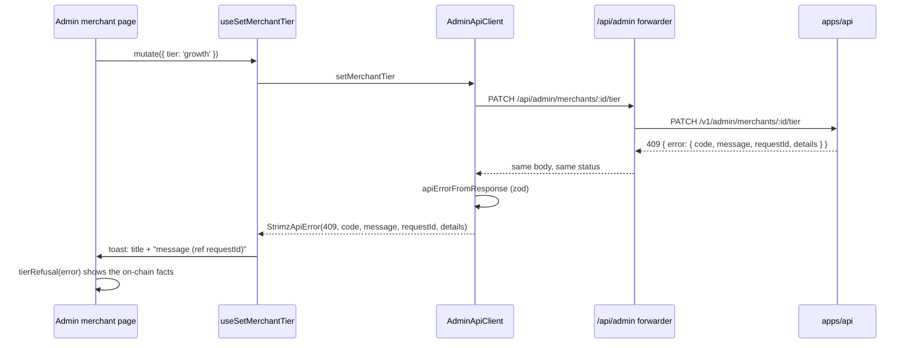

# ADR: Read the API error envelope in the web app and show tier refusals on the admin page

- **Status:** Accepted 2026-10-10 (E1–E3 as recommended)
- **Date:** 2026-10-10
- **Scope:** `apps/web` only: the merchant and admin API clients
  (`lib/merchant-api/client.ts`, `lib/admin-api/client.ts`), their shared error classes
  (`lib/merchant-api/errors.ts`), the toast hook (`hooks/api/use-mutation-with-toast.ts`),
  the admin write forwarder (`app/api/admin/_lib/forward.ts`) and the admin merchant page
  (`app/(admin)/admin/merchants/[id]/page.tsx`). No API change. No Solidity change. No
  Prisma migration. No BullMQ job or webhook payload change. No published package change
  (`@strimz/sdk` already reads the envelope: `packages/sdk/src/http/fetcher.ts:200`).

## Context

Issue #228, verified against `main` at `7c8fbca`.

1. **The API nests every error under `error`.** `AllExceptionsFilter` answers
   `{ error: { code, message, requestId?, details? } }`
   (`apps/api/src/common/filters/all-exceptions.filter.ts:15,39-72`).
2. **Both web clients read the fields at the top level.** The merchant client parses the
   body and hands it to `buildApiError` as `{ code, message, details? }`
   (`lib/merchant-api/client.ts:146-156`); the admin client does the same
   (`lib/admin-api/client.ts:232-236`). So `body.code`, `body.message` and
   `body.details` are always `undefined`:
   - every error's message is the fallback `Strimz API error <status>`
     (`lib/merchant-api/errors.ts:35`), and that is what every dashboard and admin error
     toast shows under its title (`hooks/api/use-mutation-with-toast.ts:163-166`);
   - `code` is `undefined`, so `merchant_not_synced` can never build
     `MerchantNotSyncedError` (`errors.ts:114`);
   - `details` is lost, so the admin page cannot show why #128's tier change was refused
     (`409 onchain_fee_mismatch` and `onchain_fee_above_ceiling` carry
     `{ onchainMerchantId, onchainFeeBps, requiredFeeBps, maxFeeBps }`,
     `apps/api/src/modules/admin/admin.service.ts:353-366`);
   - `requestId` is dropped, so support cannot match a toast to an API log line.
3. **The admin forwarder answers its own two errors in a third shape.** A cross-origin
   write and a write without a bearer token answer a bare `{ code, message }`
   (`app/api/admin/_lib/forward.ts:51-63`). Every other admin write error is the API's
   envelope, passed through unchanged (`forward.ts:87-94`).
4. **No body is validated.** Both clients cast the parsed JSON straight to
   `ApiErrorBody`, against the boundary rule in `AGENTS.md` (checklist item 1).

### Red, failing on `main` at `7c8fbca`

- `apps/web/src/lib/__tests__/api-error-envelope.test.ts`, 5 tests, all fail:
  - merchant client, `409` envelope: the error's message is `Strimz API error 409`, and
    `code`, `details` and `requestId` are missing;
  - merchant client, `401 merchant_not_synced`: an `AuthenticationError`, not a
    `MerchantNotSyncedError`;
  - admin client `setMerchantTier`, `409 onchain_fee_mismatch`: same as the first;
  - a `500` with an unexpected JSON body, and with an envelope missing `code`: the error
    has no `code` (expected `unknown_error`) and the message is `Strimz API error 500`
    (expected `request failed with status 500`, the text the merchant client already
    uses for a non-JSON body).
- `apps/web/src/lib/__tests__/admin-bff-errors.test.ts`, 2 tests, both fail: the
  forwarder's `403 csrf_origin_mismatch` and `401 authentication_error` are bare, not
  enveloped.
- `apps/web/src/lib/__tests__/api-error-toast.test.ts`, 3 tests, fail on the missing
  module `lib/api-error-toast.ts` (title and description of the error toast; the
  description carries the API's message and `(ref <requestId>)`).
- `apps/web/src/lib/__tests__/tier-refusal.test.ts`, 4 tests, fail on the missing module
  `lib/admin-api/tier-refusal.ts` (the facts of a tier refusal for the admin page).

## Decision

1. **One parser at the edge.** `lib/merchant-api/errors.ts` gains
   `apiErrorFromResponse(response): Promise<StrimzApiError>`. It reads the body once and
   validates it with zod against
   `{ error: { code: string, message: string, requestId?: string, details?: unknown } }`.
   A body that is not JSON or does not match keeps the HTTP status and becomes
   `{ code: 'unknown_error', message: 'request failed with status <n>' }`, the values
   the merchant client already uses for a non-JSON body (the admin client uses the
   message `failed`, `lib/admin-api/client.ts:234-235`). The error is still thrown; only the
   unreadable body is replaced, so the caller still sees a failure with its status.
   Both clients call it in place of their own parsing.
2. **`StrimzApiError` carries `requestId`.** `ApiErrorBody` gains `requestId?: string`
   and the class keeps it beside `status`, `code` and `details`. The subclasses and
   `buildApiError` are unchanged.
3. **The admin forwarder speaks the envelope.** Its two own answers become
   `{ error: { code, message } }` with the same codes and statuses.
4. **The toast mapping moves to a pure module.** `lib/api-error-toast.ts` exports
   `apiErrorToast(error): { title, description? }` with today's titles unchanged (session
   expired, not found, check the fields, too fast, Strimz trouble, otherwise "Something
   went wrong."). The description is the error's message, followed by `(ref <id>)` when
   the API sent a request id. `useMutationWithToast` calls it; a page-supplied
   `messages.error` still overrides the title. The web app has no DOM test setup, so the
   pure module is what the tests drive.
5. **The admin merchant page shows a tier refusal inline.** `lib/admin-api/tier-refusal.ts`
   exports `tierRefusal(error)`. For `merchant_not_registered`, `onchain_fee_mismatch` and
   `onchain_fee_above_ceiling` it returns the API's message and, when `details` matches
   the zod shape above, the facts as label and value pairs: On-chain merchant id, Registry
   fee, Tier needs, On-chain ceiling (in bps). Any other error returns `null`. The Tier
   box renders it under the select with `role="alert"` until the next attempt; the
   toast still fires as for any error.

## Diagram

## Consequences

- Every dashboard and admin error toast shows the API's own message and request id
  instead of a status number. Messages are written for merchants and admins already;
  none carries a secret (the filter returns a generic message for unknown errors,
  `all-exceptions.filter.ts:39-46`).
- `MerchantNotSyncedError` starts to occur. Its only consumer is `isAuthError`
  (`errors.ts:132`), which already treats it like an authentication error, so no flow
  changes.
- Hosted checkout, the contact form and the payer flow do not use these clients; their
  own helpers already read the envelope (`lib/checkout-submission.ts`,
  `lib/checkout-payer.ts`, `lib/contact-submission.ts`). Unchanged.
- The admin forwarder's two error bodies change shape. Their only reader is the admin
  client, changed in the same PR.

## Alternatives

- **Unwrap inside `buildApiError`.** Lost: it would accept both shapes forever and keep
  the cast without validation.
- **Throw a separate error class for an unreadable body.** Lost: every caller would need
  a second branch for a case that means the same thing to the user (the request failed
  with this status).
- **Show the tier facts in the toast only.** Lost: a toast disappears; the admin needs
  the required fee and the on-chain merchant id while sending `setFeeBps`.
- **Leave the request id out of the toast.** Lost: support has no way to find the API log
  line for a reported error.

## Decisions for the maintainer

- **E1. Unreadable error body.** Recommended: keep the status, `code: 'unknown_error'`,
  message `request failed with status <n>`. Alternative: a separate error class.
- **E2. Request id in the toast.** Recommended: `(ref <id>)` at the end of the
  description. Alternative: leave it out.
- **E3. Tier refusal on the admin page.** Recommended: inline under the Tier select with
  the four facts, plus the usual toast. Alternative: toast only.

## Migration, versioning, docs

- No migration. No changeset (`apps/web` is not published).
- Release note `docs/release-notes/2026-10-10-web-api-error-envelope.md`,
  `scenario-impact: needs_automation`.
- **Existing tests:** none change.
- **Comments a human must correct** (Directive 6; the agent edits none):
  - `apps/web/src/lib/merchant-api/errors.ts:11-14` says the API's envelope is
    `{ code, message, details? }`; it is nested under `error`.
  - `apps/web/src/lib/merchant-api/errors.ts:17` calls `ApiErrorBody` the "JSON error
    envelope returned by apps/api"; it becomes the inner object.
  - `apps/web/src/hooks/api/use-mutation-with-toast.ts:143-146,160-163` describe the
    mapping that moves to `lib/api-error-toast.ts`.

## Verification

- The red tests above pass. Full `./scripts/preflight.sh`.
- By hand after the Vercel deploy, in light and dark mode: on the admin merchant page,
  pick a tier whose fee does not match the registry; the toast shows the API message
  with a `ref`, and the Tier box lists the registry fee and the fee the tier needs. On
  the dashboard, any refused action shows the API's message instead of
  `Strimz API error <status>`.
