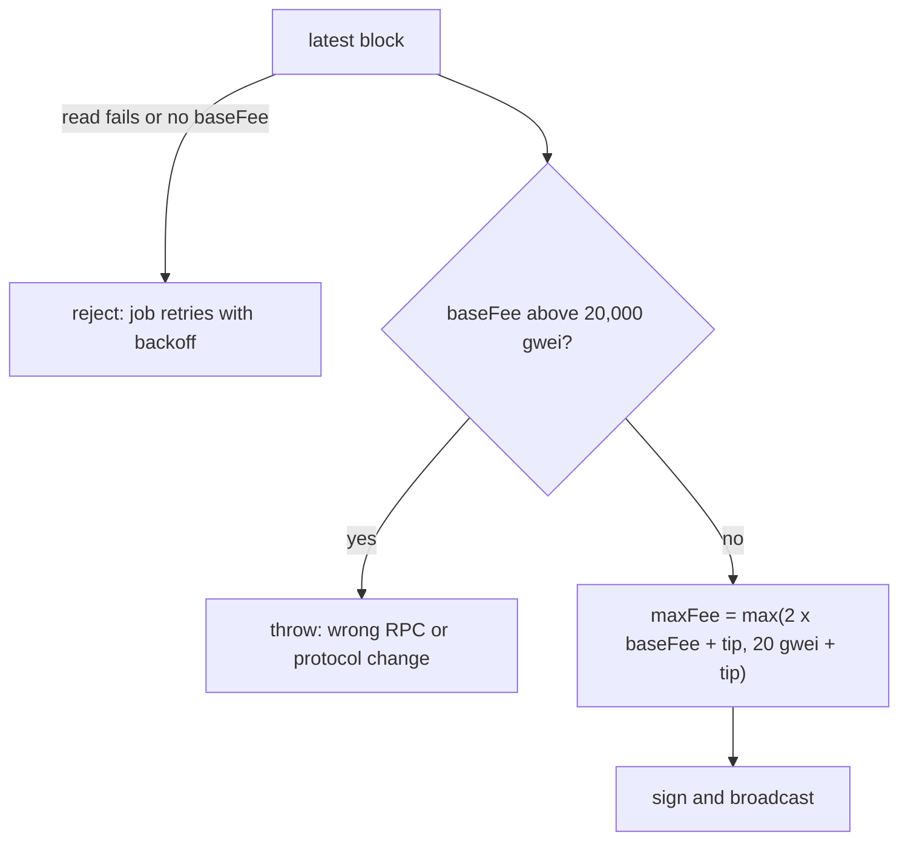

# ADR: Arc gas pricing that follows the protocol bounds, and scheduler nonces and chain

- **Status:** Accepted (2026-10-11, G1–G6 as recommended)
- **Date:** 2026-10-11
- **Scope:**
  - `apps/api/src/modules/relay/gas-pricing.service.ts` and its unit test.
  - `apps/scheduler/src/infra/chain/chain.service.ts`: nonces and the chain used to
    sign.
- **Not in scope:**
  - no Solidity, migration, job payload or published package change;
  - the boot chain-id check, which shipped in #138;
  - separate relayer and scheduler keys, which shipped in #129 and #137.

## Context

Issue #141, checked on 2026-10-11 against `main` at `e745b10`, the Arc docs
(`/arc/references/gas-and-fees`) and both live RPCs.

1. **Arc's fee bounds.**
   - The docs give a minimum base fee of 20 gwei (labelled testnet) and a maximum of
     20,000 gwei, adjusted by an EWMA of block use. They say the values may change before
     mainnet.
   - On 2026-10-11 both `rpc.testnet.arc.io` and `rpc.mainnet.arc.io` report a 20 gwei
     base fee for the last 20 blocks.
2. **The relayer's cap is below the protocol maximum.**
   - `GasPricingService` prices `maxFeePerGas = 2 × baseFee + tip`, floored at
     `20 gwei + tip`.
   - It then clamps the result to `SAFETY_MAX_FEE_WEI = 200 gwei`
     (`gas-pricing.service.ts:24`).
   - Once the base fee passes 200 gwei, every relay is priced below the base fee and is
     never included. The job waits out its receipt timeout and retries at the same cap.
     Its nonce stays taken, so every later relay queues behind it. Payments and merchant
     registrations stop until the base fee falls.
3. **A failed fee read is hidden.** When `getBlock` throws, or the block has no
   `baseFeePerGas`, the service logs a warning and prices at the floor. Under load that
   floor is too low, so the hidden error turns into a stuck transaction. AGENTS.md
   Directive 4 forbids this fallback.
4. **The existing tests lock in the behaviour.** In `gas-pricing.test.ts`, three cases
   assert that behaviour: "clamps maxFeePerGas at the safety cap", "falls back to the
   floor when the RPC has no baseFeePerGas" and "does not crash when the chain client
   throws".
5. **The scheduler has no nonce handling.**
   - The subscription charge worker and the agent action worker (CCTP claims, escrow
     calls, cancels) run in one process. Each one calls `writeContract`.
   - viem then reads the pending nonce from the RPC each time. Two sends close together
     read the same nonce, and one of them fails with "nonce too low" or "replacement
     underpriced".
   - For a charge, that burns nothing on-chain. The worker retries with the next attempt
     id, but the charge is late and the error is noise.
6. **The scheduler signs for whatever chain the RPC reports.**
   - Every `writeContract` in `apps/scheduler/src/infra/chain/chain.service.ts` passes
     `chain: null`. viem then skips its chain check and takes the chain id from
     `eth_chainId` for each transaction.
   - The #138 boot check makes a wrong RPC unlikely, but only at boot.
7. **The scheduler's fees.** It lets viem estimate fees: `1.2 × baseFee` plus the RPC's
   suggested tip. It has no cap, so finding 2 does not apply. The protocol floor holds,
   because the base fee never goes below it.

### Red, to fail on `main` at `e745b10` before the build

- `apps/api/test/unit/modules/relay/gas-pricing.test.ts`:
  - with a 500 gwei base fee, `maxFeePerGas` is at least the base fee (today 200 gwei);
  - a base fee above 20,000 gwei throws, naming the reading;
  - a failed `getBlock`, or a block without `baseFeePerGas`, rejects.
  - These replace the three cases in context item 4. The floor and tip cases stay.
- `apps/scheduler/test/unit/chain-writes.test.ts` (new), against a recording transport:
  - two concurrent `batchCharge` calls sign with consecutive nonces (today the same
    nonce);
  - every signed transaction carries the configured chain id;
  - with the RPC reporting chain 1, the write is still signed for 5042002 (today it is
    signed for chain 1).

## Decision

1. **Relayer cap (G1).** Drop the 200 gwei clamp.
   - A base fee above Arc's documented maximum (20,000 gwei) throws. That reading means a
     wrong RPC or a changed protocol, and it needs a human.
   - Otherwise `maxFeePerGas = 2 × baseFee + tip`, never clamped. A transaction pays
     gas used × (base fee + tip), not the cap.
   - Cost, from testnet `registerMerchant` transactions (84,420 gas used each):
     - at today's 20 gwei base fee: about 0.0018 USDC (for example
       `0x387d96f8…3617`, 0.00177 USDC at 21 gwei);
     - at Arc's 20,000 gwei ceiling, the worst case: about 1.7 USDC.
   - What the cap does change is the balance the node checks before accepting a
     transaction: gas limit × `maxFeePerGas`. At the ceiling, a 300,000-gas
     registration needs about 12 USDC in the relayer's account to be accepted, even
     though it is charged about 1.7 USDC.
2. **Floor (G2).** Keep the 20 gwei floor. Both live networks report it today. The floor
   and the maximum become named constants beside each other, and the release note
   records the mainnet check.
3. **Fee read errors (G3).** A failed block read, or a block without `baseFeePerGas`,
   rejects. The relay job fails that attempt and BullMQ retries it with backoff, as for
   any RPC error.
4. **Scheduler nonces (G4).** The scheduler account gets viem's `nonceManager`, which
   takes the RPC's pending count and hands out consecutive nonces within the process.
   One scheduler process runs today; a second replica would need a shared nonce store.
5. **Scheduler chain (G5).** Every scheduler write passes the configured chain instead of
   `chain: null`. viem then signs with the configured chain id whatever the RPC reports,
   so a node on another chain rejects the transaction (EIP-155). viem does not compare the
   RPC's chain id for a local signing account; the #138 boot check does that once.
6. **Scheduler fees (G6).** Unchanged: viem's estimate follows the base fee and has no cap.

## Diagram

## Consequences

- During congestion, relays keep landing and pay the going price instead of stalling. The
  per-merchant relay budget (`RelayBudgetService`) still records the gas each relay costs.
- An RPC outage now shows as failed relay attempts and retries, not as cheap transactions
  that never mine.
- The scheduler stops racing itself on nonces. If a transaction is dropped, its nonce
  still blocks later ones until the RPC's pending count moves. That is the same as today.
- If Arc raises the maximum base fee for mainnet, the relayer refuses to price until the
  constant is updated. That is deliberate, and the error says which reading tripped it.

## Alternatives

- **Raise the cap to a fixed higher number.** Lost: any fixed cap below the protocol
  maximum brings the stall back at that level.
- **Shared Redis nonce manager for the scheduler.** Lost for now: one scheduler process;
  the API's manager can move to a package when a second replica exists.
- **Leave `chain: null` because of the boot check.** Lost: one argument per call buys a
  per-transaction guarantee.
- **Price scheduler fees with the relayer's rule.** Not needed: viem's estimate has no cap.

## Decisions for the maintainer

- **G1. Relayer cap.** Recommended: no clamp; throw above Arc's 20,000 gwei maximum.
  Alternative: a fixed higher cap.
- **G2. Floor.** Recommended: keep 20 gwei, as both networks report.
- **G3. Fee read errors.** Recommended: reject and let the job retry. Alternative: keep
  the floor fallback.
- **G4. Scheduler nonces.** Recommended: viem's in-process `nonceManager`. Alternative: a
  shared Redis manager.
- **G5. Scheduler chain.** Recommended: pass the configured chain on every write, so
  every transaction is signed for it.
- **G6. Scheduler fees.** Recommended: unchanged.

## Migration, versioning, docs

- No changeset, no migration, no env change.
- `__testing__.SAFETY_MAX_FEE_WEI` goes away with the clamp. The three test cases in
  context item 4 are replaced by the red cases above.
- Comments that the change makes false (the cap's JSDoc, the fallback's JSDoc, step 5 of
  the class JSDoc) are listed in the PR for a human to correct (Directive 6).
- Release note.

## Verification

- The red tests above pass, plus the relay runner unit and e2e suites and
  `./scripts/preflight.sh` in full.
- After the next testnet redeploy: one checkout payment relays and one subscription
  charge broadcasts, with their transaction hashes in the release note follow-up.
