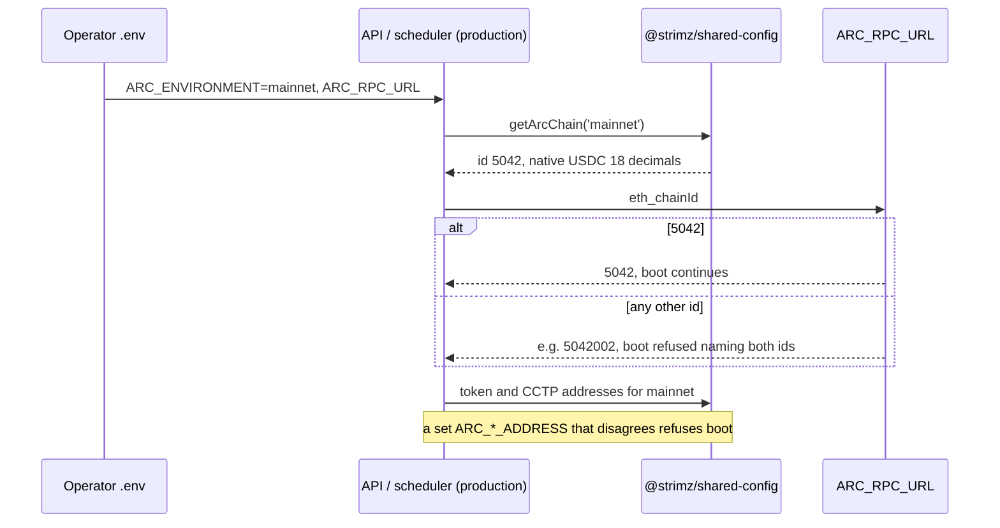

# ADR: Correct the Arc mainnet chain, tokens and CCTP, and refuse a wrong network

- **Status:** Accepted (2026-10-11, C1–C7 as recommended)
- **Date:** 2026-10-11
- **Scope:**
  - `packages/shared-config` (published): chain ids, RPC and explorer URLs, native
    currency decimals, mainnet token, CCTP and Gateway addresses. Lookups throw on an
    unknown environment.
  - `apps/api` and `apps/scheduler`: in production, refuse to boot when the RPC serves
    another chain than `ARC_ENVIRONMENT`. The API takes its token addresses from
    shared-config and refuses a contradicting `ARC_*_ADDRESS` in production.
  - `apps/agent`: production refuses an unset `ARC_ENVIRONMENT`, like the API and the
    scheduler.
  - `apps/web`: the Privy chain, the checkout wallet chain, the withdraw chain and the
    explorer links follow `NEXT_PUBLIC_ARC_ENVIRONMENT` instead of testnet.
  - Env examples, the contracts tooling (`.env.example`, `verify.sh`, `foundry.toml`)
    and the READMEs move to the `arc.io` domains.
- **Not in scope:**
  - no Solidity change, no Prisma migration, no webhook payload change;
  - the Go indexer, which already checks its chain id against the RPC;
  - a viem upgrade.

## Context

Issue #138, verified on 2026-10-11 against `main` at `c62b3e6`, the Arc docs
(`/arc/references/connect-to-arc`, `/arc/references/rpc-endpoints`,
`/arc/references/contract-addresses`) and both live RPCs.

1. **The mainnet chain is wrong.**
   - `ARC_MAINNET_CHAIN_ID` is `5040001` (`packages/shared-config/src/chains.ts:15`).
     `eth_chainId` on `https://rpc.mainnet.arc.io` returns `5042`.
   - The mainnet RPC is `https://rpc.arc.network`, which does not resolve. The explorer
     is `https://arcscan.app`, which does not resolve either.
   - A transaction signed for `5040001` is rejected by the mainnet RPC, so on mainnet the
     relayer and the scheduler could not send anything.
2. **The mainnet addresses are testnet copies, and nothing lives at them on mainnet.**
   - `TOKEN_ADDRESSES.mainnet` and `CCTP_CONTRACTS.mainnet` repeat the testnet values,
     with a comment that Circle had not published mainnet yet. Circle has now.
   - On the mainnet RPC, the testnet EURC (`0x89B5…D72a`) and the testnet
     MessageTransmitterV2 (`0xE737…E275`) have no code. A mainnet EURC payment would
     target an empty address, and the scheduler's CCTP claim would call one.
   - The published mainnet addresses, checked on the mainnet RPC:

     | Contract             | Mainnet address | On-chain check                                  |
     | -------------------- | --------------- | ----------------------------------------------- |
     | USDC                 | `0x3600…0000`   | same as testnet; `USDC`, 6 decimals             |
     | EURC                 | `0xbEf5…21c1`   | `EURC`, 6 decimals                              |
     | USYC                 | `0x8a5D…F490`   | `USYC`, 6 decimals                              |
     | TokenMessengerV2     | `0x28b5…cf5d`   | its `localMessageTransmitter()` is the next row |
     | MessageTransmitterV2 | `0x81D4…4B64`   | `localDomain()` is 26                           |
     | GatewayWallet        | `0x7777…00eE`   | contract code present                           |
     | GatewayMinter        | `0x2222…C205`   | contract code present                           |

   - All the testnet values still hold on the testnet RPC.

3. **The native currency decimals are wrong.** Both chains declare native USDC with 6
   decimals. Arc's native gas token has 18; only the ERC-20 interface at `0x3600…0000`
   has 6. Wallets that add the chain from our definition (Privy, Reown) would show
   balances 10¹² times too large. The withdraw gas maths already assumes 18
   (`apps/web/src/lib/withdraw-gas.ts:7`), and `TOKENS.USDC.decimals` (6) is right.
4. **Testnet domains moved.** Arc now documents `rpc.testnet.arc.io` and
   `explorer.testnet.arc.io`. The old `rpc.testnet.arc.network` still answers, and
   `testnet.arcscan.app` redirects to the new explorer. The new explorer serves the
   Blockscout API that `verify.sh` uses. The mainnet explorer API sits behind a
   Cloudflare check, so contract verification on mainnet is unproven.
5. **viem's built-in chains do not help at our version.** viem 2.48.4, which every app
   pins (see #137), ships `arcTestnet` with the old domains and no Arc mainnet. Newer
   viem releases add `arc`, but upgrading moves every app and package together.
6. **A wrong environment fails quietly.**
   - `getArcChain`, `getTokenAddress` and `getCctpContracts` index a record, so an
     unknown environment returns `undefined` and fails later, somewhere else.
   - The web casts `NEXT_PUBLIC_ARC_ENVIRONMENT` without checking it
     (`apps/web/src/lib/env.ts:13`). `Mainnet` or `prod` produces `undefined` lookups.
   - The API, the scheduler and the agent default an unset `ARC_ENVIRONMENT` to
     `testnet`, in production too (`apps/api/src/config/env.schema.ts:79`,
     `apps/scheduler/src/config/env.schema.ts:20`, `apps/agent/src/config/env.schema.ts:11`).
     The web does the same with `NEXT_PUBLIC_ARC_ENVIRONMENT`. AGENTS.md Directive 4
     forbids falling back to a testnet chain when configuration is missing.
   - The API and the scheduler never check that `ARC_RPC_URL` serves the chain that
     `ARC_ENVIRONMENT` names. The indexer does (ADR-2026-10-04-indexer-per-network).
7. **The web is pinned to testnet.**
   - Privy: `defaultChain` and `supportedChains` are `arcTestnet`
     (`apps/web/src/components/providers.tsx:67-68`).
   - Checkout wallets (Reown): `networks` and `defaultNetwork` are `arcTestnet`
     (`apps/web/src/lib/wagmi.ts`).
   - Withdraw signs on `arcTestnet` whatever the environment
     (`apps/web/src/app/(dashboard)/app/withdraw/page.tsx:74`).
   - Explorer links are hard-coded `arcscan.app` strings in four web files and two
     scheduler notification services.
8. **The API's token addresses come from env, not shared-config.**
   - `ARC_USDC_ADDRESS` and `ARC_EURC_ADDRESS` drive sessions, refunds and balances
     (`token-resolver.ts`, `refunds.service.ts`, `merchants.service.ts`).
   - The examples carry the testnet EURC. Copied to a mainnet `.env`, they repeat
     finding 2 even after shared-config is fixed.

### Red, to fail on `main` at `c62b3e6` before the build

- `packages/shared-config/test/networks.test.ts` (new; the package gets vitest):
  - mainnet chain id `5042`, RPC `rpc.mainnet.arc.io`, explorer `explorer.arc.io`;
  - testnet RPC `rpc.testnet.arc.io`, explorer `explorer.testnet.arc.io`;
  - native currency decimals 18 on both;
  - each mainnet token, CCTP and Gateway address equals the published one;
  - `getArcChain`, `getTokenAddress` and `getCctpContracts` throw on an unknown
    environment.
- API unit, env validation: with `NODE_ENV=production` and `ARC_ENVIRONMENT=mainnet`, a
  testnet `ARC_EURC_ADDRESS` is refused; unset, the address comes from shared-config.
- API and scheduler unit: in production, a boot probe that finds another chain id than
  `ARC_ENVIRONMENT` expects refuses to start, and its error names both ids.
- API, scheduler and agent env validation: with `NODE_ENV=production`, an unset
  `ARC_ENVIRONMENT` is refused.
- Web unit: an unknown `NEXT_PUBLIC_ARC_ENVIRONMENT` throws, an unset one throws in a
  production build, and the chain and explorer helpers return the mainnet values for
  `mainnet`.

## Decision

1. **Network values (C1).** Shared-config takes the documented values from context items
   1–4, each checked on the live RPCs as listed. `ARC_MAINNET_CHAIN_ID` becomes `5042`.
   Both chains declare native USDC with 18 decimals. The mainnet token, CCTP and Gateway
   rows carry the published addresses.
2. **Own chain definitions (C2).** Shared-config keeps `defineChain` for both networks
   and does not re-export viem's chains.
3. **Fail fast on an unknown environment (C3).**
   - `getArcChain`, `getTokenAddress` and `getCctpContracts` throw an error naming the
     value received and the two accepted ones.
   - With `NODE_ENV=production`, the API, the scheduler and the agent refuse an unset
     `ARC_ENVIRONMENT`. Development and tests keep the `testnet` default.
   - The web parses `NEXT_PUBLIC_ARC_ENVIRONMENT` once. A value other than `testnet` or
     `mainnet` throws. Unset throws in a production build and is `testnet` in
     development. The preflight and CI web builds set it to `testnet`; Vercel must have
     it set for each deployment.
4. **One source for token addresses in the API (C4).**
   - An unset `ARC_USDC_ADDRESS` or `ARC_EURC_ADDRESS` takes the shared-config address
     for `ARC_ENVIRONMENT`.
   - In production, a set value that differs from shared-config refuses boot. Outside
     production it is allowed, so local chains with mock tokens keep working.
5. **Chain id check at boot (C5).** With `NODE_ENV=production`, the API and the
   scheduler call `eth_chainId` on `ARC_RPC_URL` at startup and refuse to start on a
   mismatch. Outside production there is no call, so the e2e suites need no RPC.
6. **The web follows the environment (C6).**
   - Privy, Reown and the withdraw page use `getArcChain(env.arcEnvironment)`.
   - Explorer links in the web and the scheduler come from the chain's
     `blockExplorers.default.url`, through shared-config helpers (`getArcExplorerUrl`,
     `arcExplorerTxUrl`, `arcEnvironmentForChainId`).
   - The email template previews keep their sample links; only the domain changes.
7. **Domains everywhere else (C7).** The env examples, the contracts `.env.example`,
   `verify.sh`, `foundry.toml` and the READMEs move to `rpc.testnet.arc.io`,
   `rpc.mainnet.arc.io`, `explorer.testnet.arc.io` and `explorer.arc.io`. `foundry.toml`
   gains an `arc_mainnet` verifier entry. The mainnet `.env` values (tokens,
   `STABLECOIN_ADDRESSES`, chain id) go in the release note, not as commented lines in
   the env example, because comments are written by people (Directive 6).

## Diagram

## Consequences

- Mainnet works from the first deploy without hand-edited addresses, and a mixed-up
  `.env` stops at boot instead of failing on the first transaction.
- The API and the scheduler need the RPC to answer at boot in production. An RPC outage
  during a restart now keeps the service down until the RPC returns. The indexer already
  behaves this way.
- The published `@strimz/shared-config` changes values and behaviour, so it takes a
  minor bump (0.1.1 to 0.2.0). Anyone reading `ARC_MAINNET_CHAIN_ID` gets `5042`.
- Wallets that saved the old chain definition keep it until they re-add the chain. Arc
  mainnet was never usable with the old id, so no live user is affected.
- Mainnet contract verification through the explorer API stays to be proven at the first
  mainnet deploy.

## Alternatives

- **viem's built-in `arc` and `arcTestnet`.** Lost: needs a viem upgrade in every app at
  once (the #137 type-identity problem), and the testnet entry at our version carries
  the old domains.
- **Drop `ARC_USDC_ADDRESS` and `ARC_EURC_ADDRESS`.** Lost for now: local chains with
  mock tokens need the override.
- **Chain id check in every environment.** Lost: the e2e suites run without an RPC.

## Decisions for the maintainer

- **C1. Values.** Recommended: the documented values, checked on-chain as above.
- **C2. Chain definitions.** Recommended: keep our own `defineChain`. Alternative:
  upgrade viem everywhere and re-export its chains.
- **C3. Unknown or missing environment.** Recommended: shared-config lookups and the web
  env throw on an unknown value, and production refuses an unset one (API, scheduler,
  agent, web build). Alternative: keep the `testnet` default when unset.
- **C4. API token addresses.** Recommended: default from shared-config, refuse a
  contradicting value in production. Alternative: drop the variables.
- **C5. Chain id at boot.** Recommended: API and scheduler, production only.
  Alternative: no check.
- **C6. Web.** Recommended: Privy, Reown, withdraw and explorer links follow the
  environment. Alternative: leave the web testnet-only until a mainnet web issue.
- **C7. Domains.** Recommended: move docs and tooling to the `arc.io` domains now.

## Migration, versioning, docs

- Changeset: `@strimz/shared-config` minor; `@strimz/sdk` and `@strimz/sdk-react` follow
  as patches through `updateInternalDependencies`.
- No Prisma migration. Testnet `.env` files keep working when they set
  `ARC_ENVIRONMENT`: the chain id and token addresses do not change, and the old testnet
  RPC still answers. The Lightsail env example already sets it.
- Vercel: `NEXT_PUBLIC_ARC_ENVIRONMENT` must be set before the next web deploy, or the
  build fails.
- Comments that the changes make false (for example the "placeholder" notes in
  `chains.ts`, `tokens.ts`, `cctp.ts` and `wagmi.ts`) are listed in the PR for a human
  to correct (Directive 6).
- Release note with the mainnet `.env` values.

## Verification

- The red tests above pass, plus `./scripts/preflight.sh` in full.
- On the deployed testnet, after the next redeploy (#142): the API and the scheduler log
  the chain id check, one checkout payment relays and its explorer link opens on
  `explorer.testnet.arc.io`.
- Mainnet: a read-only check from a script that, for every address in
  `TOKEN_ADDRESSES.mainnet` and `CCTP_CONTRACTS.mainnet`, finds code on
  `rpc.mainnet.arc.io`. It runs in the build and its output goes in the PR.
