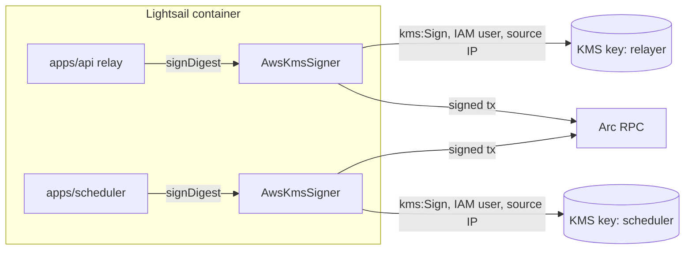

# ADR: Sign relayer and scheduler transactions with AWS KMS keys

- **Status:** Accepted (2026-10-11, K1–K7 as recommended)
- **Date:** 2026-10-11
- **Scope:**
  - A new private workspace package `packages/signer` (`@strimz/signer`): the `KmsSigner`
    interface, the software signer, a new AWS KMS signer and the viem account adapter.
  - `apps/api`: the KMS module selects `aws-kms`. The relay job records which address
    broadcast.
  - `apps/scheduler`: it signs through `@strimz/signer` instead of a raw key.
  - `packages/queue-contracts` (private): one optional field on the relay broadcast
    record.
  - `infra/lightsail`, the env examples and a new runbook.
- **Not in scope:** no Solidity change, no Prisma migration, no webhook payload change,
  no published package change.

## Context

Issue #137, verified against `main` at `009db06`.

1. **Both hot keys are plaintext in the Lightsail `.env`.**
   - The API relayer signs with `KMS_SOFTWARE_PRIVATE_KEY` through `SoftwareKmsProvider`
     (`apps/api/src/infra/kms/software-kms.provider.ts`).
   - The scheduler signs with `SCHEDULER_PRIVATE_KEY` through `privateKeyToAccount`
     (`apps/scheduler/src/infra/chain/chain.service.ts:53`).
   - Anyone who reads the `.env`, a backup of it, or the process memory has both keys for
     good. A copied key keeps working after the server is fixed, and nothing records its
     use.
   - In production the API logs a warning and carries on
     (`apps/api/src/infra/kms/kms.module.ts:41-47`).
2. **What the keys can do after #129.** The relayer holds `MERCHANT_REGISTRAR_ROLE` and
   pays gas for the payment and subscription meta-transactions. The scheduler holds
   `CHARGER_ROLE` and calls `batchCharge`, plus the escrow and CCTP calls it makes as a
   party. Both hold USDC for gas.
   - A stolen relayer key can register merchants and spend the relayer's gas balance.
   - A stolen scheduler key can charge subscriptions that are already due, and spend its
     gas balance.
   - Neither key moves payer or merchant funds on its own. The Safe can revoke either at
     once (#129, H7).
3. **The API is ready for a KMS; the scheduler is not.**
   - The API already signs through a narrow interface: `KmsSigner.signDigest(digest)`
     returning a 65-byte `r||s||v`, wrapped into a viem account by `toKmsAccount`
     (`kms.types.ts`, `kms-account.ts`).
   - The scheduler has no such seam.
4. **AWS KMS supports this key type.**
   - It offers `ECC_SECG_P256K1` keys for `SIGN_VERIFY`. `Sign` with
     `MessageType: DIGEST` and `ECDSA_SHA_256` signs a 32-byte digest and returns a DER
     signature. `GetPublicKey` returns the DER public key.
   - The private key never leaves KMS and cannot be exported.
   - Price: each key costs $1 a month. Signing requests on asymmetric keys are excluded
     from the free tier and billed per 10,000.
   - Quota: 1,000 ECC `Sign` requests a second, shared across the account.
5. **Lightsail has no instance roles.** A Lightsail instance cannot take an IAM role the
   way an EC2 instance does, so the process needs AWS credentials in its environment.
6. **Retries reuse a nonce.**
   - When a relay job retries after a broadcast, `broadcastOnce` reuses the recorded
     nonce if the signer's confirmed count has not passed it
     (`apps/api/src/modules/relay/relay-job-runner.ts:188-201`).
   - The record holds `txHash` and `nonce` but not the sender
     (`packages/queue-contracts/src/jobs.ts:108-111`).
   - If the relayer address changes while a job is in that state, the job reuses an
     old-address nonce on the new address. That leaves a nonce gap, and every later relay
     on the new address stalls behind it.

### Red, failing on `main` at `009db06`

- `apps/api/test/unit/infra/kms/kms-provider.test.ts`, 4 tests, 2 fail:
  - with `NODE_ENV=production` and `KMS_PROVIDER=software` the module resolves a signer
    instead of refusing;
  - `KMS_PROVIDER=aws-kms` is not an accepted value.
  - The 2 that pass guard the software signer in development and test.
- `apps/scheduler/test/unit/signer-provider.test.ts`, 4 tests, 3 fail:
  - production starts with a plaintext `SCHEDULER_PRIVATE_KEY`;
  - an AWS KMS configuration without `SCHEDULER_PRIVATE_KEY` is rejected;
  - a KMS signer address equal to `RELAYER_ADDRESS` is not refused.
  - The 1 that passes guards the software key outside production.
- Written first during the build:
  - `packages/signer` tests for the AWS signer against a fake KMS client that signs with
    a known local key. They cover the DER decoding, low-s normalisation, `v` recovery,
    the address taken from the public key, and a refusal when the key's address differs
    from the configured one.
  - A relay-runner test for a broadcast recorded by another address.

## Decision

### 1. `@strimz/signer` (private workspace package)

- **Contents:**
  - `KmsSigner`, moved unchanged from `apps/api/src/infra/kms/kms.types.ts`;
  - `SoftwareSigner`, today's `SoftwareKmsProvider` without Nest;
  - `toKmsAccount`, moved unchanged;
  - new `AwsKmsSigner`.
- **Consumers:** `apps/api`'s `KmsModule` becomes a thin Nest factory over it, and the
  scheduler uses it directly. Apps keep importing downward only.
- **`AwsKmsSigner.create({ keyId, expectedAddress, client })`:**
  1. calls `GetPublicKey`;
  2. checks the key spec is `ECC_SECG_P256K1`;
  3. takes the 65-byte uncompressed point from the DER public key;
  4. derives the address;
  5. throws when it differs from `expectedAddress`.
- **`signDigest(digest)`:**
  1. calls `Sign` (`MessageType: DIGEST`, `SigningAlgorithm: ECDSA_SHA_256`);
  2. decodes the DER `r` and `s`;
  3. replaces `s` with `n - s` when `s > n/2` (EIP-2);
  4. picks `v` by recovering the address from the digest with each parity;
  5. returns `0x<r><s><v>`.

  A response that recovers to neither parity throws. Nothing is retried silently; the
  SDK's own retry on throttling stays at its default.

- **Dependencies:** `@aws-sdk/client-kms`, and `viem` (already a dependency of both apps).

### 2. Configuration

| Service   | Variable                    | Rule                                                                   |
| --------- | --------------------------- | ---------------------------------------------------------------------- |
| API       | `KMS_PROVIDER`              | `software` or `aws-kms`                                                |
| API       | `KMS_AWS_KEY_ID`            | required for `aws-kms` (key ARN or alias)                              |
| API       | `KMS_SIGNER_ADDRESS`        | required for `aws-kms`; the address the key must have                  |
| Scheduler | `SCHEDULER_SIGNER_PROVIDER` | `software` (default) or `aws-kms`                                      |
| Scheduler | `SCHEDULER_PRIVATE_KEY`     | required for `software`, refused for `aws-kms`                         |
| Scheduler | `SCHEDULER_KMS_KEY_ID`      | required for `aws-kms`                                                 |
| Scheduler | `SCHEDULER_SIGNER_ADDRESS`  | required for `aws-kms`; must differ from `RELAYER_ADDRESS`             |
| Both      | `AWS_REGION`                | required for `aws-kms`                                                 |
| Both      | AWS credentials             | the SDK's default chain (`AWS_ACCESS_KEY_ID`, `AWS_SECRET_ACCESS_KEY`) |

- `NODE_ENV=production` refuses the software signer in both services (K4).
- The signer separation check from #129 uses `SCHEDULER_SIGNER_ADDRESS` under `aws-kms`
  and the key's address under `software`, so it stays synchronous in `validateEnv`.
- Each service verifies its key's real address against the configured one at boot and
  refuses to start on a mismatch (K5).

### 3. Keys and access (AWS side, done by the maintainer from the runbook)

- **Four keys:** `ECC_SECG_P256K1`, `SIGN_VERIFY`, one per role per network, with aliases
  `alias/strimz-testnet-relayer`, `alias/strimz-testnet-scheduler`,
  `alias/strimz-mainnet-relayer` and `alias/strimz-mainnet-scheduler`. They are created
  in the Lightsail region, which is `us-east-1` for the current host.
- **One IAM user per network (K1):**
  - Its policy allows only `kms:Sign` and `kms:GetPublicKey` on that network's two key
    ARNs.
  - It carries the condition `aws:SourceIp` equal to the Lightsail static IP, so a leaked
    access key cannot sign from anywhere else.
  - CloudTrail records every `Sign`.
- **New keys mean new addresses (K3).** The four keys are generated inside KMS, so
  nobody has ever held them in plaintext. On testnet:
  - the new relayer gets `MERCHANT_REGISTRAR_ROLE` and the new scheduler gets
    `CHARGER_ROLE`;
  - both roles are revoked from the old addresses;
  - the old keys' USDC moves to the new addresses;
  - the plaintext keys leave the `.env`.

### 4. Relay retries across a signer change (K7)

- `relayBroadcastSchema` gains an optional `from` address, and `broadcastOnce` records it.
- On retry, when the recorded transaction has not settled, the runner compares `from`
  with the current signer. When they differ, or `from` is missing because the broadcast
  was recorded before this change, the job fails with `relay_signer_changed` for manual
  review. It never reuses another address's nonce.
  - A missing `from` cannot be filled from the chain: a transaction the node still knows
    is waited on as today, so this branch only sees transactions the node has dropped.
- A job recorded by the current signer behaves exactly as today.

### 5. Docs

- New runbook `docs/runbooks/kms-signers.md`:
  - creating the keys and aliases;
  - the IAM policy JSON;
  - reading each key's address with `cast`;
  - funding;
  - granting and revoking roles (before #142, with the deployer; after it, through the
    Safe);
  - rotating a key.
- `infra/lightsail/README.md` and `env.example`, and the API and scheduler
  `.env.example`.
- Release note `docs/release-notes/<date>-aws-kms-signers.md`, `needs_automation`.

### 6. Changing the signing service later

The maintainer may move off AWS. Only `AwsKmsSigner`, the `aws-kms` value of the two
provider settings and their key settings name AWS. Another service is one new class
behind `KmsSigner`, one new provider value and its settings. The apps, the relay runner
and the viem adapter do not change.

## Diagram

## Consequences

- No private key is stored on the server or in any backup. A copied `.env` gives an
  access key that signs only from the Lightsail IP, is revoked with one IAM call, and
  leaves a CloudTrail record of every signature.
- Someone who controls the running server can still sign while they control it. KMS
  bounds that to the time before revocation; it does not prevent it.
- Each signature is a network round trip to KMS, roughly tens of milliseconds. The relay
  worker signs one transaction at a time and the scheduler batches charges, so
  throughput is unaffected.
- Cost: $4 a month for the four keys, plus the asymmetric request rate for each
  signature (no free tier for these).
- Local development and CI keep the software signer. Only production refuses it.

## Alternatives

- **Turnkey or another signing service.** Rejected in the issue for per-signature cost.
- **Import the current keys into KMS.** Keeps the addresses, but the plaintext copies
  stay valid forever, which defeats the change.
- **IAM Roles Anywhere** (X.509 certificate instead of an access key). No static access
  key, but it needs a private CA and certificate rotation. Worth revisiting on a move to
  EC2 or ECS, where an instance role removes the access key entirely.
- **Copy the signer into each app.** Two AWS signers to keep correct; the shared package
  costs one `package.json`.

## Decisions for the maintainer

- **K1. AWS credentials on Lightsail.** Recommended: one IAM user per network, limited to
  `kms:Sign` and `kms:GetPublicKey` on its two keys and to the Lightsail static IP.
  Alternatives: IAM Roles Anywhere, or move the services to EC2 with an instance role.
- **K2. Code location.** Recommended: private package `@strimz/signer`. Alternative: a
  copy in each app.
- **K3. Keys.** Recommended: four new keys generated in KMS, which means new addresses
  and new role grants. Alternative: import the existing keys.
- **K4. Production policy.** Recommended: both services refuse the software signer when
  `NODE_ENV=production`. Alternative: warn only.
- **K5. Expected address.** Recommended: configure each signer's address and refuse to
  boot when the KMS key does not match. Alternative: trust whatever the key ARN returns.
- **K6. Rollout order.** Recommended: switch testnet to KMS before the #142 redeploy, so
  the #142 handoff grants roles straight to the KMS addresses. Mainnet uses KMS from the
  first deploy.
- **K7. Relay retries across a key change.** Recommended: record `from` and fail a job
  for manual review rather than reuse another address's nonce. Alternative: no code
  change; drain the relay queue before switching.

## Migration, versioning, docs

- No Solidity change, no Prisma migration, no webhook payload change.
- `@strimz/queue-contracts` and `@strimz/signer` are private, so no changeset. The new
  `from` field is optional, so jobs already queued still parse.
- Existing tests that import `apps/api/src/infra/kms/*` move their imports to
  `@strimz/signer`; their assertions do not change.
- Comments in the moved files are moved byte for byte (Directive 6). Any that the move
  makes false are listed in the PR for a human to correct.

## Verification

- The red tests above pass, plus the new signer and relay-runner tests, and
  `./scripts/preflight.sh` in full.
- On Arc testnet, by the maintainer after creating the keys:
  - both services boot with `aws-kms` and log the KMS addresses;
  - one hosted checkout payment relays;
  - one subscription charge is broadcast by the scheduler;
  - CloudTrail shows the matching `Sign` calls.
  - Transaction hashes go in the PR or the release note follow-up.
