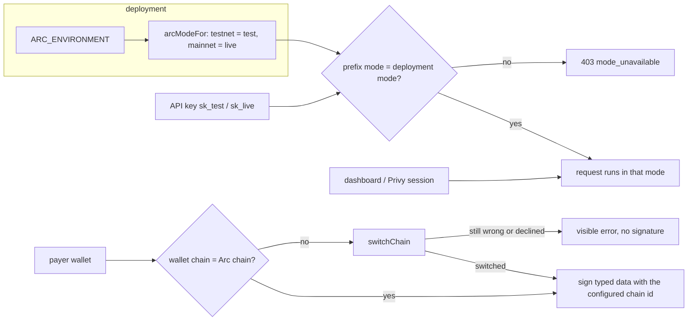

# ADR: One chain and one mode per deployment, and a chain guard before every web signature

- **Status:** Accepted (2026-10-12, W1–W4 as recommended)
- **Date:** 2026-10-12
- **Scope:**
  - `packages/shared-config`: one helper that maps an Arc environment to its mode.
  - `apps/api`: mode resolution in the two auth guards and the Privy guard, key minting,
    storefront sessions.
  - `apps/web`: the checkout signing hooks, the on-chain policy panel, the dashboard mode
    toggle, the API keys and webhooks pages.
- **Not in scope:**
  - no Solidity, migration, job payload or webhook payload change;
  - the sandbox deployment itself (DNS, a second Lightsail box, a second Vercel
    project), which this ADR documents as an operator step;
  - the agent, whose analytics read live data only and so report nothing on a test-only
    deployment.

## Context

Issue #140, checked on 2026-10-12 against `main` at `eedefd9`. #138 already made Privy,
wagmi, withdraw and the explorer links follow `NEXT_PUBLIC_ARC_ENVIRONMENT`. The
maintainer chose option A for modes: the network decides the mode.

1. **Checkout signs for the wallet's chain, not ours.**
   - `use-pay-checkout.ts:84` and `use-subscription-checkout.ts:106` take `chainId` from
     wagmi's `useChainId()` and put it in the EIP-712 domains.
   - Neither switches the wallet to Arc before `signTypedDataAsync`.
   - A payer whose wallet is on another network either gets a signature refused by the
     wallet, or produces one bound to the wrong chain. The relayer then submits it and it
     reverts, costing gas.
2. **The on-chain policy panel sends without a chain check.**
   `onchain-policy-section.tsx` (`useRegistryTx`) calls `eth_sendTransaction` on the Privy
   embedded wallet without switching to Arc. Withdraw already switches
   (`withdraw/page.tsx`).
3. **Modes today.**
   - Keys carry their mode in the prefix (`sk_test_`, `sk_live_`), and rows carry a
     `mode` column.
   - Minting a live key is refused unless the deployment is mainnet
     (`api-keys.service.ts:132`).
   - Nothing refuses test mode on mainnet:
     - a test key can be minted and used there;
     - the dashboard sends `x-strimz-mode`, and anything missing or malformed falls back
       to `test` (`merchant-auth.guard.ts:155-159`);
     - the Privy guard always sets `test` (`privy.guard.ts:78`).
   - On mainnet, test-mode sessions would relay real transactions with real USDC.
4. **Storefront sessions are always `live`.** `storefronts.service.ts:268` inserts the
   storefront's payment session as `'live'`. On the testnet deployment those sessions sit
   in live mode, which the dashboard (test only) never shows.
5. **The dashboard toggle.**
   - `mode-toggle.tsx` keeps the mode in `localStorage` and locks Live with "Mainnet
     coming soon". The API keys and webhooks pages repeat the lock.
   - Under A the mode is not a user choice: it is the deployment's.

### Red, to fail on `main` at `eedefd9` before the build

- **API unit/e2e:**
  - with `ARC_ENVIRONMENT=mainnet`: minting a test key is refused
    (`mode_unavailable`); a request with an `sk_test_` key is refused; a dashboard request
    resolves to `live` whatever `x-strimz-mode` says;
  - with `testnet`: a storefront checkout creates a `test` session.
- **shared-config:** `arcModeFor('testnet')` is `test` and `arcModeFor('mainnet')` is
  `live`; an unknown environment throws.
- **Web unit:**
  - the typed-data domain uses the configured chain id, not the wallet's;
  - the chain guard switches a wallet on another chain before signing, and refuses when
    the switch fails or is declined;
  - the dashboard mode is the deployment's, and ignores `localStorage`.

## Decision

1. **Chain guard before every web signature (W1).**
   - One helper, `ensureArcChain(wallet)`, compares the wallet's chain with
     `getArcChain(env.arcEnvironment).id`. When they differ, it calls `switchChain`, then
     reads the chain again.
   - When the wallet is still elsewhere, or the payer declines, it throws a visible error
     ("Switch your wallet to Arc to continue").
   - The pay and subscription checkouts, the on-chain policy panel and withdraw call it
     before signing.
   - The EIP-712 domains take the configured chain id, not `useChainId()`.
2. **One mode per deployment (W2).**
   - `arcModeFor(env)` in shared-config: `testnet` → `test`, `mainnet` → `live`.
   - **API:**
     - key creation and rotation refuse a mode other than the deployment's
       (`403 mode_unavailable`). This generalises `assertLiveKeyMintable`.
     - Both key guards refuse a key whose prefix mode is not the deployment's
       (`403 mode_unavailable`, naming both modes).
     - The dashboard and Privy guards set the deployment's mode and ignore
       `x-strimz-mode`.
     - Storefront sessions take the deployment's mode.
   - **Web:**
     - the toggle becomes a fixed Test or Live label from `NEXT_PUBLIC_ARC_ENVIRONMENT`;
     - `localStorage` mode and the "Mainnet coming soon" locks go;
     - the API keys and webhooks pages offer only the deployment's mode;
     - the `x-strimz-mode` header is still sent with that value.
3. **Sandbox for merchants (W3).** Merchants test against a separate testnet deployment.
   The runbook gains a "mainnet launch" section: the mainnet deployment (`ARC_ENVIRONMENT=mainnet`,
   live only) and a sandbox deployment (`testnet`, test only), each with its own database,
   keys and webhooks. The names (for example `sandbox.strimz.finance`) are the
   maintainer's to pick.
4. **Existing testnet rows (W4).** Testnet storefront sessions and transactions already
   stored as `live` stay as they are. The release note gives a one-off SQL that moves them
   to `test` on the testnet database, for the operator to run or skip.

### Note added during the build

`live_mode_unavailable` is a documented public error code (`errors.mdx`,
`authentication.mdx`). The build keeps it unchanged for its existing case: a live key
created or rotated on a testnet deployment. `mode_unavailable` covers only the new cases:

- a test key created or rotated on mainnet;
- a request made with a key of the other mode, on either deployment.

Integrators who handle `live_mode_unavailable` today see no change.

## Diagram

## Consequences

- Test mode can no longer touch mainnet funds, and live mode cannot exist on testnet.
- Merchants test on the sandbox deployment, with separate keys, webhooks and dashboard,
  as on Stripe. Running two deployments costs a second server and database.
- A test key used against the mainnet API gets a clear 403 instead of quietly working.
- Payers on the wrong network are asked to switch instead of signing something that
  cannot settle.
- The SDK is unchanged: key prefixes already carry the mode.

## Alternatives

- **B: both modes on mainnet.** Lost: test mode would need its own chain or no chain.
- **Keep the toggle and refuse the wrong mode in the API only.** Lost: the toggle
  would offer a mode that always fails.
- **Trust the wallet's chain and let the relayer fail.** Lost: costs gas and gives the
  payer no reason.

## Decisions for the maintainer

- **W1. Chain guard.** Recommended: switch, then refuse with a visible error.
- **W2. Mode enforcement.** Recommended: refuse other-mode keys at mint and at auth,
  deployment mode for dashboard and storefront traffic, fixed label in the web.
- **W3. Sandbox.** Recommended: document the two-deployment setup now, and build it with
  the mainnet deploy.
- **W4. Existing testnet `live` rows.** Recommended: leave, and give the SQL as an
  optional operator step. Alternative: a Prisma data migration.

## Migration, versioning, docs

- Changeset: `@strimz/shared-config` minor (new export).
- No schema migration.
- Comments the change makes false are listed in the PR for a human to correct
  (Directive 6). Examples: the `mode-toggle.tsx` header, `merchant-auth.guard.ts:155-157`
  and `privy.guard.ts:77`.
- Release note and the runbook section.

## Verification

- The red tests above pass, plus `./scripts/preflight.sh` in full and the API e2e suite.
- On the testnet deployment after redeploy: the dashboard shows Test with no toggle, a
  payer with a wallet on another network is asked to switch, and a checkout completes.
