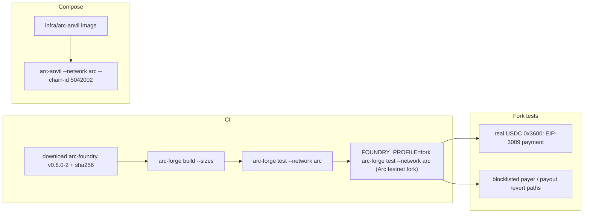

# ADR: Build, test and run the local chain on Arc Foundry, with fork tests against real Arc USDC

- **Status:** Accepted (2026-10-13, F1–F4 as recommended)
- **Date:** 2026-10-13
- **Scope:**
  - `packages/contracts`: the toolchain, a Foundry profile for fork tests, new fork
    tests, the README.
  - `.github/workflows/ci.yml` (foundry job) and `scripts/preflight.sh`.
  - `docker-compose.yml` and a new `infra/arc-anvil/Dockerfile`; the docker workflow
    builds and checks that image.
- **Not in scope:**
  - no Solidity source change: the porting audit below found nothing to change;
  - deploy-script, `Verify.s.sol`, `e2e.sh` and `verify.sh` fixes, which belong to #142
    and will use the toolchain set here;
  - the Go indexer's own end-to-end tests, which start their own `anvil`.

## Context

Issue #244, checked on 2026-10-13 against `main` at `6ea1791` with Arc Foundry v0.8.0-2
(`arc-foundry-v0.8.0-2-aarch64-apple-darwin.tar.gz`, checksum verified).

1. **CI tests our contracts against Ethereum rules.**
   - The foundry job installs upstream Foundry (`foundry-rs/foundry-toolchain@v1`).
   - The Arc Foundry README says: "Do not use `foundry-rs/foundry-toolchain` to test Arc
     contracts — it installs upstream Foundry, which has no Arc support and will run
     your tests against Ethereum rules while reporting them as passing."
   - Preflight runs whatever `forge` is on the developer's `PATH`.
2. **Arc rules are opt-in, even in Arc Foundry.**
   - `arc-forge` and `arc-anvil` take `--network arc`.
   - Without it, Arc's native-coin precompile at `0x1800…` is not emulated, and a real
     USDC transfer on a fork reverts: tested, `StackUnderflow` inside
     `0x1800…::transfer`.
   - With it, the same transfer settles.
3. **Our suite already passes under Arc rules.**
   - `arc-forge test --network arc` from a clean build passes 199 of 199.
   - Our tests use a `MockUsdc`, so they never touch Arc's real USDC.
4. **Real Arc USDC works with our payment path, which the tests don't show today.**
   - A prototype fork test against `rpc.testnet.arc.io` with `--network arc`:
     - deploys our contracts;
     - funds a payer through the native balance (100 native USDC reads as
       `100_000_000` through the 6-decimal ERC-20 view);
     - pays through `payWithAuthorization` with Arc's real EIP-3009 USDC.
   - Fee and net land, nothing is left in `StrimzPayments`, and the nonce is burnt.
     The payment uses 255,503 gas.
5. **Build info from two compiles confuses the upgrade validator.** Running the fork
   tests and the main suite as separate compiles into the same `out/` leaves two
   build-info files. The OpenZeppelin validator then reports "Found multiple contracts
   with name … TokenWhitelist" and four upgrade tests fail. One compile, or a clean
   build between them, avoids it.
6. **Porting checklist** (`/arc/tutorials/porting-contracts-to-arc`):
   - `src/` has no `msg.value`, `payable`, native sends, `selfdestruct`, `prevrandao` or
     blob opcodes;
   - every USDC movement goes through the ERC-20 interface;
   - `block.timestamp` is only compared with deadlines, which tolerates Arc's
     non-decreasing block times;
   - `batchCharge` settles each row inside `try`, so a transfer that reverts records
     `TransferFailed` for that row only.
   - The checklist asks for the revert paths to be exercised with Arc's seeded
     blocklisted address (`0x7099…79C8` on testnet); our suite does not do that today.
7. **Local chain.**
   - Compose runs upstream `anvil` (chain id 5042002 since #144).
   - `arc-anvil --network arc` deploys Arc's system contracts: USDC at `0x3600…` with
     6 decimals, and a 20 gwei base fee. Its chain id defaults to 31337.
   - Circle publishes no container image; the release ships glibc Linux binaries.
8. **Developer machines.** Arc Foundry installs as `arc-forge`, `arc-cast` and
   `arc-anvil` next to upstream Foundry, from release archives, not `foundryup`. Intel
   Macs build from source.

### Red, before the build

- The fork test above without `--network arc` fails on the native-coin precompile. That
  is the failure CI would hide by using upstream Foundry.
- Written first during the build, run against the testnet fork:
  - `batchCharge` with one row whose payer is the seeded blocklisted address: that row
    records `TransferFailed` and the other row is charged;
  - `payWithAuthorization` to a merchant whose payout is the blocklisted address
    reverts, and the payer keeps the funds.

## Decision

1. **Toolchain (F1).**
   - Arc Foundry v0.8.0-2 is the only Foundry for contracts, run with `--network arc`.
   - **CI:** the foundry job downloads the Linux x86_64 archive, checks it against a
     SHA-256 pinned in the workflow, and runs `arc-forge build --sizes` and
     `arc-forge test --network arc`. `foundry-rs/foundry-toolchain` goes.
   - **Preflight:** requires `arc-forge` and runs the same commands. The missing-tool
     message names the install page.
   - The pinned version lives in one place in each of CI, preflight and the contracts
     README.
2. **Fork tests (F2).**
   - New `test/fork/` suites run on a fork of Arc testnet:
     - the real-USDC payment from context item 4;
     - the native/ERC-20 balance identity;
     - the two blocklist revert paths above.
   - The default profile skips `test/fork/`. A `fork` profile runs only them, with
     `ARC_TESTNET_RPC_URL`, in its own compile so the build info never mixes.
   - CI runs them as a separate step. Preflight runs them too, using the public RPC
     when `ARC_TESTNET_RPC_URL` is unset. A missing RPC fails the gate; it is never
     skipped.
3. **Local chain (F3).**
   - `infra/arc-anvil/Dockerfile` builds a small Debian image from the pinned release,
     with the checksum verified.
   - Compose's `anvil` service runs
     `arc-anvil --network arc --chain-id 5042002 --host 0.0.0.0 --block-time 2`, with an
     `arc-cast` healthcheck.
   - The docker workflow builds the image and checks the chain id and the USDC system
     contract.
4. **Deploy and verify (F4).** The contracts README documents
   `arc-forge script … --network arc` for deploys and
   `arc-forge verify-contract --verifier blockscout --verifier-url https://explorer.<testnet.>arc.io/api/`
   for verification, as in Arc's deploy tutorial. #142 moves the scripts and
   `verify.sh` onto them.

## Diagram

## Consequences

- Contract tests run under Arc's rules, and the fork tests prove our payment path with
  Arc's real USDC and blocklist, in CI and locally.
- Developers must install Arc Foundry; preflight fails without it. Intel Macs build from
  source.
- CI and preflight need the Arc testnet RPC for the fork step. If the public RPC is down,
  the gate fails, which is correct, but it can block unrelated merges until it is back.
- The local compose chain behaves like Arc, so local runs can hit the same reverts that
  production would.
- The pinned version must be bumped by hand. The README says where.

## Alternatives

- **Keep upstream Foundry in CI and add Arc Foundry only for fork tests.** Lost: the
  main suite would still run under Ethereum rules, and the README warns against exactly
  that.
- **Skip fork tests when no RPC is set.** Lost: a silent skip is a masked gate
  (Directive 4).
- **Keep upstream `anvil` in compose.** Lost: it cannot reproduce Arc's USDC or blocklist.

## Decisions for the maintainer

- **F1. Toolchain.** Recommended: Arc Foundry v0.8.0-2 with `--network arc` in CI and
  preflight; upstream Foundry removed from both.
- **F2. Fork tests.** Recommended: a `fork` profile run in CI and preflight against the
  testnet RPC, failing the gate when the RPC is missing. Alternative: CI only.
- **F3. Local chain.** Recommended: an `arc-anvil` image built from the pinned release.
- **F4. Deploy and verify.** Recommended: document the `arc-forge` commands now; #142
  switches the scripts.

## Migration, versioning, docs

- Developers install Arc Foundry before their next preflight. The contracts README and
  the release note give the commands.
- No changeset, no migration.
- Comments the change makes false (for example the compose header's anvil lines and the
  `foundry.toml` notes on verification) are listed in the PR for a human (Directive 6).
- Release note.

## Verification

- Clean `arc-forge build` and `arc-forge test --network arc` (199), and the fork profile
  (the new fork tests), locally and in CI.
- `docker compose --profile full` still runs (#144 check) with the `arc-anvil` image
  serving chain id 5042002 and USDC at `0x3600…`.
- `./scripts/preflight.sh` in full with `arc-forge`.
