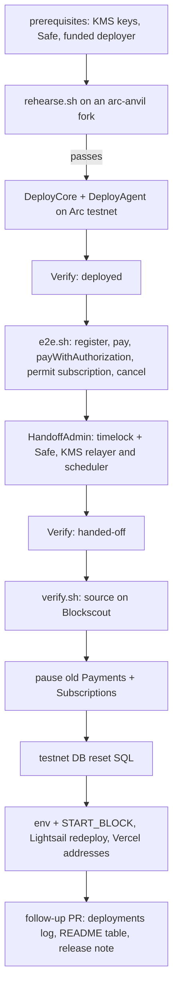

# ADR: Deploy tooling that matches the contracts, a rehearsal on a fork, and the testnet redeploy

- **Status:** Accepted (2026-10-13, R1–R8 as recommended; the redeploy runs after all logged issues are resolved)
- **Date:** 2026-10-13
- **Scope:**
  - `packages/contracts/script`: `DeploymentLog`, `Verify.s.sol`, `Digests.s.sol`,
    `e2e.sh`, `verify.sh`, and a new rehearsal script.
  - The contracts README and a new runbook, `docs/runbooks/testnet-redeploy.md`.
  - After the maintainer runs the redeploy, a second PR records the new addresses
    (`deployments/5042002.json`, README table, env examples, `START_BLOCK`).
- **Not in scope:**
  - no Solidity source change;
  - the mainnet deploy itself, which uses the same tooling later;
  - the KMS keys (#137) and the Safe, which are prerequisites the maintainer creates.

## Context

Issue #142, checked on 2026-10-13 against `main` at `ccad744`, with Arc Foundry v0.8.0-2
(#244).

1. **The deployed testnet contracts are stale.**
   - The API uses the `core` deploy of 2026-07-10 (registry `0x23bb…1ae3`, Payments
     `0x2dfa…`, Subscriptions `0xed37…`) and the `agent` deploy of the same day.
   - Every contract fix since then is undeployed:
     - #100, which closed the Buantum audit findings;
     - #189 (gap charging), #203 (ownership and payout delays), #207 (single-use
       subscription intents);
     - #129 (admin roles split between a timelock, a Safe and service keys).
   - Payments and Subscriptions are immutable, so only a redeploy puts the fixes live.
   - The contracts README table still lists the 2026-06-02 deploy.
2. **`e2e.sh` calls the old ABIs.**
   - `payWithAuthorization` now takes the EIP-3009 authorization signature and a
     PayIntent signature, as two `Sig` structs; the script sends one `(v, r, s)`.
   - `permitAndCreateSubscription` now takes a nonce and two `Sig` structs.
   - `getMerchant` returns nine fields, not five.
   - `Digests.s.sol` signs only the token's EIP-3009 and permit messages, not the
     PayIntent or SubscriptionIntent.
3. **`Verify.s.sol` checks the wrong state for the new flow.**
   - It covers the core contracts only, not AgentRegistry or AgentEscrow.
   - It requires the deployer to hold `DEFAULT_ADMIN_ROLE`, which is false after the
     #129 handoff.
   - `AdminHandoff.verify` already checks the complete post-handoff role table,
     including that the deployer holds nothing, but no script exposes it.
4. **The deployment log is written by dry runs.** `DeploymentLog.append` runs after
   `vm.stopBroadcast()` whether or not the script broadcast. A simulation, or a run
   against a local fork that shares chain id 5042002, appends fake entries to
   `deployments/5042002.json`. forge-std exposes
   `vm.isContext(ForgeContext.ScriptBroadcast)` to tell the cases apart.
5. **`verify.sh` works and stays testable only on a real deploy.**
   - It posts each implementation's standard JSON to Blockscout. It verified the July
     deploy.
   - Arc's tutorial uses `arc-forge verify-contract --verifier blockscout` instead,
     one contract at a time with manual constructor arguments.
   - Neither can be exercised before a deploy without spending testnet gas.
6. **Arc Foundry makes a full rehearsal possible.**
   - With `--network arc`, `arc-forge script` simulates Arc's precompiles (#244).
     `arc-anvil --network arc --fork-url <testnet>` serves Arc testnet's state locally.
   - The deploy, verification, e2e and handoff can all run against that fork before
     anything is spent. The README's note that `forge script` cannot simulate Arc
     (`README.md`, "Why a shell driver") predates Arc Foundry.
   - With `--chain-id 31337` the fork's log goes to `deployments/31337.json`, never the
     real file.
7. **Data that points at the old contracts.**
   - Merchants carry `onchainMerchantId` and `onchainRegistrationTxHash` from the old
     registry.
   - Registration is lazy: `requestRegistration` enqueues it when `onchainMerchantId`
     is null, on the next session, invoice or plan.
   - The relay runner links an earlier `onchainRegistrationTxHash` receipt if it
     succeeded, and that receipt is from the old registry. So both columns must be
     cleared, or the API keeps using old ids.
   - Active subscriptions live on the old Subscriptions contract. The scheduler,
     pointed at the new address, would charge ids that do not exist there.
   - Relay jobs are removed an hour after they finish, so a re-registration is not
     deduplicated.
8. **Prerequisites the maintainer holds:**
   - the two testnet KMS keys and their addresses (#137);
   - a Safe with threshold at least 2 (#129);
   - a funded deployer;
   - `TURNSTILE_SECRET_KEY` (#133) and Privy CAPTCHA for the Lightsail redeploy;
   - Vercel's `NEXT_PUBLIC_ARC_ENVIRONMENT` (#138).

### Red, before the build

- A rehearsal on an `arc-anvil` fork of Arc testnet, using today's scripts:
  - `e2e.sh` fails at the first `payWithAuthorization`, on the ABI mismatch;
  - `Verify.s.sol` cannot check the agent contracts or the post-handoff roles;
  - a dry run of `DeployCore` appends to the deployment log.
- Forge tests for `DeploymentLog`: in a non-broadcast context, `append` leaves the log
  file untouched (today it writes).

## Decision

1. **Log only real broadcasts (R1).** `DeploymentLog.append` writes only in a
   `ScriptBroadcast` or `ScriptResume` context. Otherwise it prints the entry and writes
   nothing.
2. **Verification in two phases (R2).** `Verify.s.sol` takes `STRIMZ_VERIFY_PHASE`:
   - `deployed` checks today's wiring plus the agent contracts, with the deployer as
     admin.
   - `handed-off` runs `AdminHandoff.verify` with the timelock address. That checks the
     whole role table, that the deployer holds nothing, and the service-role admins.
   - Both phases check the token whitelist and its capability flags for USDC and EURC.
3. **`e2e.sh` on the current ABIs (R3).**
   - `Digests.s.sol` gains `signPayIntent` and `signSubscriptionIntent`. They take the
     digest from the deployed contract (`payIntentDigest`, `subscriptionIntentDigest`)
     so the script hashes exactly what the chain checks.
   - `e2e.sh` sends both signatures, the subscription intent nonce, and reads the
     nine-field `getMerchant`.
   - It stays a `cast send` driver against the real RPC, run with `arc-cast` and
     `arc-forge`.
4. **Source verification (R4).** `verify.sh` keeps its log-driven Blockscout upload,
   which is proven on Arc. It uses `arc-forge inspect` and the arc.io explorer URLs.
5. **A rehearsal (R5).** `script/rehearse.sh`:
   - starts `arc-anvil --network arc --fork-url $ARC_TESTNET_RPC_URL --chain-id 31337`;
   - deploys core and agent, runs `Verify` (`deployed`) and `e2e.sh`;
   - creates a 2-of-3 Safe on the fork through the Safe factory already on Arc testnet;
   - runs `HandoffAdmin` with the given relayer and scheduler addresses, then `Verify`
     (`handed-off`);
   - exits non-zero on the first failure. `deployments/31337.json` is gitignored.
   - The PR's verification is a passing rehearsal. The operator runs it again right
     before the real deploy.
6. **Redeploy runbook (R6).** `docs/runbooks/testnet-redeploy.md`:
   - prerequisites, then: rehearse; deploy core and agent; `Verify deployed`;
     `e2e.sh`; handoff to the Safe with the KMS addresses as relayer and scheduler;
     `Verify handed-off`; `verify.sh`.
   - Then pause the old Payments and Subscriptions with the old deployer key, which
     still holds admin there.
   - Then the API, scheduler, agent and indexer env (new addresses, `START_BLOCK` =
     the core deploy block), Vercel's contract addresses, and a Lightsail redeploy.
7. **Data reset (R7).** The runbook gives SQL for the testnet database, run between the
   contract deploy and the Lightsail redeploy:
   - clear `onchainMerchantId`, `onchainRegistrationTxHash` and
     `onchainRegistrationRequestedAt`, so merchants re-register lazily on the new
     registry;
   - mark subscriptions created on the old contract as cancelled, with the reason
     "testnet redeploy";
   - expire open payment sessions.
   - Payments, refunds and history rows stay.
8. **Record the deploy (R8).** After the maintainer's run, a follow-up PR commits the
   new `deployments/5042002.json` entries and updates the README table, the env
   examples, `START_BLOCK` and the release note with the transaction hashes.

### Note on #129 H6 (2026-10-13)

The #129 ADR (`ADR-2026-10-10-admin-timelock-handoff.md`, H6) recommended that testnet
keep the Registry, TokenWhitelist and FeeCollector proxies and upgrade them in place,
redeploying only Payments and Subscriptions. Strimz has not launched; testnet holds test
data only. The maintainer chose a full redeploy instead (2026-10-13). This ADR
supersedes H6 for testnet:

- testnet merchants re-register on first use;
- the testnet path is the same as the mainnet deploy, so the rehearsal exercises the
  mainnet path.

## Diagram

## Consequences

- The audit and Phase 1–2 contract fixes go live on testnet, under the timelock and
  Safe admin model, with KMS service keys.
- Every step is rehearsed on a fork first, so the real run spends gas only once.
- Testnet merchants re-register on their next session, invoice or plan. Old
  subscriptions are cancelled, and payers re-subscribe.
- The old contracts stay on chain, paused, as history.
- Mainnet uses the same tooling and runbook with mainnet values.

## Alternatives

- **Rewrite `e2e.sh` as a forge script now that Arc Foundry can simulate Arc.** Lost:
  more churn than updating the ABIs, and the shell driver already exercises the real
  RPC path the API uses.
- **Switch `verify.sh` to `arc-forge verify-contract`.** Lost for now: unproven for us,
  and it needs per-contract constructor arguments. It can be tried at the mainnet
  deploy.
- **Wipe the testnet database.** Lost: it throws away merchants, keys and history that
  the reset keeps.
- **Keep the old contracts unpaused.** Lost: payers could still reach unfixed
  contracts.

## Decisions for the maintainer

- **R1. Deployment log.** Recommended: write only on broadcast.
- **R2. Verification.** Recommended: two phases, with the post-handoff phase reusing
  `AdminHandoff.verify`.
- **R3. e2e.** Recommended: keep the `cast` driver and move it to the current ABIs.
- **R4. Source verification.** Recommended: keep `verify.sh`, on `arc-forge`.
  Alternative: `arc-forge verify-contract`.
- **R5. Rehearsal.** Recommended: `rehearse.sh` on an `arc-anvil` fork, required before
  the real deploy.
- **R6. Runbook.** Recommended: as above, including pausing the old contracts.
- **R7. Testnet data.** Recommended: targeted reset (merchant chain ids, old
  subscriptions, open sessions). Alternatives: wipe the database; leave the data.
- **R8. Recording.** Recommended: a follow-up PR after your run.

## Migration, versioning, docs

- No migration, no changeset.
- The redeploy itself is an operator action from the runbook. This PR changes tooling
  and docs only.
- Comments the change makes false (for example the README's "Why a shell driver" note
  and `Verify.s.sol`'s header) are listed in the PR for a human (Directive 6).
- Release note now; addresses and transaction hashes in the R8 follow-up.

## Verification

- `DeploymentLog` tests fail before the change and pass after.
- `rehearse.sh` passes end to end on an `arc-anvil` fork of Arc testnet. The PR records
  its output: deploy, `Verify deployed`, all five e2e flows, handoff, and
  `Verify handed-off`.
- `./scripts/preflight.sh` in full.
