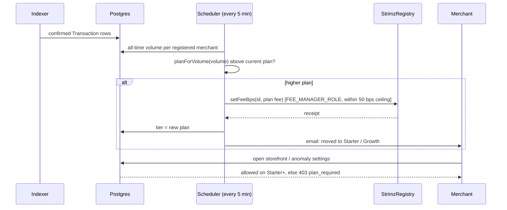

# ADR: Pricing plans from the pricing page, automatic upgrade by all-time volume, and plan-limited features

- **Status:** Accepted (2026-10-14, D1–D7 as recommended; D6: keep only priority email support, on Starter and above)
- **Date:** 2026-10-14
- **Scope:**
  - `packages/shared-config`: one plan table (published, minor).
  - `packages/contracts`:
    - the registry's fee ceiling;
    - a narrow fee-setting role (resolves #146);
    - the `AdminHandoff` role table, `Verify` and the rehearsal.
  - `packages/db`: the `MerchantTier` enum (migration).
  - `apps/api`: plan checks on plan-limited features, the registration fee and ceiling,
    and admin tier control (#128).
  - `apps/scheduler`: the automatic upgrade.
  - `apps/agent`: plan-limited capabilities.
  - `apps/web`: the pricing page, the home-page teaser, the dashboard plan display and
    upgrade notices.
- **Not in scope:**
  - CCTP and agent escrow, hidden for launch (#145);
  - custom domains and webhook quotas, which do not exist;
  - billing for Enterprise contracts.

## Context

Issue #250, from the maintainer on 2026-10-14. Checked against `main` at `84b6898`.

1. **The maintainer's pricing.**
   - **Plans:** Free 0%, Starter 0.5%, Growth 0.4%, Enterprise custom, as on the pricing
     page.
   - **Upgrade:** a merchant moves up automatically when its all-time volume crosses a
     threshold, and never moves back down.
   - **Buttons:** Free, Starter and Growth lead to login; Enterprise is a contact button.
     Growth reads "Start with Growth".
   - **Features:** a merchant gets only its plan's features.
2. **The code charges something else.**
   - `packages/shared-config/src/tiers.ts`:
     - Free 1.5%, Growth 0.8% plus $49/month, Business 0.5% plus $199/month,
       Enterprise;
     - a 0.2% "subscription premium" that the contracts never charge (#225);
     - monthly volume caps.
   - The API registers every merchant on-chain at the Free fee from that table, 150 bps
     (`registration.ts:36`). The three testnet merchants all charge 1.5%.
   - The pricing page shows other plans (#224).
3. **The page promises features that do not exist.**
   - Custom domains appear only on the pricing page.
   - "Accept payments from any USDC chain" is CCTP, hidden for launch (#145).
   - Per-plan webhook-event quotas (1k / 50k / 500k): nothing counts or limits webhook
     events.
   - The comparison table's SLA cells show `', '` for Free and Starter.
   - What does exist:
     - payment APIs, refunds, invoices and webhooks;
     - recovery emails and the cashflow digest (agent);
     - anomaly alerts and yield recommendations (agent);
     - the storefront builder.
4. **The fee ceiling blocks automatic upgrades.**
   - `registerMerchant` sets `maxFeeBps = feeBps`, and `setFeeBps` refuses anything above
     it. A Free merchant registered at 0% would have a ceiling of 0 and could never be
     moved to Starter (0.5%).
   - `setMaxFeeBps` lets the merchant's owner wallet lower the ceiling, snapping the fee
     down with it (#146).
   - The maintainer chose "block cutting the fee" for #146: the ceiling may not go below
     the current fee. That still lets a Free merchant (0%) lower its ceiling to 0, which
     locks it at 0% for good.
5. **Only the Safe and the timelock can change a fee.** `setFeeBps` requires `ADMIN_ROLE`,
   which after the #129 handoff belongs to the timelock and the Safe. An automatic
   upgrade needs an automated signer.
6. **Volume is recorded per transaction.**
   - Confirmed `Transaction` rows carry `amount`, `currency` (USDC or EURC, 6 decimals)
     and `mode`.
   - USDC and EURC are separate currencies; there is no EUR/USD price source in the
     stack.
7. **Admin tier control (#128).** An admin sets a merchant's tier. The API refuses unless
   the on-chain fee already matches, and tells the admin to send `setFeeBps` from the
   admin key first.

### Red, to fail on `main` before the build

- **shared-config:**
  - the plans are Free 0, Starter 50, Growth 40 bps;
  - `planForVolume` takes per-currency volumes and returns Free below 1,000 in both,
    Starter from 1,000 in either currency, and Growth from 50,000 in either currency;
  - there is no subscription premium.
- **Contracts:**
  - `registerMerchant` stores a ceiling of 50 bps for a 0 bps merchant;
  - a holder of the new fee-manager role can raise a Free merchant to 50 bps;
  - the owner cannot lower the ceiling;
  - `AdminHandoff` grants the fee-manager role to the scheduler and verifies it.
- **API:** creating a storefront, or enabling anomaly or yield recommendations, as a Free
  merchant is refused with `plan_required`. A Starter merchant succeeds.
- **Scheduler:**
  - crossing 1,000 USDC (or 1,000 EURC) of all-time confirmed volume moves a Free
    merchant to Starter, on-chain first and then in the database;
  - 600 USDC plus 600 EURC does not;
  - a merchant never moves down;
  - Growth is reached at $50k.
- **Web:**
  - the pricing data shows only built features;
  - Free, Starter and Growth link to `/login`, Growth's button reads "Start with
    Growth", and Enterprise links to contact.

## Decision

1. **One plan table (P1).** Shared-config defines the plans, and the page, the API, the
   scheduler and the agent all read them:

   | Plan       | Fee    | Enters at all-time volume | Leaves              |
   | ---------- | ------ | ------------------------- | ------------------- |
   | Free       | 0 bps  | sign-up                   | at $1,000           |
   | Starter    | 50 bps | $1,000                    | at $50,000          |
   | Growth     | 40 bps | $50,000                   | never automatically |
   | Enterprise | custom | by contract (admin)       | never               |
   - There are no monthly fees and no subscription premium (#225).
   - Above $1M a merchant stays on Growth until an Enterprise contract. The page's
     "$1M" becomes the point where Enterprise is offered, not an automatic step.

2. **Volume (P2).**
   - All-time confirmed volume, in the deployment's mode (#140), counted per currency.
   - AGENTS.md forbids summing USDC and EURC, so each currency is held against the
     thresholds in its own unit: $1,000 and $50,000 for USDC, €1,000 and €50,000 for
     EURC.
   - A merchant moves up when either currency crosses the threshold.
   - A merchant that splits volume across both moves up later than one using a single
     currency.
3. **Automatic upgrade (P3).**
   - A scheduler job runs every 5 minutes. It finds registered merchants whose volume puts
     them on a higher plan.
   - It sends `setFeeBps` with the scheduler's KMS key, waits for the receipt, then
     updates the merchant's plan in the database and emails the merchant ("You've moved
     to Starter: 0.5% per transaction").
   - It only moves up. A failed transaction is retried and leaves the plan unchanged.
   - The payment that crosses a threshold is charged at the old rate. The new rate
     applies from the next payment.
4. **Contract changes (P4), in the redeploy (#142).**
   - `registerMerchant(owner, payout, feeBps, maxFeeBps, parentMerchantId)` takes the
     ceiling separately, with `feeBps <= maxFeeBps <= MAX_FEE_BPS`. The API registers
     every merchant at its plan fee, with a 50 bps ceiling: the highest plan rate.
   - The owner's `setMaxFeeBps` is removed, so a merchant cannot cut its own fee or lock
     itself at 0%.
     - This goes further than the #146 choice ("block cutting the fee"), which context
       item 4 shows is not enough under these plans.
     - The ceiling still protects merchants: no role can charge them more than 0.5%.
   - A new `FEE_MANAGER_ROLE` may call `setFeeBps` within the ceiling. Its role admin is
     `ADMIN_ROLE`, so the Safe can revoke it at once.
   - `AdminHandoff` grants it to the scheduler. `Verify` and the rehearsal check it.
   - `ADMIN_ROLE` keeps `setFeeBps`, for Enterprise.
5. **Plan-limited features (P5).**
   - **Free:** payment APIs, refunds, invoices, webhooks, recovery emails, the cashflow
     digest.
   - **Starter and above:** the storefront builder, anomaly alerts, yield
     recommendations.
   - **Enforcement:**
     - the API refuses plan-limited endpoints with `403 plan_required` and
       `details.requiredPlan`;
     - the agent skips plan-limited capabilities for lower plans;
     - the dashboard shows those sections with an "Unlocks automatically at $1,000
       processed" notice instead of the controls.
6. **Pricing page and teaser (P6).**
   - Thresholds read as all-time: "First $1,000 processed", "From $1,000",
     "From $50,000", "Above $1M".
   - Features list only what exists, as in P5.
     - Removed: custom domains, "any USDC chain", and the webhook-event quotas.
     - The support and SLA lines are commitments rather than app features; they stay
       only if the maintainer confirms them (D6 below).
   - **Buttons:** Free "Start free", Starter "Start with Starter" and Growth "Start with
     Growth" all go to `/login`. Enterprise "Contact us" goes to `/contact`. Every merchant
     starts on Free and moves up automatically, and the page says so.
7. **Plans in the database (P7).**
   - `MerchantTier` becomes `free | starter | growth | enterprise`.
   - A Prisma migration maps the old values:
     - `growth` → `starter`;
     - `business` → `growth`;
     - `free` and `enterprise` unchanged.
   - The first scheduler run then corrects every merchant from its volume.
   - Admin tier control (#128) only sets Enterprise; the other plans follow volume.
8. **Order (P8).** This lands before the testnet redeploy and the external re-review
   (#147), so both cover the final contracts. #224 and #225 close with this; #146 closes
   with P4.

### D6 resolved (2026-10-14)

The page keeps one commitment: priority email support, on Starter and above. Removed:

- the dedicated Slack channel;
- the 99.9% and 99.99% SLAs;
- the dedicated solutions engineer;
- custom legal terms;
- the uptime SLA row of the comparison table.

Enterprise is described as custom pricing by contract.

### Delivery

Four PRs, in order:

1. contracts (P4);
2. shared plans, database and API (P1, P2, P5 on the API and agent, P7);
3. scheduler upgrade (P3);
4. web (P5 in the dashboard, P6).

## Diagram

## Consequences

- What the page says is what the chain charges, and Free costs 0% for the first $1,000.
- Merchants never pay more than 0.5%, enforced on-chain by the ceiling.
- **Lost:** a merchant can no longer lower its own ceiling. On-chain fee changes are
  visible as `MerchantFeeBpsUpdated` events.
- **Risk:** the scheduler's key can set a merchant's fee anywhere between 0 and the
  ceiling. A leaked key could set fees to 0 (lost revenue) or 0.5% (bounded). The Safe
  revokes it at once.
- **Mixed currencies:** a merchant taking both USDC and EURC reaches a threshold later,
  because the currencies are counted separately.
- **Promises:** features not yet built drop off the page until they ship.

## Alternatives

- **Keep the owner's ceiling, only blocking cuts (#146 as first chosen).** Lost: a Free
  merchant could still lock itself at 0%.
- **Upgrade by Safe transaction instead of an automated role.** Lost: not automatic.
- **Monthly volume.** Lost: the maintainer chose all-time.
- **Count EURC one-for-one with USDC.** Lost: AGENTS.md forbids summing the two.
- **Convert EURC with an FX feed.** Lost for now: no price source in the stack.
- **Keep listing unbuilt features as "coming soon".** Possible, but the maintainer asked
  that a merchant gets only what its plan includes.

## Decisions for the maintainer

- **D1. Plan table.** Recommended: P1. Growth from $50k; above $1M stays Growth until an
  Enterprise contract.
- **D2. Volume.** Recommended: all-time confirmed volume per currency; a merchant moves
  up when either currency crosses the threshold.
- **D3. Automatic upgrade.** Recommended: a scheduler job every 5 minutes, on-chain first,
  then the database, then an email.
- **D4. Contracts.** Recommended: a ceiling set at registration (50 bps), no owner
  lowering, and `FEE_MANAGER_ROLE` for the scheduler. This supersedes the #146 answer.
- **D5. Feature limits.** Recommended: storefront, anomaly alerts and yield
  recommendations from Starter.
- **D6. Commitments on the page.** Which support and SLA lines stay: priority email
  support (Starter), dedicated Slack channel and 99.9% SLA (Growth), solutions engineer,
  99.99% SLA and custom legal terms (Enterprise)? Recommended: keep only the ones you
  will honour at launch.
- **D7. Buttons.** Recommended: as in P6.

## Migration, versioning, docs

- **Prisma migration:** the `MerchantTier` enum change, mapping old values (P7).
- **Changeset:** `@strimz/shared-config` minor (new plan table, `planForVolume`). The
  old `effectiveFeeBps(tier, kind)` and `subscriptionPremiumBps` are removed; the SDK
  does not use them.
- **Contracts:** source changes ship in the redeploy (#142). The runbook and the
  rehearsal check the fee-manager role.
- **Directive 6:** comments the change makes false are listed in the PR.
- **Release note.** The public docs update the pricing and error pages
  (`plan_required`).

## Verification

- The red tests above pass, plus `./scripts/preflight.sh` in full and the rehearsal with
  the new role.
- **Testnet, after the redeploy:** a new merchant registers at 0% with a 0.5% ceiling.
  Once a test payment pushes its all-time volume past $1,000, the scheduler moves it to
  Starter and the next payment is charged 0.5%. Record the transaction hashes.
