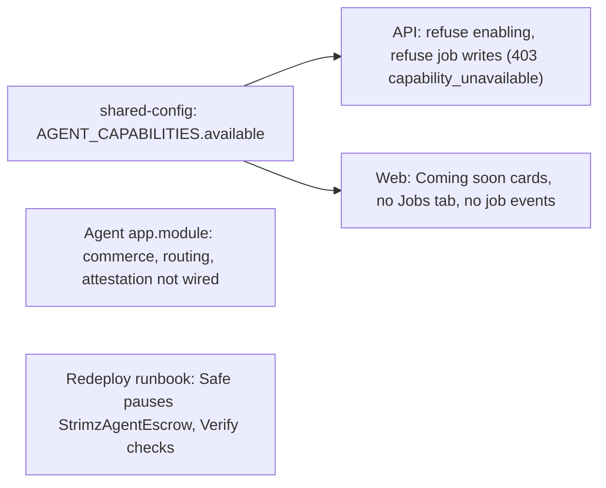

# ADR: Hide agent escrow and CCTP funding for launch

- **Status:** Accepted (2026-10-15) for agent escrow, D1 to D3 as recommended, D4 leave the privacy page, D5 escrow follow-up only. **CCTP is out of scope:** the maintainer will deliver cross-chain funding through Whisk (github.com/usewhisk/whisk), so the CCTP code, the `routing` capability and its docs are left as they are.
- **Date:** 2026-10-15
- **Issue:** #145. The maintainer chose "hide for launch" on 2026-10-14 ("CCTP funding flow is
  coming. I will work on those later"). This ADR defines what hiding covers.
- **Scope:**
  - `packages/shared-config`: an availability flag on agent capabilities (published, minor).
  - `apps/api`: refuse turning on the two capabilities and creating or approving escrow jobs.
  - `apps/agent`: stop wiring the commerce and routing modules.
  - `apps/web`: dashboard, webhook event picker, footer, docs.
  - Redeploy runbook: pause the escrow after the redeploy (D3).
- **Not in scope:**
  - Deleting code, contracts, tables or published SDK methods.
  - Fixing escrow or CCTP. Both are filed as follow-up issues (D5).

## Context

Checked against `main` at `6de49b7`.

1. **The escrow flow cannot complete.**
   - The scheduler calls `StrimzAgentEscrow.createJob` from its own key
     (`agent-action.worker.ts:78-107`). That makes the scheduler wallet the on-chain client.
     The job starts in `Proposed`.
   - Only the client can `fundJob`. Nothing calls it: there is no ERC-20 approve, and
     merchant funds never reach the scheduler wallet. The database still marks the job
     `in_progress`.
   - Release needs the assessor (`approveAndRelease`, `StrimzAgentEscrow.sol:172-184`).
     - The assessor defaults to the merchant payout address.
     - `createJob` reverts with `SelfDeal` if the assessor is the caller, so the scheduler
       can never be the assessor. Yet its release handler signs as the scheduler.
   - `job.release-onchain`, `job.dispute-onchain` and `job.cancel-onchain` are never
     enqueued. The vendor steps (`startJob`, `submitDeliverable`) have no product surface.
   - `approveJob` accepts a `delivered` job and enqueues `job.create-onchain` again. That
     would create and orphan a second on-chain job (`agents.service.ts:225-245`).
   - `agent.job_proposed`, `agent.job_completed` and `agent.job_disputed` webhooks have no
     producer.
2. **CCTP funding is dead code.**
   - Nothing outside tests enqueues `strimz.routing.cctp.bridge`. The comments say the
     checkout enqueues it, but the web has no queue client and no checkout code mentions a
     source chain.
   - `BridgeWorker` never checks that the merchant enabled `routing`.
   - The Circle attestation URL defaults to the sandbox (`apps/agent/src/config/env.schema.ts:34`,
     `infra/lightsail/env.example:96`), whatever the network.
   - The payment-session input accepts `supportedSourceChains` but never stores or reads it.
   - The issue's "mainnet CCTP config is placeholder" is out of date. The mainnet addresses
     in `cctp.ts` were set and tested in #138. Only the comment at `cctp.ts:31-32` still
     says placeholder.
3. **Where a merchant meets them today.**
   - **API:** `PATCH /v1/agents/config` accepts `commerce` and `routing` in
     `enabledCapabilities`. The four `/v1/agents/jobs` routes are live. The published SDK
     has `agents.listJobs`, `retrieveJob`, `createJob` and `approveJob`.
   - **Dashboard:** a Commerce card with settings, a Jobs tab with "New job", and a job
     detail page. The routing card already shows "Coming soon".
   - **Webhook endpoint form:** offers the three `agent.job_*` events.
   - **Marketing and docs:**
     - the footer says "agent-driven escrow";
     - the docs index, the agent guide, the API agents page, and the dashboard and
       self-hosting pages describe escrow and routing as working;
     - the cross-chain guide is already marked "Roadmap, not shipped".
4. **Boot dependencies.**
   - The scheduler and the indexer require `AGENT_ESCROW_ADDRESS`.
   - The agent and the API need no escrow or CCTP setting.
   - `DeployAgent.s.sol` deploys the escrow together with the agent identity registry, and
     the handoff, `Verify` and the rehearsal cover it.

### Red, to fail on `main` before the build

- **shared-config:** `commerce` and `routing` are marked unavailable; `identity`,
  `recovery`, `cashflow` and `pricing_intelligence` are available.
- **API:**
  - turning on `commerce` or `routing` answers `403 capability_unavailable` and stores
    nothing;
  - a merchant whose stored config already lists one can still save other settings and
    can turn it off;
  - `POST /v1/agents/jobs` and `POST /v1/agents/jobs/:id/approve` answer
    `403 capability_unavailable` and enqueue nothing.
- **Agent:** the app boots without the commerce cron, the bridge worker or the
  attestation client.
- **Web:**
  - the agents page has no Jobs tab, no "New job" and no commerce settings;
  - the commerce and routing cards read "Coming soon";
  - the job detail route is gone;
  - the webhook event picker does not offer `agent.job_*`;
  - the footer does not mention escrow.

## Resolution (2026-10-15)

The maintainer approved the escrow part and set CCTP aside: "leave the CCTP side of things. We would work on it later." Cross-chain funding will come from Whisk, the maintainer's embeddable USDC send, bridge and swap widget on Circle App Kit, which is still in progress. So for this ADR:

- H1 marks only `commerce` unavailable. `routing` keeps its current behaviour.
- H2, H4 and H5 apply to escrow only. For H3, the agent does not schedule the commerce cron while `commerce` is unavailable. `CommerceModule` stays imported, because the non-production admin trigger and the tests use its service. The routing module, the attestation client, the CCTP docs and the cross-chain guide are unchanged.
- D5 files one follow-up issue: finish agent escrow.
- Also removed with this PR, at the maintainer's request: the per-plan API rate-limit line in `apps/web/content/docs/api/overview.mdx`. No plan-based per-key limit exists.

The sections below are kept as proposed.

## Decision

1. **One availability flag (H1).**
   - `AGENT_CAPABILITIES[id].available` is `false` for `commerce` and `routing` and
     `true` for the rest.
   - The API, the agent and the web all read it. Turning a capability back on is a
     one-line change plus whatever the follow-up issue fixes.
2. **API (H2).**
   - **Config:** `PATCH /v1/agents/config` refuses a newly added unavailable capability
     with `403 capability_unavailable`. One already stored may stay or be removed, so
     existing merchants are not blocked from saving.
   - **Jobs:** `POST /v1/agents/jobs` and `POST /v1/agents/jobs/:id/approve` answer
     `403 capability_unavailable` before any database write or queue job. This also
     closes the double-create in context item 1 while hidden.
   - **Reads stay:** `GET /v1/agents/jobs` and `GET /v1/agents/jobs/:id` return what
     exists (nothing, after the redeploy reset). The published SDK keeps its methods, so
     no SDK release is forced; the docs say the endpoints are unavailable.
3. **Agent (H3).** `app.module.ts` stops importing `CommerceModule`, `RoutingModule` and
   `CircleAttestationModule`. The code and its tests stay, and the tests still build each
   module directly. Nothing runs the commerce cron, the bridge worker or the sandbox
   attestation client in production.
4. **Contracts and redeploy (H4, D3).**
   - **Recommended: deploy the escrow as today and pause it straight after the handoff.**
     The Safe holds `PAUSER_ROLE`. The runbook gets the step and `Verify` checks it.
   - **Why pause:** the escrow is a public contract with Strimz as dispute resolver. Paused,
     nobody can open jobs on a Strimz contract the product does not support.
   - **Configuration stays:** the scheduler and the indexer keep `AGENT_ESCROW_ADDRESS`,
     so neither needs a config change. The external re-review (#147) can skip the escrow
     while it is paused, or cover it now.
   - **Alternative:** do not deploy the escrow at all. That needs `DeployAgent` split,
     `AGENT_ESCROW_ADDRESS` made optional in the scheduler and the indexer, and changes to
     the handoff table, `Verify` and the rehearsal. It is more change for the same result.
5. **Web (H5).**
   - **Agents page:** the Commerce and Routing cards show "Coming soon" with no settings,
     like routing today. The Jobs tab, the "New job" dialog, the commerce settings dialog
     mount and the job detail route are removed from the page tree. Their components stay
     in the code.
   - **Webhooks:** the event picker leaves out events with no producer (`agent.job_*`).
     The event names stay in the schema.
   - **Footer:** drops "agent-driven escrow".
   - **Docs:**
     - the commerce, jobs and routing sections become "Coming soon, not available at
       launch";
     - the docs index cards stop presenting escrow and cross-chain as available;
     - the agent guide's routing section stops saying it works;
     - the API agents page marks the jobs endpoints and `agent.job_*` events as
       unavailable.
   - **Left alone:** the FAQ (it already calls cross-chain a roadmap item) and the privacy
     page's Circle sub-processor line (D4).
6. **Order (H6).** One PR, before the testnet redeploy (#142), so the redeploy runbook
   carries the pause step.

## Diagram

## Consequences

- Launch surfaces only what works: payments, subscriptions, refunds, invoices,
  webhooks, recovery, cash flow and pricing insights.
- **The SDK still lists the job methods,** which answer 403. This is documented.
- **The code stays,** so it keeps passing tests and costs CI time. Un-hiding is a flag
  plus the fixes in the follow-up issues.
- **Paused escrow:** the Safe must unpause it when escrow ships.

## Alternatives

- **Delete the escrow and CCTP code.** Lost: the work so far, and the maintainer plans to
  finish both.
- **Hide only the UI.** Lost: the public API and SDK would still create jobs that cannot
  complete.
- **Do not deploy the escrow.** See H4. More change for the same effect.

## Decisions for the maintainer

- **D1. Availability flag in shared-config, read by the API, the agent and the web.**
  Recommended.
- **D2. API refuses newly enabling and job writes; reads stay; SDK unchanged.**
  Recommended.
- **D3. Escrow at the redeploy.** Recommended: deploy and pause after the handoff.
  Alternative: do not deploy.
- **D4. Privacy page.** It lists Circle CCTP attestation as a sub-processor. Recommended:
  leave it, as the code still exists and it will return. Or remove it until CCTP ships.
- **D5. Follow-up issues.** Recommended: file two now:
  - **Finish agent escrow:** client funding, the assessor and release path, the vendor
    steps, the `approveJob` double-create, job webhooks.
  - **Finish CCTP funding:** the enqueue path from checkout, the routing capability
    check, the attestation URL by network, storing `supportedSourceChains`.

## Migration, versioning, docs

- **Migration:** none. Stored `commerce` and `routing` flags are left as they are and do
  nothing.
- **Changeset:** `@strimz/shared-config` minor (`available` on capability descriptors).
- **Directive 6:** comments the change makes false are listed in the PR, for example
  `cctp.ts:31-32`.
- **Release note:** with the redeploy runbook change.

## Verification

- The red tests above pass. `./scripts/preflight.sh` in full.
- The redeploy rehearsal pauses the escrow and `Verify` sees it paused.
