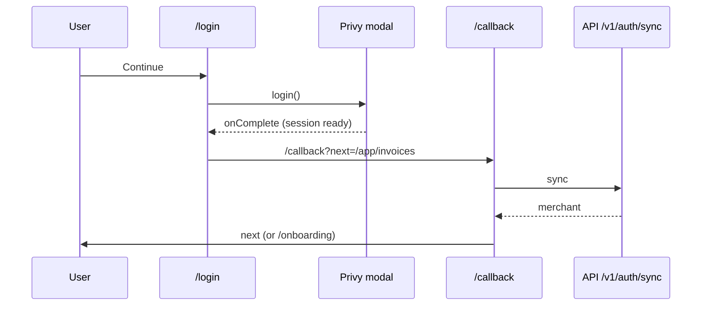

# ADR: Wait for Privy before leaving login, guard the dashboard, honour `next`

- **Status:** Accepted (2026-10-16, D1 to D3 as recommended)
- **Date:** 2026-10-16
- **Issue:** #148
- **Scope:** `apps/web`: the login, signup and callback pages, the dashboard shell, and a
  small tested helper module. No API, schema, contract or published package change.

## Context

Checked against `main` at `c2fb4bd`.

1. **Login and signup leave before Privy finishes.**
   - Both pages run `await privy.login()` and then `router.push('/callback')`
     (`(auth)/login/page.tsx:20-23`, `(auth)/signup/page.tsx:24-27`).
   - In `@privy-io/react-auth` 1.99.1 (installed), `login` is typed
     `(options?) => void`: it opens the modal and returns at once. The `await` does not wait
     for anything.
   - So the page moves to `/callback` while the modal is still open. The callback sees
     `authenticated === false` and sends the user back to `/login` (`callback/page.tsx:25-27`).
     That is the reported bounce.
   - Privy's documented way is `useLogin({ onComplete, onError })`. `onComplete` fires after
     a successful login, or straight away if the user is already signed in. `onError` fires
     on failure or when the user closes the modal.
2. **The merchant dashboard has no auth guard.**
   - `DashboardShell` only checks `onboardingCompleted`. A signed-out visitor to `/app`
     gets the dashboard frame with every query failing.
   - A user signed in to Privy but without a `Merchant` row gets `401 merchant_not_synced`
     (`MerchantNotSyncedError`) on every call and is never sent to `/callback` to sync. Only
     the error toast mentions it.
   - The admin shell already has the guard this needs (`admin-shell.tsx:61-76`).
3. **`next` is dropped.** The admin shell redirects to `/login?next=<path>`, but login,
   signup and callback ignore it. An admin who signs in lands on `/app`, not where they
   were going.

### Red, to fail on `main` before the build

- **`lib/auth-redirect` (unit):**
  - `safeNextPath` keeps same-site paths (`/app/invoices`, `/admin/merchants?x=1`);
  - it refuses everything else, returning `null`: absolute URLs, protocol-relative
    `//evil.test`, backslash tricks, empty values and non-strings;
  - `dashboardGate` returns `loading` while Privy hydrates or the merchant loads, `login`
    when signed out, `sync` on `MerchantNotSyncedError`, `onboarding`, `error` for any
    other failure, and `ready`.
- **Sources:**
  - login and signup use `useLogin` and no longer call `router.push('/callback')` right
    after `login()`;
  - the dashboard shell uses `dashboardGate`.

## Decision

1. **Login and signup (A1).**
   - Both use `useLogin({ onComplete, onError })`. `onComplete` navigates to `/callback`,
     carrying a safe `next`.
   - `onError` stays quiet when the user simply closed the modal (`exited_auth_flow`) and
     shows a toast for any other error.
   - Already signed-in visitors are forwarded straight away, as `onComplete` fires on mount
     for them.
2. **Dashboard guard (A2).** `DashboardShell` asks a pure `dashboardGate` function what to
   do:
   - Privy not ready, or the merchant loading: spinner;
   - not signed in: `/login?next=<current path>`;
   - `MerchantNotSyncedError`: `/callback?next=<current path>`, which syncs and comes
     back;
   - onboarding not finished: `/onboarding`, as today;
   - any other error: a card with the message and a retry button, not a broken dashboard;
   - otherwise: the dashboard.

   The merchant query only runs once Privy reports a session.

3. **`next` (A3).**
   - Login and signup pass `next` to `/callback`. After sync, the callback goes to `next`
     when onboarding is done, and to `/onboarding` when not.
   - **Open-redirect guard:** `safeNextPath` accepts only a path starting with a single `/`
     that resolves to the same origin. Anything else is dropped, and the user lands on
     `/app`.
4. **Verification in a browser (A4).** The issue asks to confirm the bounce in a browser.
   The types show it (`login` returns `void`). After the fix, the maintainer checks it once
   against the deployed web with a real Privy app, which unit tests cannot reach.

## Diagram

## Consequences

- Sign-in works on the first click. Closing the modal leaves the user on the page with no
  error.
- Signed-out and unsynced visitors to `/app` are routed instead of seeing a broken
  dashboard.
- **`next` is honoured** for both dashboards, through one tested guard.

## Alternatives

- **Poll `privy.authenticated` after `login()`.** Lost: Privy documents `useLogin` for this.
- **A Next.js middleware guard.** Lost: the Privy session lives in the browser, and the
  admin shell already guards on the client.

## Decisions for the maintainer

- **D1.** `useLogin` with `onComplete` and `onError` on login and signup. Recommended.
- **D2.** The dashboard guard as in A2, including sending unsynced users to `/callback`.
  Recommended.
- **D3.** Honour `next` through login and callback, same-origin paths only. Recommended.

## Migration, versioning, docs

- **Migration:** none.
- **Changeset:** none.
- **Release note.**
- **Directive 6:** comments the change makes false are listed in the PR.

## Verification

- The red tests above pass. `./scripts/preflight.sh` in full.
- **On the deployed web:**
  - log in and sign up once each;
  - open `/app/invoices` signed out and confirm you return there after login;
  - close the modal and confirm no error toast.
