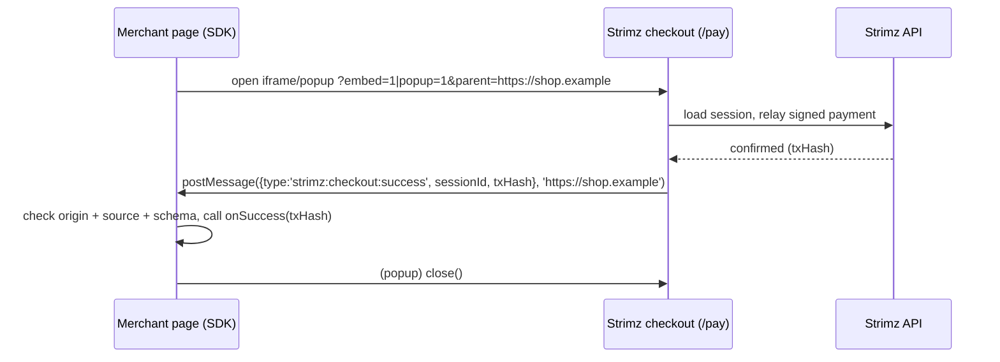

# ADR: Hosted checkout reports its result to the merchant page

- **Status:** Accepted (approved by the maintainer, 2026-10-16)
- **Date:** 2026-10-16
- **Issue:** #153
- **Scope:**
  - `apps/web`: hosted checkout `/pay/[sessionId]`, and the cancel button on `/sub/[planId]`.
  - `@strimz/sdk-react` (published, minor bump).
  - `@strimz/shared-types` (the message shape).
  - Checkout docs.
  - No API, database or contract change.

## Context

Checked against `main` at `a716e14`.

1. **The SDK waits for messages nobody sends.**
   - `StrimzPayButton`, `useStrimzCheckout` and `StrimzCheckoutEmbed` listen for
     `strimz:checkout:success | cancel | error` from the checkout origin
     (`useStrimzCheckout.ts:52-79`, `StrimzCheckoutEmbed.tsx:57-77`).
   - The hosted checkout never calls `postMessage` (no match in `apps/web/src`).
   - So `onSuccess`, `onCancel` and `onError` never fire, in popup or embed.
2. **`?embed=1` only changes the frame.**
   - It hides the layout header (`(checkout)/layout.tsx:28`) and forces the theme.
   - On success the page still counts down and sets `window.location.href = successUrl`
     inside the iframe (`pay/[sessionId]/page.tsx:440-448`). That loads the merchant's
     thank-you page _inside the frame_.
   - In a popup, the popup itself navigates away instead of telling its opener.
3. **Cancel goes to the Strimz homepage.**
   - Both `/pay` and `/sub` wire Cancel to `router.push('/')` (`pay:122`, `sub:181`).
   - `cancelUrl` is stored and returned by the API (`payment-sessions.service.ts:100,267`) but
     never read by the web app.
4. **Documented placeholders are not substituted.**
   - `docs/checkout/callbacks.mdx:12-32` promises `{CHECKOUT_SESSION_ID}` and
     `{ON_CHAIN_TX_HASH}` in `successUrl` / `cancelUrl`.
   - The checkout redirects to the raw string, braces included.
   - The same page also says Cancel "flips the session to `cancelled`" and shows a "Back
     link to your business URL". Neither exists: there is no public cancel endpoint, and the
     public merchant brand has no website field (`merchantPublicBrandSchema`).
5. **Stale closures in `@strimz/sdk-react` 0.2.8.**
   - `useStrimzCheckout.ts:104`: the popup close-watcher reads `status` from the `open`
     closure, so it is never `'open'` and `onCancel` never fires when the payer closes the
     popup.
   - `useStrimzSession.ts:65`: the interval reads `session` from the first render (`null`),
     so polling never stops at a terminal state.
   - The listeners also accept any window on the checkout origin. They don't check that
     the message came from _their_ popup or iframe.
6. **The error-envelope item is already fixed.** `strimz-bff.ts` was removed in #125. The
   checkout now posts to the API directly, and `lib/checkout-submission.ts:53-90` reads the
   `{ error: { code, message } }` envelope, with tests. Nothing to do here.
7. **Smart-contract wallets (ERC-1271) are rejected by the contracts, not the web app.**
   - `StrimzPayments.sol:234` and `StrimzSubscriptions.sol:262` verify the intent with
     `ECDSA.recover(v, r, s)`.
   - The payment itself uses USDC's `receiveWithAuthorization` with `v, r, s`.
   - A Safe or other contract account cannot produce either signature. Supporting them
     means `SignatureChecker`, `bytes` signatures and the token's `bytes` overload: a
     contract change.
   - Today such a payer signs and then gets a revert or a relay error with no explanation.

## Decision

1. **One message contract, in `@strimz/shared-types`.**
   - `checkoutResultMessageSchema` is a union of three messages:
     - `{ type: 'strimz:checkout:success', sessionId, txHash }`;
     - `{ type: 'strimz:checkout:cancel', sessionId }`;
     - `{ type: 'strimz:checkout:error', sessionId, code, message }`.
   - The web app sends exactly this shape and the SDK parses it with the schema.
   - Error codes are `load_failed`, `merchant_not_ready`, `payment_reverted` and
     `unsupported_wallet`. A failure before submission (rejected signature, network blip)
     stays on the page with "Try again" and posts nothing, because the payer can still
     finish.
2. **The SDK tells the checkout where to answer.**
   - The embed opens `/pay/{id}?embed=1&parent=<window.location.origin>`. The popup opens
     `/pay/{id}?popup=1&parent=<origin>`.
   - The checkout accepts `parent` only if it parses as an `http(s)` origin. It posts to
     `window.parent` (embed) or `window.opener` (popup) with `targetOrigin = parent`, never
     `'*'`.
   - No valid `parent` means no message. That covers a plain link, an old SDK, or a forged
     value: the result goes nowhere it wasn't asked to go.
   - The messages carry only the session id and the public tx hash. Merchants still confirm
     payment by webhook or API, as the docs already require.
3. **Embed and popup never navigate.**
   - With `embed=1` or `popup=1`, success shows the completion panel without the countdown
     or redirect, and posts `success`. The merchant's `onSuccess` decides what happens next.
   - In a popup the SDK then closes the window. If it is still open after 2 seconds, the
     panel reads "You can close this window".
   - Full-page checkout keeps today's countdown and redirect to `successUrl`.
4. **Cancel honours `cancelUrl`.**
   - Full page: Cancel goes to `cancelUrl` if set. Otherwise it shows a "Payment
     cancelled" panel ("Nothing was charged. You can close this window.") instead of the
     Strimz homepage.
   - Embed or popup: Cancel posts `cancel` and shows the same panel.
   - Cancel does not change the session on the server. It stays payable until it expires.
     The docs are corrected to say so.
   - `/sub/[planId]` gets the same panel in place of `router.push('/')`. Plans have no
     `cancelUrl` to honour.
5. **Placeholders are substituted.**
   - A tested helper `buildReturnUrl(template, { sessionId, txHash })` replaces
     `{CHECKOUT_SESSION_ID}` and `{ON_CHAIN_TX_HASH}` with URL-encoded values. The hash is
     empty on cancel.
   - It is used for both redirects.
   - The API already restricts both URLs to `http(s)`. A test confirms that a template
     containing braces passes that validation.
6. **`@strimz/sdk-react` fixes (minor release, 0.3.0).**
   - Pass `parent` (decision 2).
   - Read popup status and session state through refs, so cancel-on-close fires and polling
     stops at a terminal state.
   - Accept a message only when `ev.origin` matches _and_ `ev.source` is this hook's popup
     or this component's iframe, and it parses with the shared schema.
   - Changeset and README updated.
7. **Contract-account payers get a clear "not supported yet", before signing.**
   - After connect, the checkout reads `eth_getCode` for the payer address.
   - Code present → the page says "Smart-contract wallets (like Safe) can't pay here yet.
     Connect a regular wallet." The Pay button stays disabled, and embed/popup post `error`
     with `unsupported_wallet`.
   - EIP-7702 delegated accounts (code starting `0xef0100`) still sign with their own key,
     so they are treated as regular wallets.
   - Real ERC-1271 support is a contract change. It goes to a new issue tied to the
     contract freeze (#142/#147), and you decide whether it goes in before the redeploy.
8. **Out of scope, filed as issues:**
   - ERC-1271 contract support (decision 7): #287;
   - an SDK and embed entry point for subscription plan checkout `/sub/{planId}`, with
     plan-level success/cancel URLs: #288. The b2b-saas recipe's claim that plans have a success
     URL "in the dashboard" is false today; that doc fix joins #154.

## Diagram

## Consequences

- `onSuccess`, `onCancel` and `onError` work for the first time, in popup and embed.
- Merchants on `@strimz/sdk-react` 0.2.x keep getting no messages until they upgrade,
  because those versions don't send `parent`. That is no worse than today, and the
  changelog says so.
- Embedded checkout no longer redirects inside the frame. A merchant who relied on
  `successUrl` inside an iframe must use `onSuccess` instead, as the embed docs already say.
- Contract-wallet payers are turned away politely rather than failing after a signature.
  They still can't pay until the contract work lands.

## Alternatives considered

- **`postMessage(..., '*')` with no `parent` parameter.**
  - Simpler, but any page that frames or opens the checkout receives the result.
  - The data is not secret, but there is no reason to broadcast it. The explicit origin
    costs one query parameter.
- **A public "cancel session" endpoint.**
  - Would make Cancel authoritative.
  - But anyone holding a payment link could cancel someone else's invoice. Expiry already
    closes abandoned sessions.
- **Fix ERC-1271 in this issue.**
  - Needs a change to both payment contracts and to the token call path. That needs a new
    audit look and touches the frozen contract set (#147).
  - Too large for a web/SDK fix, so it is split out.

## Verification

Red first, on `main`:

- **`apps/web` unit:**
  - `buildReturnUrl` substitutes and encodes both placeholders and leaves other text
    untouched;
  - `resolveParentOrigin` accepts `https://shop.example` and refuses `javascript:`, paths,
    `*` and missing values;
  - `postCheckoutResult` posts the schema shape to `parent`/`opener` with the exact origin
    and does nothing without a parent;
  - `isContractAccount` treats empty code as an EOA, `0xef0100…` as an EOA, and other code
    as a contract.
- **`@strimz/sdk-react` (vitest + jsdom, fake timers):**
  - popup close fires `onCancel` once;
  - `useStrimzSession` stops polling at `confirmed`;
  - success from the right origin but the wrong `source` is ignored;
  - the embed `src` and popup URL carry `parent`.
- **`shared-types`:** the message schema accepts the three shapes and rejects the rest.
- **API:** `paymentSessions.create` accepts a `successUrl` containing `{CHECKOUT_SESSION_ID}`.
- **Manual, on testnet:** `apps/demo-merchant` pays one session through `StrimzPayButton`
  (popup) and one through `StrimzCheckoutEmbed`, and sees `onSuccess` with the tx hash; it
  then cancels one of each.
- Full `./scripts/preflight.sh`.
