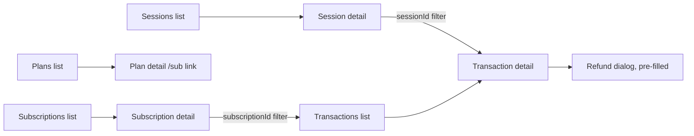

# ADR: Plans, payment sessions and transactions in the dashboard

- **Status:** Accepted (2026-10-16, D1 to D5 as recommended)
- **Date:** 2026-10-16
- **Issue:** #149
- **Scope:**
  - `apps/web`: new dashboard pages, dialogs and detail pages, the sidebar, the refund
    dialog, and the dashboard docs.
  - `apps/api`: two list filters on transactions (`sessionId`, `subscriptionId`).
- **Not in scope:**
  - A customer detail page (`customers.mdx` claims one; separate issue);
  - pausing subscriptions (no API);
  - cross-chain source chains on sessions (left for Whisk);
  - plan editing (plans are immutable in the API).

## Context

Checked against `main` at `8facf0a`.

1. **What the dashboard lacks.**
   - **Plans:** no page. The plan hooks exist but are unused, except the storefront's plan
     picker. That picker tells merchants to "Create one under Subscriptions", where nothing
     exists.
   - **Payment sessions:** a list with cancel, but no way to create one. The empty state says
     "via the API or SDK". There is no detail page, although rows already prefetch the detail
     on hover.
   - **Transactions:** no list and no detail page. `useTransactions` and `useTransaction`
     are unused.
   - **Subscriptions:** a list with cancel, showing the raw plan id instead of the plan
     name. No detail page.
2. **Refunds need an id the UI never shows.**
   - The "New refund" dialog asks for an "Original transaction ID" typed by hand. No page
     shows a transaction id, except the refunds table for transactions already refunded.
   - The amount field is labelled "USDC" for EURC transactions too.
3. **The API cannot link a session or subscription to its transactions.**
   - Sessions carry no `transactionId`.
   - `GET /v1/transactions` filters only by `kind` and `status`.
   - So a session page cannot show the payment it produced, or offer "Refund".
4. **The docs describe the missing pieces as present.**
   - `dashboard/payment-sessions.mdx` describes a New session dialog and a detail page, with
     wrong statuses (`pending`/`succeeded`).
   - `dashboard/subscriptions.mdx` describes Plans and Subscribers tabs, wrong intervals,
     and a Pause action the API does not have.
   - `dashboard/refunds.mdx` describes a Refund button on detail pages, with wrong statuses.
5. **What can be reused.**
   - The invoices list, new and detail pages, and the webhook detail pages.
   - `DataTable`, `StatusPill`, `PageHeader`, `ConfirmActionDialog`, cursor pagination
     (`useCursorList`, `patchListCacheRow`), CSV export and `FieldLabel`.
   - The API already has create, list, retrieve and archive for plans; create, list,
     retrieve, cancel and expire for sessions; and list and retrieve for transactions. None
     is plan-limited.
6. **Tests.** The web app has no component-render tooling. Its tests are pure-function or
   source-reading. New behaviour goes into pure helpers that get unit tests.

## Decision

Three PRs, in order. Each updates the dashboard docs for what it ships.

1. **Transactions and refunds (PR 1).**
   - **API:** `GET /v1/transactions` accepts `sessionId` and `subscriptionId` filters,
     validated as ids and scoped by merchant and mode like today. The SDK and the shared
     list-query schema gain the same optional fields (changeset if a published package
     changes).
   - **Transactions page** at `/app/transactions`, in the sidebar under Payments:
     - filters by kind and status;
     - amount, fee and net shown in their own currency;
     - CSV export;
     - each row links to its detail.
   - **Transaction detail page:**
     - amounts, payer and merchant addresses, block, and an Arcscan link;
     - links to its session, subscription, charge and refund;
     - a **Refund** button for confirmed, non-refund transactions.
   - **Refund dialog:**
     - it can open pre-filled from a transaction;
     - the amount is labelled and parsed in that transaction's currency;
     - the amount must be above 0 and at most the transaction amount, checked by a tested
       helper (the API still enforces the remaining refundable amount).
2. **Payment sessions (PR 2).**
   - **"New session" dialog:**
     - **Fields:** amount (required) and currency (required); description, customer email,
       expiry in minutes, and success and cancel URLs (all optional, labelled as such).
     - **Checks:** the API's minimum of 1.00, and http(s)-only URLs, checked by a tested
       input builder.
     - **On success** it shows the checkout link with a copy button and opens the session.
   - **Session detail page:**
     - status, amount, fee and net, customer, expiry, and the checkout link;
     - the on-chain transaction with an Arcscan link, and its transaction found through the
       new `sessionId` filter;
     - **actions:** Cancel (open sessions), and Refund (confirmed, opening the dialog
       pre-filled).
   - **Also:** the session list links rows to the detail page and gains "New session". The
     success toast shows formatted amounts instead of base units.
3. **Plans and subscriptions (PR 3).**
   - **Plans page** at `/app/plans`, in the sidebar under Payments:
     - list of active and archived plans: name, price per interval, trial, status;
     - **New plan** dialog with name, amount, currency, interval, interval count, trial
       days and description, checked by a tested builder (minimum 1.00, interval count
       1-365, trial 0-365);
     - **Archive**, with a confirmation that says existing subscribers keep being charged
       and the checkout link stops working.
   - **Plan detail page:** the plan's fields, the hosted checkout link `/sub/<id>` with a
     copy button, and Archive.
   - **Subscriptions:**
     - the list shows plan names and links to a new subscription detail page;
     - the detail page shows plan, customer, status, current period and trial, its charges
       (through the `subscriptionId` filter), and Cancel.
   - **Storefront picker:** its "Create one under Subscriptions" hint links to `/app/plans`.

**Across all three:**

- detail rows link with `<Link>` like invoices;
- the sidebar highlights the parent entry on detail pages;
- every input is labelled `(required) *` or `(optional)`;
- only theme colour tokens, so the light/dark toggle keeps working;
- every query shows loading, empty and error states.

## Diagram

## Consequences

- A merchant can create and share a payment link, set up a plan, find any payment and refund
  it without the API.
- **The API change** is two optional filters; nothing existing changes.
- **Three PRs** keep each review readable; the docs stay true after each.

## Alternatives

- **Plans as a tab inside Subscriptions** (what the docs describe). Lost: a plan has its own
  detail page and checkout link; a separate entry is easier to find and link to.
- **A `transactionId` on sessions** (schema change). Lost: the filter gives the same link
  without a migration, and works for subscriptions too.
- **One PR.** Lost: too large to review well.

## Decisions for the maintainer

- **D1. Three PRs** in the order above. Recommended.
- **D2. API filters** `sessionId` and `subscriptionId` on `GET /v1/transactions`.
  Recommended.
- **D3. Plans** get their own sidebar entry and page (recommended), not a tab in
  Subscriptions.
- **D4. Session creation** in a dialog with the fields above (recommended), not a full page
  like invoices.
- **D5. Out of scope here:** the customer detail page, subscription pause, cross-chain
  source chains and plan editing. File the customer detail page as its own issue.
  Recommended.

## Migration, versioning, docs

- **Migration:** none.
- **Changeset:** `@strimz/sdk` and `@strimz/shared-types` minor if the list filters are
  added there (PR 1).
- **Docs:** each PR rewrites the dashboard page it ships (transactions, payment sessions,
  subscriptions and plans, refunds), with the real statuses and fields.
- **Directive 6:** comments the change makes false are listed in each PR.
- **Release notes:** one per PR.

## Verification

- Each PR's helpers and API filters are tested first. `./scripts/preflight.sh` in full each
  time.
- **After each deploy:** create the object from the dashboard on testnet, open its detail
  page, and follow the links.
