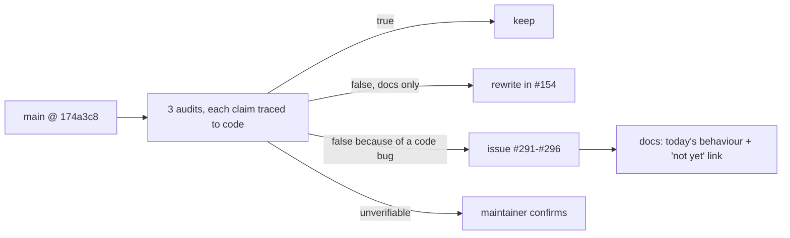

# ADR: Marketing site, docs and SDK READMEs describe the product as it is

- **Status:** Accepted (approved by the maintainer, 2026-10-16)
- **Date:** 2026-10-16
- **Issue:** #154
- **Scope:**
  - `apps/web`: marketing pages and components, legal pages, `content/docs`.
  - READMEs of `@strimz/sdk`, `@strimz/sdk-react`, `@strimz/shared-types`, `@strimz/shared-config`, `@strimz/shared-crypto`.
  - One stale comment in `packages/shared-config/src/tiers.ts`.
  - No API, contract, database or package-API change.

## Context

Checked against `main` at `174a3c8` by three audits: marketing, docs and READMEs.
Every finding was traced to a code line. In summary:

1. **Invented proof.**
   - "$48M settled", "12,400 transactions", "13s median", "99.97% webhook success" appear
     on Home (`stats-band.tsx`), Customers and About.
   - Customers also has eight invented logos and three invented testimonials with metrics
     ("+2.4%", "4 hours", "1 weekend").
   - About claims "6 chains". The Terms say the contracts are "audited". Starter is
     marked "Most popular".
   - Live mode is refused until Arc mainnet (`api-keys.service.ts:135-140`), so none of
     these can be true today.
2. **Features presented as live that are not.**
   - Cross-chain payments: checkout is Arc-only, and the routing producer was never built.
   - Wallet screening: nothing calls `ComplianceService.screen()`.
   - "Identity verification": there is no KYC. Live mode needs email, 2FA, onboarding and
     Arc mainnet.
   - Government ID collection, GitGuardian key auto-revoke, brand colour, logo CDN, hosted
     invoice page, `Strimz-Version` pinning, `subscriptions.pause/resume/chargeNow`,
     `listAll()` and `GET /v1/subscription-charges`.
3. **Wrong behaviour descriptions.**
   - **Subscriptions:**
     - "first charge in the same transaction as enrolment": the scheduler charges on its
       next 15-minute sweep;
     - an "at period end" cancel mode that doesn't exist;
     - retry schedule "24h, 72h, 7d": it is 15m, 1h, 3h, 6h, 12h, 24h, capped at 8;
     - grace "settable": it is fixed at 48h;
     - batches of 20: the scheduler sends one per job;
     - the charge-id formula is wrong.
   - **Webhooks:** the retry schedule ends at 2h not 12h, the timeout is 10s not 5s, and
     auto-disable is 5 failures in 24h. Five events are documented as firing but never
     emitted.
   - **Payment sessions:** wrong status names; expiry is 30 minutes, not 24 hours.
   - **Indexer:** "CONFIRMATIONS default 5", although Arc has deterministic finality and
     the variable is required.
   - **Self-hosting the scheduler:** env vars that don't exist; required ones missing.
   - **Pricing copy:**
     - "the more volume, the lower your rate": it goes from 0% to 0.5% at $1,000;
     - "the free plan includes every feature";
     - an "above $1M" Enterprise threshold that isn't in `PLANS`;
     - opt-in features listed as included.
     - The fee table itself matches `shared-config/tiers.ts`.
4. **Docs that promise behaviour the code doesn't have yet.** Each is now its own bug:
   - `Idempotency-Key` dedup: #292;
   - API cancel "cancels on-chain": #293;
   - `refunds.create` returning signing instructions: #294;
   - never-emitted events and trial retries: #295;
   - SDK version header: #296;
   - default `checkoutOrigin`: #291.
5. **Placeholders and broken links.**
   - Four broken `/docs` links.
   - `rpc.arc-testnet.example.com`, and checkout hosts split between `strimz.finance` and
     `strimz-finance.vercel.app`.
   - ID prefixes that don't exist (`cs_`, `sess_`), `github.com/Signor1/strimz`.
   - A dashboard mock with an `app.` subdomain and dates before the signing date.
   - Typos ("Built by the Strimz", broken sentences in the FAQ and legal pages).
6. **READMEs.**
   - sdk-react documents TanStack Query, `{ data, isLoading }`, `@strimz/sdk` as a peer
     dependency, a "single EIP-3009 signature" and "about 6 KB, zero dependencies".
   - The sdk README shows `paymentSessions.retrieve` on the browser client, and its errors
     and EIP-712 sections are incomplete.
   - The shared-\* READMEs have dependency and subpath gaps.

## Decision

1. **Rule:** a public page states only what `main` does today. A planned feature is called
   "coming" or left out. Where a code bug makes the documented behaviour wrong, the docs
   describe today's behaviour, add a one-line "not yet" note and link the bug issue. When
   that bug is fixed, its PR restores the doc.
2. **Proof:**
   - **Stats band, Customers metrics, About metrics:** removed. #277 (honest proof) builds
     the replacement in the redesign.
   - **Logos:** removed.
   - **Testimonials:** kept, as decided by the maintainer. Three quotes are rewritten in
     plain customer language about things the product does today: one signature, no gas
     for the payer, USDC or EURC settling to the merchant's own wallet, signed webhooks,
     plan billing. They contain no numbers. Names and roles are placeholders,
     `[Name]` / `[Role, Company]`, which the maintainer replaces with real customers who
     approved their quote. The page does not ship to production with placeholders.
   - **Customers page copy:** "Built for teams who…" instead of "companies running Strimz
     in production".
   - **"Audited"** is removed from the Terms. **"Most popular"** becomes "Recommended".
3. **Not live → "coming", or removed:**
   - Cross-chain payments: "coming". Today customers pay on Arc.
   - Wallet screening: "not part of checkout today".
   - Identity verification: replaced by the real gate (email, 2FA, onboarding, and
     mainnet for live mode).
   - Removed: GitGuardian auto-revoke, brand colour, logo CDN and 404 emails, hosted
     invoice page, version pinning, pause/resume/chargeNow, `listAll`, the charges
     endpoint, the government-ID line.
4. **Behaviour descriptions** follow the code exactly, with file references kept in the
   audit notes rather than in the docs.
5. **Pricing copy** follows `PLANS`:
   - "0% on your first $1,000, then 0.5%, dropping to 0.4% from $50,000";
   - the Free plan lists what it actually includes;
   - opt-in features are labelled "(opt-in)";
   - Enterprise is "Custom, by contract" with no $1M figure;
   - the threshold row is derived from `PLANS`, so it can't drift. That is the only code
     change on the site, and it has a test.
6. **One checkout host in the docs:** the canonical origin chosen in #291. Until #291
   lands, the docs use `https://www.strimz.finance`, which is what production serves
   today. Real ID formats replace `cs_`/`sess_`. The repo link becomes `StrimzLab/strimz`.
7. **READMEs** match the exports. The sdk-react README fix is published with a patch
   changeset for `@strimz/sdk-react`, `@strimz/sdk`, `@strimz/shared-types`,
   `@strimz/shared-config` and `@strimz/shared-crypto`, so npm shows the corrected
   README.
8. **Needs the maintainer, not guessed:**
   - the sales@, security@, privacy@, legal@, compliance@ and abuse@ inboxes;
   - the X and LinkedIn handles;
   - "a small team across London and Lagos, hiring".
   - Until confirmed, unconfirmed inboxes point to `support@strimz.finance` (the only one
     the backend uses).
   - The "PGP key on the security page" line is removed, since no such page exists.
9. **Comments:** the stale `tiers.ts:5-6` comment about a subscription premium that no
   longer exists is removed.

## Diagram

## Consequences

- The site loses its most impressive-looking numbers until #277 adds real ones.
- Docs get shorter in places: features that don't exist are gone.
- Testimonials can't go to production until real names and approvals arrive.
- Six "not yet" notes stay in the docs until #291–#296 are fixed.

## Alternatives considered

- **Delete the testimonials.** Rejected by the maintainer, who will supply real customers.
- **Fix the code bugs inside #154.** #292 and #293 change the API and possibly the
  contracts, so each needs its own ADR and tests. #154 stays docs-only.
- **Keep the stats with a "sample data" label.** A labelled sample still reads as a
  claim on a business page. #277 handles a clearly framed demo scene.

## Verification

- `pricing-plans.test.ts`: the threshold row is derived from `PLANS` (red first).
- A docs link test: every `/docs/...` link in `content/docs` and the marketing components
  resolves to a page or anchor (red first; four links fail today).
- A test that no marketing component contains `$48M`, `12,400`, `99.97%` or the invented
  logo names (red first).
- `docs-code-samples.test.ts` still passes on every changed sample.
- Full `./scripts/preflight.sh`. Manual read-through of every changed page in light and
  dark mode.
