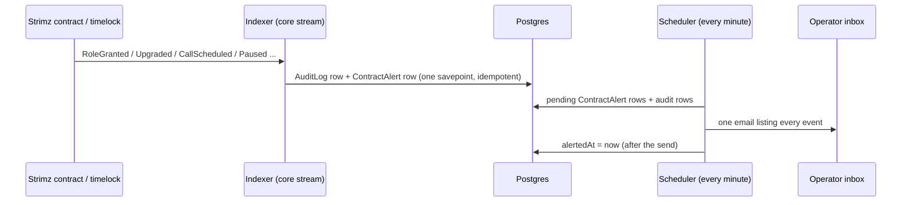

# ADR: Record and alert on role changes, upgrades, timelock operations and agent-registry events

- **Status:** Accepted (2026-10-16, D1 to D6 as recommended)
- **Date:** 2026-10-16
- **Issue:** #211, deferred from ADR-2026-10-04-indexer-per-network (D11).
- **Scope:**
  - `apps/indexer`: watch two more addresses (agent registry, timelock), subscribe to the
    access-control, upgrade, timelock and agent-registry events, write audit rows and an
    alert outbox row.
  - `packages/db`: an alert outbox table (migration).
  - `apps/scheduler`: a cron that emails pending alerts to `STRIMZ_ADMIN_ALERT_EMAIL`.
  - `packages/email-templates`: one alert email.
  - The redeploy runbook, the Lightsail env example and the self-hosting indexer docs.
- **Not in scope:**
  - An admin console page for the audit log. Nothing reads `AuditLog` yet; see D5.
  - Moving the older random-id audit writers to deterministic ids (ADR-2026-10-04 D9).
  - Projecting the agent registry into `AgentIdentity`; see D4.

## Context

Checked against `main` at `2744d9f`.

1. **Nothing watches who holds power over the contracts.**
   - The indexer subscribes to 36 events. `RoleGranted`, `RoleRevoked`,
     `RoleAdminChanged` and `Upgraded` are not among them, so the RPC filter never returns
     them (`apps/indexer/internal/abi/events.go:88-104`, `:185-200`).
   - A role granted to an unknown address, or an implementation swapped by an upgrade, is
     the first sign of a stolen admin key. Today nothing records it and nobody hears of it.
2. **What each contract can emit.** All use `StrimzAccessControl`, which extends OpenZeppelin
   `AccessControlUpgradeable`.

   | Contract                               | Kind                 | Emits                                                                                                                                 |
   | -------------------------------------- | -------------------- | ------------------------------------------------------------------------------------------------------------------------------------- |
   | Registry, TokenWhitelist, FeeCollector | UUPS proxy           | role events, `Upgraded`                                                                                                               |
   | AgentEscrow                            | UUPS proxy, pausable | role events, `Upgraded`, `Paused`, `Unpaused`                                                                                         |
   | AgentRegistry                          | UUPS proxy           | role events, `Upgraded`, `AgentRegistered`, `AgentCredentialRotated`, `AgentReputationAdjusted`, `AgentDeactivated`, `AgentActivated` |
   | Payments, Subscriptions                | immutable, pausable  | role events, `Paused`, `Unpaused` (never `Upgraded`)                                                                                  |
   | TimelockController (#129 handoff)      | immutable            | role events, `CallScheduled`, `CallExecuted`, `Cancelled`, `MinDelayChange`                                                           |
   - `Upgraded` is emitted at the proxy address, which the indexer already watches for four
     of the five proxies.
   - The agent registry and the timelock are watched by nothing: they have no indexer ABI,
     no `Makefile` entry and no address setting. The timelock address exists only in the
     contract scripts and the runbook.

3. **What exists to build on.**
   - **Idempotent audit rows.** The indexer writes contract operations to `AuditLog` with
     the id `onchain:<chainId>:<txHash>:<logIndex>` and `ON CONFLICT DO NOTHING`
     (`store/onchain_audit.go`). `Paused` and `Unpaused` already go there (category
     `admin`, target the contract address).
   - **One email path for operators.** The scheduler's gas monitor emails
     `STRIMZ_ADMIN_ALERT_EMAIL` through Resend. There is no Slack, pager or ops webhook.
   - **The expected role table.** `AdminHandoff.roleTable` lists every expected grant after
     the handoff (35 entries, 38 with a guardian), including which accounts hold what.
4. **The redeploy will emit dozens of these events.** The handoff grants and renounces
   roles on all seven contracts after `START_BLOCK`. A naive one-email-per-event design
   would send about 70 emails that day.
5. **Old ADR text is stale.** ADR-2026-10-04 D11 said agent-registry state had "no off-chain
   table". `AgentIdentity` now exists. Payments and Subscriptions are called upgradeable in
   places; they are not.

### Red, to fail on `main` before the build

- **Indexer config:**
  - `AGENT_REGISTRY_ADDRESS` and `TIMELOCK_ADDRESS` are required and validated;
  - the core stream asks the RPC for all eight addresses and for the new topics.
- **Indexer ABI:**
  - the new events decode;
  - every subscribed event is one that some watched contract emits;
  - the role-name table matches the Solidity constants.
- **Indexer projection (e2e):**
  - a `RoleGranted` writes one `AuditLog` row (`contract.role_granted`, with the role name,
    the account and the sender) and one alert outbox row;
  - the same applies to `RoleRevoked`, `RoleAdminChanged`, `Upgraded`, `CallScheduled`,
    `CallExecuted`, `Cancelled`, `MinDelayChange`, `Paused` and `Unpaused`;
  - replaying the same log writes nothing new;
  - agent-registry events write audit rows and no alert.
- **Scheduler:**
  - pending alerts are sent as one email per tick, listing every event, and are stamped;
  - a failed send leaves them pending;
  - nothing is sent when there are no alerts.

## Decision

1. **Watch the two missing addresses (M1).**
   - New required indexer settings `AGENT_REGISTRY_ADDRESS` and `TIMELOCK_ADDRESS`,
     validated like the others and added to the core stream's address set.
   - `make abi` adds `StrimzAgentRegistry` and `TimelockController` (events only).
   - A required timelock means the indexer is deployed after the handoff, which the
     redeploy runbook already does (step 8 follows step 4). The runbook and the Lightsail
     env example gain both names.
2. **Record (M2).** Each event writes an `AuditLog` row with the existing idempotent id, in
   the same transaction as the cursor.

   | Event                                                                                                        | `action`                                          | Category | Alert |
   | ------------------------------------------------------------------------------------------------------------ | ------------------------------------------------- | -------- | ----- |
   | `RoleGranted`, `RoleRevoked`                                                                                 | `contract.role_granted` / `contract.role_revoked` | `admin`  | yes   |
   | `RoleAdminChanged`                                                                                           | `contract.role_admin_changed`                     | `admin`  | yes   |
   | `Upgraded`                                                                                                   | `contract.upgraded`                               | `admin`  | yes   |
   | `CallScheduled`, `CallExecuted`, `Cancelled`, `MinDelayChange`                                               | `timelock.*`                                      | `admin`  | yes   |
   | `Paused`, `Unpaused` (already recorded)                                                                      | unchanged                                         | `admin`  | yes   |
   | `AgentRegistered`, `AgentCredentialRotated`, `AgentReputationAdjusted`, `AgentDeactivated`, `AgentActivated` | `agent.*`                                         | `agent`  | no    |
   - **Metadata:**
     - the contract name (the indexer knows which setting each address came from);
     - the role as both hash and name, from a table built from the Solidity constants
       (`STRIMZ_*_ROLE`, `DEFAULT_ADMIN_ROLE`, and the timelock's `PROPOSER_ROLE`,
       `EXECUTOR_ROLE` and `CANCELLER_ROLE`), with unknown hashes kept as hashes;
     - the account and the sender, the new implementation, the timelock operation id,
       target, value, data and delay;
     - the transaction hash, log index and block, as today.
   - `targetType` is `Contract` and `targetId` is the contract address, as for pauses.

3. **Alert outbox (M3).** A new table, `ContractAlert`:
   - **Columns:** id, `auditLogId` unique, `chainId`, `createdAt`, `alertedAt` nullable,
     with a partial index on pending rows.
   - **Written:** the indexer writes it in the same savepoint as the audit row, for every
     event marked "alert" above. The insert is idempotent on `auditLogId`, so a replay
     never alerts twice.
   - This is the outbox pattern the webhook pipeline already uses. The audit trail stays in
     `AuditLog`, and the alert state stays out of it.
4. **Deliver (M4).** A scheduler cron, `contract-alerts`, runs every minute
   (`CONTRACT_ALERT_CRON`).
   - **One email per tick:** it reads every pending alert with its audit row (oldest first,
     capped at 200) and sends one email to `STRIMZ_ADMIN_ALERT_EMAIL` listing all of them.
     It stamps `alertedAt` only after the send succeeds; a failed send stays pending and is
     retried next tick.
   - The redeploy's handoff becomes one email with about 70 lines, not 70 emails.
   - **Each line shows:**
     - network, contract, event;
     - the role name and the account;
     - the account labelled when it is the relayer or the scheduler (both known to the
       scheduler) or a Strimz contract;
     - an Arcscan link to the transaction.
   - **Subject:** "Strimz contract alert: N on-chain admin events" with the network name.
   - **Stub mode:** with no Resend key, it logs and stamps, as the other scheduler emails
     do.
5. **Alert on every event, not only unexpected ones (M5).**
   - Every role change, upgrade, timelock operation and pause is a deliberate action by the
     Safe, the timelock or the deployer, so each email confirms one of these or exposes one
     that nobody made.
   - Comparing against the expected role table would need the Safe, guardian, relayer and
     scheduler addresses in the indexer, and would still have to alert on the handoff. It
     is left as an option (D3).

## Diagram

## Consequences

- A stolen admin key that grants a role, upgrades a proxy or schedules a timelock call
  produces an email within about a minute of the indexer reaching the block.
- **Planned operations email too.** The handoff, a pause, and the planned fee-manager
  revocation are all confirmed by email.
- **The indexer needs two more required settings,** so an old `.env` fails at boot until
  they are added, as with every address setting.
- **Email is the only channel.** If the alert inbox is not watched, the alert is a database
  row. D2 offers a second channel.
- **Not covered:**
  - the old July contracts, which the indexer no longer watches;
  - the Safe itself (owner changes, threshold), which is not a Strimz contract (D6).

## Alternatives

- **Audit rows only, no alert (ADR-2026-10-04 D11 option b).** Lost: a compromise is
  recorded but nobody is told.
- **Alert from the indexer directly.** Lost: the indexer is Go with no email client. The
  scheduler already has Resend, templates and the alert address.
- **An `alertedAt` column on `AuditLog`.** Possible. Rejected to keep the general audit
  table free of one consumer's state, and because an outbox row makes "which events alert"
  an explicit write.
- **One email per event.** Lost: the handoff would send about 70 emails.

## Decisions for the maintainer

- **D1. Scope of alerts.** Recommended: role changes, role-admin changes, upgrades, timelock
  operations and pauses alert; agent-registry events are recorded only.
- **D2. Channel.** Recommended: email to `STRIMZ_ADMIN_ALERT_EMAIL` only. Alternative: also
  post to a Slack or Discord webhook URL (one optional setting).
- **D3. Expected vs unexpected.** Recommended: alert on every event (M5). Alternative: mark
  each line "expected" or "unexpected" against the handoff role table, which needs the Safe
  and guardian addresses in the scheduler's settings.
- **D4. Agent registry.** Recommended: audit rows only. Alternative: also project
  registrations into `AgentIdentity`.
- **D5. Admin console.** Recommended: no page now; file a follow-up for an audit-log page in
  the admin console.
- **D6. The Safe.** Recommended: out of scope. Safe owner or threshold changes are watched
  in the Safe's own interface. Alternative: watch the Safe's `AddedOwner`,
  `RemovedOwner` and `ChangedThreshold` events too.

## Migration, versioning, docs

- **Prisma migration:** the `ContractAlert` table.
- **Changeset:** none. No published package changes.
- **Docs:**
  - the self-hosting indexer page lists the two new settings, and the self-hosting scheduler
    page lists `CONTRACT_ALERT_CRON`;
  - the redeploy runbook sets the indexer addresses after the handoff;
  - ADR-2026-10-04's D11 is superseded by this ADR.
- **Directive 6:** comments the change makes false are listed in the PR.
- **Release note.**

## Verification

- The red tests above pass. `./scripts/preflight.sh` in full, including the indexer e2e
  suite.
- **At the redeploy:** after the indexer starts, the operator inbox receives one email
  listing the handoff's grants and revocations and the escrow pause, with Arcscan links.
