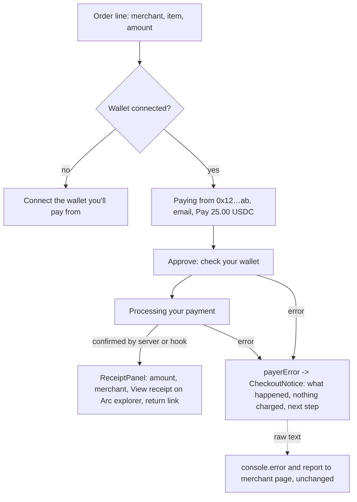

# ADR: Hosted checkout and storefront in plain language

- **Status:** Accepted (maintainer approved 2026-10-19)
- **Date:** 2026-10-19
- **Issue:** #285 (part of #286). Audit posted on the issue before any change.
- **Scope:**
  - **Changes:** web only. `/pay/[sessionId]`, `/sub/[planId]`, `components/checkout/*`, `/store/[slug]/**` and `components/store/buy-button.tsx`.
  - **Unchanged:**
    - the signing, relay, polling and payment hooks (`use-pay-checkout`, `use-subscription-checkout`, `checkout-submission`);
    - the API, schema, webhooks and published packages;
    - the result messages posted to the merchant page (#153).

## Context

The audit on #285 found that a payer new to stablecoins meets protocol wording before paying:

- "Sign" and "Settle", "signed authorization", "on-chain confirmation", "transaction", and "Reown AppKit";
- a monospace wallet address;
- a heading that names the token, not the merchant or the item.

Developer errors reach the screen as they are:

- "Set ARC_USDC_ADDRESS on the API";
- "NEXT_PUBLIC_STRIMZ_PAYMENTS_ADDRESS is not configured";
- "does not support EIP-3009";
- "submission status poll timed out".

Only relay errors with a known code are mapped (`PAYER_MESSAGES`).

The storefront says "Settles in ~13s on Arc". Arc's docs say sub-second deterministic finality, final on block inclusion, so that line is false.

On the success side:

- `/pay` already has a restrained `CompletionPanel`, gated on a real confirmation;
- `/sub` prints a raw full tx hash with no explorer link;
- the two use different headings for the same moment.

Plans have no `successUrl` or `cancelUrl` (only payment sessions do), so `/sub` cannot return the payer to the merchant without a schema change.

## Decision

### D1. Lead with the order

The form column opens with a single order line: "Pay {merchant}" plus the item, then the amount in large type (`25.00 USDC`, or `10.00 USDC / month`).

- **The token logo** sits beside the amount, small. The "Secured by Strimz" badge stays.
- **The action button:**
  - one-off: `Pay 25.00 USDC`;
  - subscription: `Subscribe for 10.00 USDC / month`, or the existing trial label "Start 7-day free trial".
- **The amount stays in the token,** not "$". USDC and EURC are not dollar balances on a bank card, and "$" would be wrong for EURC.
- **The summary rail** keeps the merchant and description, and drops the duplicate "Total amount" / "Total due" pair for a single "Total" line.

### D2. Plain-language steps

| Today                                                                  | After                                                                                                                                  |
| ---------------------------------------------------------------------- | -------------------------------------------------------------------------------------------------------------------------------------- |
| "Connect a wallet to continue. We use Reown AppKit…"                   | "Connect the wallet you'll pay from."                                                                                                  |
| Step indicator "Sign" then "Settle"                                    | "Approve" then "Processing"                                                                                                            |
| "Awaiting wallet signature…" / "Confirm the signature in your wallet." | "Check your wallet and approve the payment."                                                                                           |
| "Submitting your signed authorization to the network…"                 | "Processing your payment…"                                                                                                             |
| "Waiting for on-chain confirmation…" / "Confirming on-chain…"          | "Almost done…"                                                                                                                         |
| "One signature. Strimz settles the payment…"                           | "You approve once in your wallet. No extra fee for you." (The relay pays the network fee; the merchant's plan fee is not the payer's.) |
| "How it works": "on Arc", "Sign once. Strimz submits the transaction"  | 1. Connect your wallet. 2. Approve once. 3. The merchant is paid straight away. Plus a small note: "Paid in USDC on the Arc network."  |
| "We send your receipt here once the payment settles on-chain."         | "We'll email your receipt here."                                                                                                       |
| Sub: "Cancel anytime from your wallet."                                | Removed. There is no in-wallet cancel today. The trial copy keeps "Cancel anytime", which the merchant honours.                        |

- **The connected wallet row** keeps the short address. It's the payer's own check that the right wallet is connected. It moves to the sans-serif type, with a "Paying from" label.

### D3. One payer-error mapper

A new `lib/payer-errors.ts` exposes `payerError(raw, context): { title, detail, action }`. The page renders the result in one `CheckoutNotice` component (tones: error, info).

- **Known relay codes** keep their current `PAYER_MESSAGES` wording (moved, not rewritten).
- **The wallet rejected the request** (`UserRejectedRequestError`, or "User rejected" or "denied" in the message):
  - "You cancelled in your wallet. Nothing was charged."
  - action: "Try again".
- **Config and developer faults** (missing env, missing token address, unsupported token, a malformed signature):
  - "This checkout isn't available right now. Nothing was charged. Contact {merchant}."
  - The raw text goes to `console.error` and to the existing `report()` call unchanged, so #153's messages to the merchant page keep their content.
- **A poll timeout:** "This is taking longer than usual. Don't pay again: we'll email your receipt when it lands." The action refreshes the page, which reads the session status.
- **Merchant not ready:** "{merchant} can't take payments yet. This page will update by itself." The poll is unchanged.
- **Contract wallets:** "This wallet type can't pay here yet. Connect a regular wallet such as MetaMask or Coinbase Wallet."
- **Storefront buy errors** go through the same mapper. The fallback becomes "We couldn't open checkout. Try again."
- **Missing Reown project id** (operator config): the payer sees "Wallet connection isn't available right now." The env name appears only in development builds.

### D4. One receipt panel for both flows

`CompletionPanel` moves to `components/checkout/receipt-panel.tsx`, and both pages use it.

- **Heading:** "Payment complete" or "Subscription active". The page heading uses the same words, so there is one name for one moment.
- **Rows:**
  - Amount;
  - Paid to {merchant};
  - item;
  - date;
  - for subscriptions, the next charge or trial end (from the existing `trialCopy`).
- **"View receipt on Arc explorer"** opens `arcExplorerTxUrl`, built from shared config. No hash is printed.
- **Return link:**
  - `/pay` keeps its `successUrl` countdown and the "Return to {merchant}" button;
  - `/sub` shows "You can close this window", since plans have no success URL.
- **It renders only when confirmed:** hook `confirmed`, or server `status === 'confirmed'`. This is unchanged.
- **Motion:** a one-time check-mark draw (CSS, about 400 ms), skipped under reduced motion. No confetti, no loop.
- **The receipt row** uses theme tokens; `bg-white/60` goes.

### D5. Corrections found in the audit

- **The storefront line** becomes "Powered by Strimz". The "~13s" claim goes.
- **The storefront OG text** "Instant, gas-free, no card needed" becomes "Pay {name} with USDC from your wallet."
- **Intervals:** one `intervalLabel()` replaces `interval.replace('ly', '')`, so "daily" no longer becomes "dai". The `/sub` copy shares it.
- **The fallback button** loses the stray full stop ("Subscribe. 10 USDC/month").
- **The cancelled panel** says "Subscription cancelled" on `/sub`.
- **Dark variants** for:
  - the amber and red notices (through `CheckoutNotice`);
  - the storefront "Sold out" overlay (`bg-background/80`).
- **The product page price** moves to the sans-serif type.

### D6. Out of scope, flagged

- **`/sub` cancel** stays local only. It can't redirect without a plan `cancelUrl`, and sending checkout result messages from `/sub` belongs with #153.
- **#243** (Circle user-controlled wallet) adds a second way to connect. D2's "Connect the wallet you'll pay from" and D3's mapper are built so that option can slot in beside Reown.

## Diagram

## Consequences

- **Payers** read one order and one action. Protocol words appear only behind "View receipt on Arc explorer" and in the small "Arc network" note.
- **Developers debugging a broken checkout** no longer see the env-var hint on screen. It's in the console and in the host message, and development builds still show it.
- **The two checkout pages** share a receipt panel and an error mapper instead of duplicating them, which leaves less to drift.
- **`/sub` still has no merchant return link** until plans gain URLs. That gap is now visible in this ADR, not hidden.

## Alternatives considered

- **Show "$25.00" instead of "25.00 USDC":** reads friendlier, but it's wrong for EURC and blurs what actually moves. Rejected.
- **Hide the wallet address entirely:** fewer characters, but the payer loses their check that the right wallet is connected. Kept, shortened.
- **Map errors inside the hooks:** would touch the payment hooks this issue must not change. The mapper sits at the display edge.

## Verification

- **Red-green Vitest:**
  - `payer-errors` (every raw string from the audit maps to payer copy with no env names, no "EIP-", no "on-chain");
  - `interval-label`;
  - a checkout copy guard that scans the checkout and storefront sources for banned payer-facing words (`signature`, `on-chain`, `gas`, `EIP-`, `~13s`, `Reown`);
  - a receipt-panel test that it renders only for a confirmed phase and links to the explorer from shared config.
- **`./scripts/preflight.sh`** in full.
- **By hand** on the dev server with a testnet session, light and dark at 375 px and at desktop:
  - connect, approve, the receipt and the explorer link;
  - wallet reject;
  - a not-ready merchant;
  - a subscription with and without a trial;
  - a storefront product to checkout.
- **The testnet payment hash** is recorded in the PR. This needs the maintainer's session if no local API is available.
