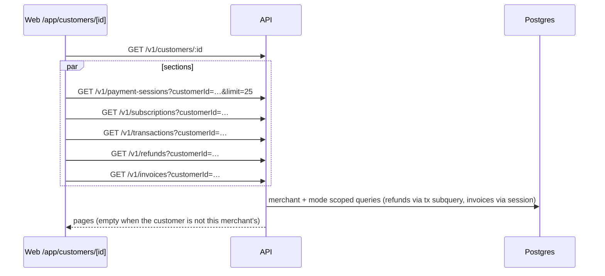

# ADR: Customer detail page and customer filters

- **Status:** Accepted (maintainer approved 2026-10-19)
- **Date:** 2026-10-19
- **Issue:** #263 (split from #149, ADR-2026-10-16-dashboard-plans-sessions-transactions D5)
- **Scope:**
  - **Changes:**
    - API list filters;
    - one Prisma migration (indexes only);
    - `@strimz/sdk` list params (minor bump);
    - the web dashboard;
    - the customers docs page.
  - **Unchanged:**
    - contracts, the indexer, the scheduler, and webhook and BullMQ payloads;
    - how customers and their emails are recorded at checkout.

## Context

`/app/customers` is a list only.

**The docs (`content/docs/dashboard/customers.mdx`) promise more than exists:**

- "Click the wallet. The customer detail page shows every payment session, subscription, refund, and invoice" (line 31): neither the page nor the link exists.
- A "Lifetime value" column (lines 3 and 14): not built, and the list page says it was left out on purpose.
- "Receipts go to the most recent email entered for a given checkout" (line 23): false. The payer notifier sends to `customer.email`, the single stored email (`payer-notifications.service.ts:69-80, 122-135, 197-212`).
- "The same wallet can enter different emails… the dialog shows every email" (line 21): the UI can show a list, but `CustomersService.upsertFromCheckout` (`customers.service.ts:73-94`) records an email only when the customer has none, so the history never grows past one entry from checkout.
- "Look up by wallet address" (line 27): only the client-side table search does this. `GET /v1/customers` ignores `walletAddress`, even though `@strimz/sdk` `customers.list` already declares it.

**How records link to a customer (Prisma):**

| Record         | Link                                                                                   | Index today             |
| -------------- | -------------------------------------------------------------------------------------- | ----------------------- |
| PaymentSession | `customerId?`                                                                          | none                    |
| Subscription   | `customerId`                                                                           | yes                     |
| Transaction    | `customerId?`                                                                          | yes                     |
| Refund         | none. Through `transactionId` (plain string) → the original Transaction's `customerId` | none on `transactionId` |
| Invoice        | none. Through `sessionId` (unique) → PaymentSession `customerId`                       | `sessionId` unique      |

**The list API:** `listQuerySchema` is strict and has no `customerId`, so today the filter is refused with 400. `GET /v1/customers/:id` exists and returns the customer row, including `metadata.emailHistory`.

## Decision

### D1. One `customerId` filter on five list endpoints

`listQuerySchema` gains `customerId` (idSchema, optional). Each service applies it scoped to the caller's merchant and mode, like the existing `sessionId` and `subscriptionId` filters:

- **Payment sessions:** `where.customerId`.
- **Subscriptions:** `where.customerId`.
- **Transactions:** `where.customerId`.
- **Refunds:** `where.transactionId IN (transactions of this merchant where customerId = X)`. This is one subquery, so no new column is needed.
- **Invoices:** `where.session.customerId = X`, through the existing `sessionId` relation.

An unknown or other merchant's `customerId` returns an empty page, not a 404. This matches how `sessionId` behaves today.

### D2. Wallet lookup on the customers list

`GET /v1/customers` accepts `walletAddress`. It is validated as an EVM address, lower-cased, and matched exactly on the existing `@@unique([merchantId, walletAddress])` index. This makes the SDK's declared `walletAddress` param real.

### D3. Indexes (migration, indexes only)

- `PaymentSession @@index([merchantId, customerId])`.
- `Refund @@index([transactionId])`.

No columns change. The migration is additive and safe on a live table: plain `CREATE INDEX`. It is small at today's volume. The runbook notes `CONCURRENTLY` if volume grows first.

### D4. SDK (minor bump with a changeset)

- `customerId?` is added to the list params of `paymentSessions`, `subscriptions`, `transactions`, `refunds` and `invoices`.
- `customers.list` keeps `walletAddress`, which now works.
- `sdk-route-parity` stays green.

### D5. Dashboard page `/app/customers/[id]`

The page mirrors `subscriptions/[id]`: `use(params)`, a spinner, a "not found" card and `BackLink`.

- **Header:**
  - the display name, falling back to the email, then "Anonymous customer";
  - the full wallet with copy;
  - the receipt email with copy, labelled "Receipts go here";
  - external ref, first seen and last activity.
- **Sections**, each a card with up to 25 newest rows linking to its own detail page, and an empty state that says what will appear there:
  1. **Payments:** payment sessions, showing status, amount, description and date.
  2. **Subscriptions:** plan, status and next charge.
  3. **Transactions:** kind, status, amount and date.
  4. **Refunds:** status, amount and date.
  5. **Invoices:** number, status, amount and due date.

  When a section has 25 rows, a "Showing the latest 25" note appears. Paging inside a customer is left for later.

- **No lifetime value.** USDC and EURC are never summed, and a per-currency total needs its own aggregate endpoint. It stays out, and the docs say so.
- **The list page:** each row's name and wallet link to the detail page, and the actions menu gets "View customer". The CSV export, search and email-history dialog stay as they are.
- Light and dark, and the existing label conventions. The page has no form inputs.

### D6. Docs match the code

`customers.mdx` is rewritten to describe:

- the columns that exist;
- the detail page from D5;
- lookup by wallet (search box, API `walletAddress`);
- **email:** Strimz keeps the first email a wallet gives you, and receipts go to that stored email;
- the customers CSV export.

"Lifetime value" and the multi-email claims are removed. The layout metadata ("history, and lifetime value") is fixed too.

### D7. Out of scope, flagged

Recording every new email a wallet enters, and choosing which one gets receipts, changes checkout and notifier behaviour. If wanted, that becomes a separate issue.

## Diagram

## Consequences

- **Merchants** can answer "what has this customer done?" in one place, and integrators can filter by customer through the API and SDK.
- **Five list endpoints** gain one optional filter each, with no change for existing callers.
- **The SDK minor bump** ships through the existing changesets flow.
- **Refunds keep no `customerId` column.** The subquery costs one extra indexed lookup. If refunds grow, a denormalised column can come later.

## Alternatives considered

- **One aggregate endpoint `GET /v1/customers/:id/activity`:** fewer requests, but a new response shape to version and test, and the SDK and API users still couldn't filter the lists. Rejected.
- **Filter refunds by `payerAddress`:** this would catch refunds for the wallet across other contexts, and the column isn't indexed. Rejected in favour of the transaction link.
- **Build lifetime value now:** it needs per-currency aggregation and a decision on refunds. It's out of this issue.

## Verification

- **Red-green API e2e** in a new `customer-filters.e2e.test.ts`:
  - each of the five lists returns only the customer's rows;
  - another merchant's customer returns an empty page;
  - a malformed id returns 400;
  - `walletAddress` finds the customer whatever its case.
- **SDK unit tests:** the params are sent; route parity holds.
- **Web tests:**
  - the merchant-api resources pass `customerId`;
  - the list rows link to `/app/customers/:id`;
  - a docs guard checks that "Lifetime value" and "most recent email" are gone.
- **The migration** is applied to a scratch database and checked by hand.
- **`./scripts/preflight.sh`** in full.
- **Signed-in check (maintainer):** open a customer who has paid on testnet and see their payment, transaction and subscription. Listed in the PR, since the agent can't sign in.
