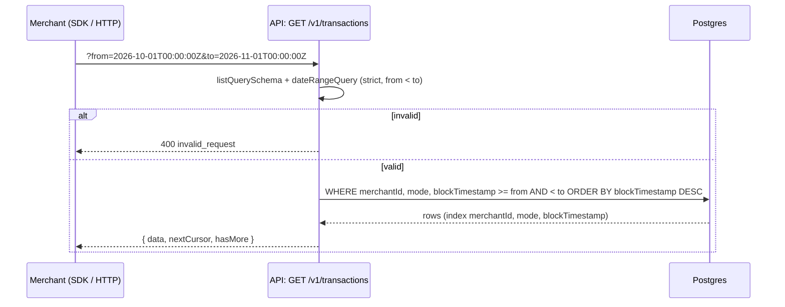

# ADR: `from` / `to` date range on transaction and agent activity lists

- **Status:** Accepted 2026-10-21
- **Date:** 2026-10-21
- **Issue:** #333
- **Scope:**
  - **Changes:**
    - API: two list routes accept `from` and `to`;
    - Prisma: one index-only migration;
    - `@strimz/sdk`: JSDoc only, with a patch changeset;
    - docs.
  - **Unchanged:** contracts, the indexer, the scheduler, webhook and BullMQ payloads, response shapes, and every other list route.

## Context

`@strimz/sdk` declares `from?: string` and `to?: string` on two list methods:

- `transactions.list` (`packages/sdk/src/resources/transactions.ts`);
- `agents.listActivity` (`packages/sdk/src/resources/agents.ts`).

Both routes validate their query with the shared `listQuerySchema`. That schema is `.strict()` and has no date fields. So this compiles, then fails with **400 `invalid_request`**:

```ts
await strimz.transactions.list({ from: '2026-10-01T00:00:00Z' })
```

The `sdk-route-parity` e2e test checks routes, not query parameters, which is why it stayed green.

The data is already there:

- **Transactions** have `blockTimestamp`, the time of the block the payment landed in. Lists already sort by it (`desc`).
- **Agent activity** rows have `createdAt`. That list sorts by it, and there's an index on `[merchantId, createdAt]`.
- **Transaction indexes:** there are `[merchantId, kind, blockTimestamp]` and `[merchantId, mode, status, blockTimestamp]`, but none on `[merchantId, mode, blockTimestamp]`. That is the shape of an unfiltered list, which is the common case for a date range.

The main use is reconciliation: "give me everything that settled in October".

## Decision

1. **Query fields.** The two routes accept `from` and `to`. Both are optional ISO-8601 timestamps with a time-zone offset, using the existing `isoTimestampSchema` from `@strimz/shared-types`. Examples: `2026-10-01T00:00:00Z` and `2026-10-01T00:00:00+01:00`.
   - **Half-open range:** `from` is inclusive (`>=`) and `to` is exclusive (`<`). So months chain without overlap: `from=2026-10-01T00:00:00Z&to=2026-11-01T00:00:00Z`.
   - **Order:** if both are given, `from` must be before `to`. Otherwise the route answers 400 `invalid_request`, and the error names `to`.
   - **Rejected:** a date without a time (`2026-10-01`) or without an offset. A bare date has no time zone, and guessing UTC would quietly move the boundary for anyone east or west of it.
2. **Schema placement.** A new `dateRangeQuery` in `apps/api/src/common/schemas/list-query.ts`:
   - each of the two routes uses `listQuerySchema.extend(dateRangeQuery).superRefine(order check)`;
   - `listQuerySchema` itself doesn't change, so every other list route still refuses `from` and `to` (400) rather than ignoring them.
3. **Filtered column.**
   - **Transactions:** `blockTimestamp`, the on-chain settlement time and the column the list already sorts by.
   - **Agent activity:** `createdAt`.
4. **Index.** Prisma `Transaction @@index([merchantId, mode, blockTimestamp])`, in migration `20261021120000_transaction_time_index` (CREATE INDEX only). It serves the date-ranged list and the plain list, which sorts by that column.
5. **Pagination.** `from` and `to` combine with the existing filters and with `cursor`. A caller keeps the same `from` and `to` while following `nextCursor`, as with the other filters.
6. **SDK.** The parameter types stay `string`. Each field gets a one-line JSDoc giving the format and the inclusive/exclusive rule. A patch changeset says the filters now work.
7. **Docs.**
   - `dashboard/transactions.mdx` gets a short "From the API" line with the month example;
   - the OpenAPI spec picks the fields up from the zod schema.

## Diagram



## Consequences

- **What the SDK promises now works,** with no breaking type change.
- **Reconciliation by period** is one call plus pagination.
- **One more index on `Transaction`.** It adds a little write cost on a table that grows only by settled payments.
- **Timestamps must carry a time zone.** Callers who pass bare dates get a clear 400 instead of a silent UTC guess.

## Alternatives considered

- **Remove `from` and `to` from the SDK (option B in #333).** Smaller, but merchants lose a filter they need for reconciliation. Not chosen by the maintainer.
- **Add `from` and `to` to the shared `listQuerySchema`.** Every list route would then accept them, and most would silently ignore them. Rejected: only routes that implement the filter accept it.
- **Inclusive `to` (`<=`).** Month ranges would need `23:59:59.999` and could double-count a boundary row. Rejected in favour of half-open.
- **Filter transactions on `createdAt`.** That's when Strimz recorded the row, which can trail the block. `blockTimestamp` is the settlement time and the sort key. Rejected.
- **Accept bare dates as UTC.** Rejected: see Decision 1.

## Verification

- **Red-green tests:**
  - **API e2e** (`transaction-filters`, plus a new agent activity date case):
    - rows inside and outside the range;
    - `from` inclusive and `to` exclusive at the exact boundary;
    - only `from` or only `to`;
    - date range combined with `kind` / `customerId` and with `cursor`;
    - another merchant's rows never appear;
    - 400 for `from >= to`, a bare date, garbage, and `from` on an unrelated list route such as `/v1/refunds`.
  - **SDK:** `transactions.list({ from, to })` and `agents.listActivity({ from, to })` send both in the query string.
  - **Migration:** `migrate deploy` on a scratch Postgres, then `migrate diff` against the schema shows no difference.
- **`./scripts/preflight.sh`** in full, plus the full API e2e suite.
