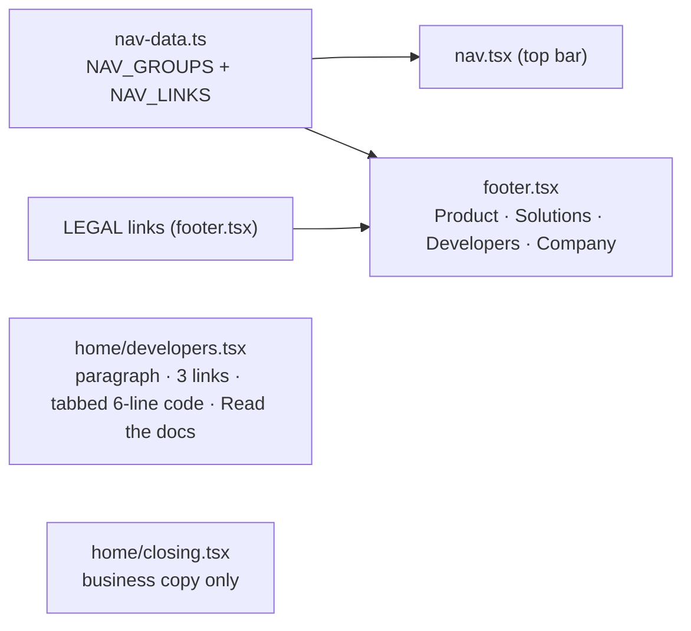

# ADR: One compact developer band, business-only closing CTA, fuller footer

- **Status:** Accepted 2026-10-22
- **Date:** 2026-10-22
- **Scope:** `apps/web` marketing only:
  - `home/developers.tsx`;
  - `home/closing.tsx`;
  - `footer.tsx` (shared by every marketing page);
  - `nav-data.ts` (read, not changed in shape).

  No API, contract or package change.

## Context

#279 wants the homepage to read as a business product, with developers served by one compact band.

**What exists today (measured at 1440 × 900):**

- **Developer band:** **983 px**, more than one screen. It has an eyebrow, a heading, a paragraph, three install cards with `pnpm add`/`curl` commands and copy buttons, a 3D typing-keyboard animation, and a tabbed editor with two 12–15 line files (`checkout.tsx`, `webhooks.ts`).
- **Closing CTA:** already business-facing: "Stop chasing payments. / Get paid in seconds.", **Start free** and **Talk to us**. Its paragraph lists "webhooks", which is developer language.
- **Footer:** the bottom line already reads "Built by the Strimz team". Its columns are Product (Pricing, Use cases, Documentation, API reference), Company and Legal. There are no Solutions or Developers columns, and developer links sit under Product.
- **Nav (#271):** `nav-data.ts` already holds the Product, Solutions, Developers and Company groups.

## Decision

1. **Developer band, compact** (target: well under one screen, about 600 px at 1440 × 900):
   - Keep the eyebrow "For your developer" and the heading "One API. Three ways in."
   - One short paragraph: "Add a pay button to your app, call the server SDK, or generate a client from the OpenAPI file. Every webhook is signed."
   - **Three small links** instead of the install cards:
     - **Server SDK** → `/docs/sdks/server`;
     - **React pay button** → `/docs/sdks/react`;
     - **OpenAPI** → `/docs/api/overview`.
   - **One tabbed code card** with two short tabs of about 6 lines each, `checkout.tsx` (the pay button) and `webhooks.ts` (verify the signature), with copy buttons. Nothing scrolls inside the card.
   - **Read the docs** stays.
   - **Remove the typing-keyboard animation**, with `fx/typing-keyboard.tsx` and its `--tk-*` / `.tk-*` CSS, since nothing else uses them. It is the biggest single block in the band, and its line `+49.00 USDC to your wallet` is a developer-facing demo.
   - The entrance (rise-in on scroll, once) stays, and reduced motion is respected as today.
2. **Closing CTA:** keep the heading and buttons, which already speak to the business buyer. Change the paragraph to "Start free with payments, subscriptions, refunds and invoices. No monthly fee, and nothing to pay on your first $1,000."
   - "Talk to us" is kept rather than the issue's "Talk to sales", because there is no sales team to promise.
   - Recipe 12 (click → success) is not added: this CTA navigates, and there is no success moment to celebrate.
3. **Footer columns:** built from `nav-data.ts`, so the nav and footer can't disagree. Each column lists link labels only, no descriptions.
   - **Product:** the nav's Product items, plus Pricing.
   - **Solutions:** the five use cases, plus All use cases.
   - **Developers:** Documentation, Quickstart, SDKs, API reference, Webhooks, plus GitHub (external).
   - **Company:** About, Contact.
   - **Legal:** unchanged.
   - **Layout:** the brand block and socials sit on the left, with the five columns at `lg`, three at `sm` and two on phones. The motion (rule draw, column rise, wordmark) is unchanged.
4. **Copy rules:** no "Sample"/"Live" labels, no network name, no comparisons. The closing CTA has no developer-only words (webhook, API, SDK, code), and a test enforces it.

## Diagram

## Consequences

- The homepage loses about 400 px of developer content, and the business story runs straight from pricing to the close.
- **The keyboard animation goes.** It was one of the more striking cinematic pieces, but it only tells a developer story. If you want to keep it, the alternative is to keep it at about 60% size beside the code card, which still fits in one screen. Say so when approving.
- The footer gets longer, but every link now sits under a heading a business reader expects. Adding a nav item also adds it to the footer.

## Alternatives considered

- **Keep the install cards and shrink them.** Install commands are developer-only and duplicate the docs.
- **Move the developer band off the homepage entirely.** The issue keeps one band for the second reader, the developer.
- **A separate footer link list.** It would drift from the nav.

## Verification

- Red first. `dev-band-footer.test.ts` asserts:
  - the band has no `pnpm add`/`curl` install commands and no `TypingKeyboard`;
  - each code tab is at most 8 lines;
  - the three links point to docs pages that exist in `content/docs`;
  - the closing copy has no developer-only words;
  - the footer has Product, Solutions, Developers, Company and Legal columns, built from `NAV_GROUPS`, and every internal link resolves.
- Browser:
  - the developer band measures ≤ 900 px at 1440 × 900;
  - light and dark at 1440 and 375;
  - the footer is checked on every marketing page (home, use cases, pricing, about, contact, legal, login, signup).
- `./scripts/preflight.sh` passes in full.
