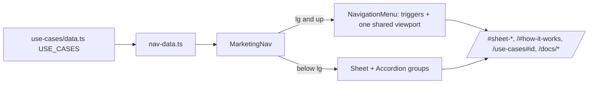

# ADR: Marketing nav with Product, Solutions, Developers and Company menus

- **Status:** Accepted 2026-10-22
- **Date:** 2026-10-22
- **Scope:**
  - Web, marketing surface only:
    - `apps/web/src/components/marketing/nav.tsx`;
    - a new `nav-data.ts` next to it;
    - a new `NavigationMenu` wrapper in `@strimz/ui`.
  - No change to the footer (#279), the dashboard, the checkout or the docs layout.

## Context

- The nav is five flat links: About, Pricing, Use cases, Docs, Contact. On the right are Sign in, the theme toggle and **Get started**.
  - A visitor can't see from the nav what Strimz does, or that there's a page per business type.
  - The hero, pricing and closing all say **Start free**, but the nav says **Get started**.
- What the menus can link to today:
  - **Homepage anchors:**
    - `#product`, plus one per Billing tools sheet: `#sheet-subscriptions`, `#sheet-recovery`, `#sheet-refunds`, `#sheet-invoices`, `#sheet-analytics`;
    - `#how-it-works`, `#developers` and `#pricing`.
    - Sections already use `scroll-mt-20` so the sticky nav doesn't cover them. The sheets don't use it yet.
  - **Use cases:** `/use-cases#saas`, `#marketplaces`, `#creators`, `#agencies`, `#global-b2b`, from `USE_CASES` in `use-cases/data.ts`.
  - **Docs:** `/docs`, `/docs/quickstart`, `/docs/sdks`, `/docs/api/overview`, `/docs/webhooks`.
- The current nav already uses Vengeance UI's Spotlight hover, the scroll-shrink pill and the Sheet for phones. These stay.
- `@strimz/ui` has Radix dropdown, accordion and dialog, but no navigation menu.
- **Hidden features stay out:** agent escrow and CCTP (#145). The nav also leaves the network name out (#349).

## Decision

1. **Desktop layout (from `lg`):**
   - Logo on the left.
   - Menus in the middle: **Product ▾**, **Solutions ▾**, **Pricing**, **Developers ▾**, **Company ▾**.
   - On the right: **Sign in** (text), the theme toggle and **Start free** (primary, `/signup`).
2. **Accessible menus.** Built on `@radix-ui/react-navigation-menu` 1.2.22, the stable line released July 2026, rather than the 1.3/1.4 releases from this month.
   - It gives the disclosure pattern: Enter and Space open a menu, arrow keys move between triggers, Escape closes and returns focus, and focus never gets trapped.
   - Menus open on hover with Radix's delay, and on click or keyboard.
   - Wrapped as `NavigationMenu*` in `@strimz/ui`, following the shadcn shape of the other wrappers.
3. **Motion: one shared panel.** All menus open into a single panel under the nav.
   - The panel resizes between menus (Radix's viewport size variables, 250 ms with the site easing).
   - The content slides in from the side you moved from, and a small caret follows the active trigger.
   - The Spotlight glow stays on the triggers.
   - With reduced motion, the panel swaps instantly with no slide or resize.
4. **Menu content.** Every item has a Solar icon, a name and one plain line, all defined in `nav-data.ts`.
   - **Product:** links to homepage anchors.
     - Subscriptions, Payment recovery, Refunds, Invoices and Analytics go to `/#sheet-<key>`.
     - Payment links and checkout goes to `/#how-it-works`.
     - Storefront goes to `/use-cases#creators`.
     - The panel also has one tile, "From link to paid in four steps", linking to `/#how-it-works`.
   - **Solutions:** the five audiences read from `USE_CASES` (label and an existing line), plus "All use cases".
   - **Developers:** Documentation, Quickstart, SDKs, API reference, Webhooks.
   - **Company:** About, Contact.
5. **Phones and tablets (below `lg`).** The Sheet keeps its large type, and the four menus become accordions (the Radix accordion already in `@strimz/ui`).
   - Pricing and Sign in are plain links.
   - **Start free** sits at the bottom.
   - Choosing a link closes the sheet.
6. **Anchors.** The Billing tools sheets get `scroll-mt-24`, so a menu jump lands below the sticky nav.
7. **One source of truth.** `nav-data.ts` is the only place nav links are defined, so #279's footer can reuse it.
8. **States.**
   - **Active:** the current route is marked with `aria-current="page"` (Pricing, and the Solutions and Company pages).
   - **Focus:** every item has a visible ring.
   - **Theme:** the panel uses theme tokens, so it follows the light/dark toggle.

## Diagram

## Consequences

- Visitors can browse what Strimz does and who it serves from any page. Returning merchants get a clear Sign in.
- One new dependency, about 10 kB gzipped, loaded only on marketing pages.
- Product items jump to homepage sections until dedicated product pages exist. When those pages land, only `nav-data.ts` changes.
- **Get started** becomes **Start free** in the nav. Tests that look for the old label are updated.

## Alternatives considered

- **Hand-written dropdowns.** No dependency, but focus handling and keyboard behaviour are easy to get wrong. Radix is already how the rest of `@strimz/ui` is built.
- **Radix navigation-menu 1.4.1.** Released 10 days ago, so too new for launch.
- **A separate dropdown per menu instead of one shared panel.** Simpler, but the resizing shared panel is the one motion moment of the nav. It reads as one surface, not five popups.
- **A product page per feature first.** Larger scope than #271. Anchors work now.

## Verification

- **Tests written first (source checks plus data):**
  - every `nav-data.ts` link resolves: homepage anchors exist as `id`s in the home sections, use-case ids exist in `USE_CASES`, and docs paths exist under `content/docs`;
  - the nav uses `NavigationMenu`, offers Sign in and **Start free**, and has no Get started;
  - no hidden feature (escrow, CCTP, cross-chain) and no "Arc" appears in the nav data;
  - the mobile sheet uses the accordion.
- **By hand in Chrome:**
  - 1440, 1024, 768 and 390 px, light and dark;
  - keyboard only: Tab, Enter, arrows, Escape;
  - with reduced motion;
  - every link lands on its section below the nav;
  - check the other marketing pages that share the nav (pricing, use cases, about, contact, legal) and the docs header.
- **`./scripts/preflight.sh`** passes in full.
