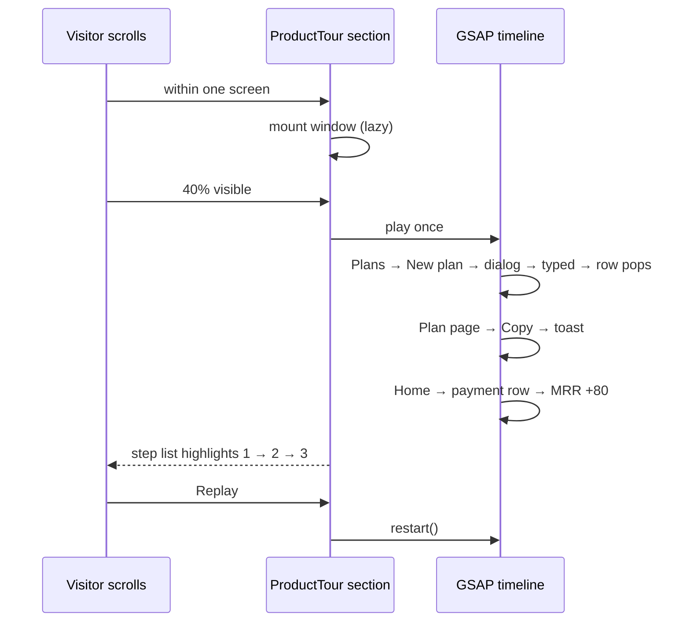

# ADR: Cursor product tour on the homepage

- **Status:** Accepted 2026-10-22
- **Date:** 2026-10-22
- **Scope:** `apps/web` marketing homepage only. The dashboard isn't changed, and the tour doesn't import dashboard components. No API, contract or package change.

## Context

The homepage never shows the dashboard a merchant will use. "How it works" explains the four steps with small illustrations, and the hero mock is a single card.

#276 asks for a tour: a simplified render of the dashboard in which a cursor creates a plan, copies its link, and a payment then appears and monthly recurring revenue goes up. It should use recipe 07 _Cursor tour_ (curved cursor paths, click ripples, an auto-zoom of about 1.4× around each action), play once on scroll with a replay button, be lazy-mounted and `aria-hidden`, and have a text summary beside it.

The real flow in the dashboard (checked in the code):

- **Sidebar:** groups "Overview" (Home, Analytics), "Payments" (Payment links, Transactions, Plans, Subscriptions, …), "Customers" and "Configuration".
- **Plans page:** a **New plan** button opens the "New subscription plan" dialog, with **Plan name (required) \***, **Price (required) \***, **Currency (required) \*** (USDC/EURC) and **Interval (required) \***, then **Create plan**.
- **Plan page:** a **Sign-up link** with a Copy button and the toast "Sign-up link copied". The issue says "checkout link"; the tour uses the dashboard's real name.
- **Home:** KPI cards, the first being **Monthly recurring revenue**.

The issue asks for a "demo" label. The maintainer's later rule (#356) overrides that: no "Sample" or "Live" labels on public pages.

## Decision

1. **New `home/product-tour.tsx`**, placed right after "How it works" in `app/(marketing)/page.tsx`, with its own `SectionBoundary` ("product tour").
   - Heading "See it in your dashboard".
   - Left: an ordered list of the steps as plain text, server-rendered (the steps really are a sequence, so they're numbered). The step being played is highlighted.
   - Right: the tour window and a **Replay** button.
2. **The window** is a simplified, hand-built copy of the dashboard using the same tokens (`bg-muted` sidebar, `bg-card` cards, `border-border`, accent green, Sora/Poppins). It is drawn at a fixed 960 × 600 design size and scaled to fit its column, so it keeps the dashboard's proportions down to 375 px. It doesn't import dashboard components, which fetch data and route.
3. **Script** (one GSAP timeline, about 14 s; durations are tuned in the browser):
   1. **Plans page:** one existing plan row. The cursor glides to **New plan** and clicks, with a press and a ripple.
   2. **Dialog** "New subscription plan" springs open. The cursor clicks Plan name and types "Team" with a caret, then clicks Price and types "80.00". Currency USDC and Interval Monthly are already set. It clicks **Create plan**, the dialog closes and a "Team · 80 USDC / month" row pops in with an accent ring.
   3. **Plan page:** the cursor clicks **Copy** beside the Sign-up link, and a "Sign-up link copied" toast appears.
   4. **Home:** the cursor moves to **Home** in the sidebar. A "Payment received · Team · 80.00 USDC" row slides into Recent activity, and the Monthly recurring revenue card counts up by 80 USDC (tabular numbers).
   - The camera eases in to about 1.4× around each action and back out, clamped inside the window. Movement is about 30% slower than the recipe, for a payments audience.
4. **Playback:**
   - The scene mounts when the section comes within one screen of the viewport.
   - It plays once when 40% of it is visible, and **Replay** restarts it.
   - It pauses while the tab is hidden.
   - Under `prefers-reduced-motion` it shows the final frame (Home with the payment and the higher MRR), with no cursor, camera or replay.
5. **Accessibility:** the window is `aria-hidden` and not focusable. Replay is a real button with a visible focus ring. The step list carries the meaning.
6. **Copy rules:**
   - No "Sample", "Demo" or "Live" labels, and no network name.
   - Plan names and amounts are generic ("Starter", "Team"). There are no customer names, logos or volume claims beyond the scene's own small numbers.
   - The light/dark toggle restyles the window through tokens.
7. **Step list copy:**
   1. **Create a plan.** Give it a name and a price, like Team at 80 USDC a month.
   2. **Copy its sign-up link.** Send it to customers or put it on your site.
   3. **Watch payments arrive.** Each one shows in your dashboard, and monthly recurring revenue updates.

## Diagram

## Consequences

- Visitors see the real shape of the dashboard before signing up.
- The tour is a hand-built copy, so a dashboard redesign needs a matching update here. The test pins the labels it copies ("New subscription plan", "Sign-up link copied", "Monthly recurring revenue") to the dashboard source, so a rename there fails the test.
- It adds one client component, which mounts lazily, so the first load isn't affected.

## Alternatives considered

- **Screenshots or a video.** They go stale silently, don't follow the light/dark toggle, and a video is heavy.
- **Rendering the real dashboard components.** They need the API, auth and router, and would ship dashboard code to the homepage.
- **framer-motion.** It's used in the dashboard, but the homepage sequences use GSAP (`MOTION_OK`, `PLAY_ONCE`). One timeline with labels suits a scripted tour better.

## Verification

- Red first: `product-tour.test.ts` asserts:
  - the section is on the homepage after `HowItWorks`;
  - the scene is `aria-hidden`;
  - the copied labels still exist in the dashboard source;
  - the step list has three steps;
  - there's no "Sample"/"Demo"/"Live" text.
- The existing marketing guards stay green.
- Browser:
  - light and dark at 1440 and 375;
  - the whole tour plays once on scroll, and Replay replays it;
  - reduced motion shows the final frame with no Replay;
  - the page shows no console errors.
- `./scripts/preflight.sh` passes in full.
