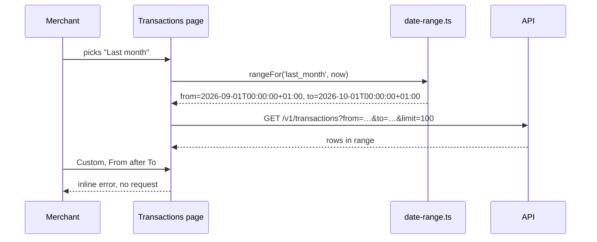

# ADR: Date range filter on the dashboard Transactions page

- **Status:** Accepted 2026-10-22
- **Date:** 2026-10-22
- **Scope:**
  - Web: the Transactions page (`apps/web/src/app/(dashboard)/app/transactions/page.tsx`) and a new pure helper `apps/web/src/lib/date-range.ts`.
  - No change to the API, the SDK, shared types, the schema or any other list page.

## Context

- Since #333, `GET /v1/transactions` accepts `from` (inclusive) and `to` (exclusive), both ISO-8601 with a time-zone offset. `from >= to` answers 400 (`docs/adr/ADR-2026-10-21-list-date-range.md`).
- `@strimz/sdk` already types both on `transactions.list`, and `useTransactionPages` passes its params straight through. So the page only has to send them.
- The page filters by kind and status with chip rows in the `DataTable` toolbar. The filters live in React state, not the URL.
- **Export CSV** writes the rows already loaded (`data.rows`). Whatever the list query returns is what gets exported.
- When the list is empty, the page always shows the first-run copy "No transactions yet" with "Create a payment link", even when a filter is what emptied it.
- `@strimz/ui` has no date picker or popover. `date-fns` 4 is already a web dependency.

## Decision

1. **Control.** A third chip row in the toolbar: **Any time** (default), **Last 7 days**, **This month**, **Last month**, **Custom**.
   - **Custom** opens two native date inputs underneath: **From (optional)** and **To (optional)**. The **To** day is included.
   - A short line under the inputs says the dates use the merchant's time zone and names it, for example "Dates are in your time zone (Africa/Lagos)." The zone comes from `Intl.DateTimeFormat().resolvedOptions().timeZone`.
   - The inputs set `color-scheme` from the theme, so the browser's calendar matches light and dark.
2. **Range helper.** `lib/date-range.ts` turns a pick into `{ from?, to? }` and is pure, with `now` passed in.
   - Days start at local midnight. Timestamps are written with `formatISO` from `date-fns`, which keeps the local offset (`2026-10-01T00:00:00+01:00`).
   - `to` is local midnight at the start of the day after the last day picked, so that day is included.
   - **Last 7 days** is today and the 6 days before it. **This month** runs from the 1st to the start of tomorrow. **Last month** is the whole previous month.
   - DST days are handled by building dates from local calendar fields, not by adding 24 hours.
3. **Invalid range.** If the custom **From** day is after **To**, the inputs show an error, "From must be on or before To", and the page keeps showing the last valid result. No request is sent, so the API's 400 is never reached from the UI.
4. **Empty states.**
   - With no filter set, the first-run copy stays as it is.
   - With any filter set (kind, status or dates), the empty state says "No transactions match these filters" and offers **Clear filters**, which resets all three.
5. **Loading.** Changing the range starts a new query key, so the table shows its skeleton rows as it does for kind and status today.
6. **Export.** The export keeps using the loaded rows, so it follows the range with no change. When a range is set, the file is named after it, for example `transactions-2026-10-01-to-2026-10-31.csv`.
7. **Labels.** The two date inputs follow the form convention: `(optional)`.

## Diagram

## Consequences

- Merchants can reconcile a month on screen and export only that month.
- The range follows the browser's time zone. A merchant who travels sees ranges in their current zone. This is stated in the control.
- Native date inputs look slightly different in each browser. In return there's no new dependency and keyboard and screen-reader support comes from the browser.
- The filter isn't in the URL, so a reload resets it, as the kind and status filters do today.

## Alternatives considered

- **A calendar popover (react-day-picker and a Radix popover).** Better looking range selection, but it adds two dependencies and a new `@strimz/ui` component for one page. Can come later if more pages need dates.
- **Send bare dates and let the API pick the zone.** The API refuses bare dates on purpose (see the #333 ADR).
- **Inclusive `to` at 23:59:59.999.** The API's `to` is exclusive. Sending the next midnight matches it exactly.
- **Filters in the URL query.** Useful for sharing a view, but none of the dashboard lists do it today. It would be a separate change across all of them.

## Verification

- **Unit tests for `date-range.ts`, written first:**
  - each preset for a fixed `now`, including the 1st of a month, January (last month is the previous December) and a DST change day;
  - a custom range with both days, only From, and only To;
  - `to` is the next local midnight;
  - From after To is reported as invalid.
- **Page tests:**
  - picking a preset calls `useTransactionPages` with `from` and `to`;
  - an invalid custom range shows the error and doesn't change the query;
  - the filtered empty state appears with **Clear filters**, and that button resets the filters;
  - the export file name carries the range.
- **By hand, light and dark, at desktop and phone width:** each preset, a custom range, an invalid range, an empty range, the export.
- **`./scripts/preflight.sh`** passes in full.
