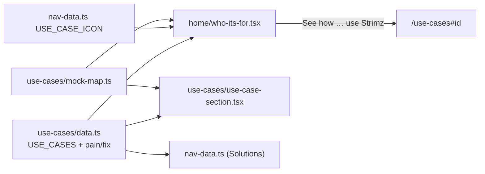

# ADR: "Who it's for" section on the homepage

- **Status:** Accepted 2026-10-22
- **Date:** 2026-10-22
- **Scope:** `apps/web` marketing homepage only. The use-cases page and nav are reused, not changed. No API, contract or package change.

## Context

Under the hero, `home/sectors.tsx` shows "Built for businesses that bill online" with two marquees of eight chips (SaaS billing, Marketplace fees, …). The chips name a sector but say nothing about why it should care. The marquee loops forever and is the only user of `fx/marquee.tsx` and the `marquee` keyframes.

The use-cases page already defines five audiences in `use-cases/data.ts` (`USE_CASES`: saas, marketplaces, creators, agencies, global-b2b). Each has an anchor `/use-cases#<id>`, a mock illustration and real features. The nav's Solutions menu reads the same list and icons.

#273 asks for a "Who it's for" section: one concrete pain and one concrete Strimz feature per audience, each linking to its use-case story, with a cross-fade tab switch and no marquee.

## Decision

1. **One source.** Add `pain` and `fix` (one sentence each) to every `UseCase` in `use-cases/data.ts`. The homepage section and any later surface read them from there. The five audiences match the issue; there is no DAO entry.
2. **New `home/who-its-for.tsx`** replaces `home/sectors.tsx` in `app/(marketing)/page.tsx`. Its `SectionBoundary` name changes from "industries" to "who it's for".
   - Heading "Who it's for", one subline.
   - Left: a tab list of the five audiences with the nav's icons (`USE_CASE_ICON`, exported from `nav-data.ts`).
   - Right: the active panel shows the audience's title, **The problem** (`pain`), **With Strimz** (`fix`), the same mock the use-cases page shows for it, and the link "See how <label> use Strimz" to `/use-cases#<id>`.
   - On phones, the tabs are a horizontally scrolling row above the panel.
3. **Accessible tabs.** Uses the existing `@strimz/ui` `Tabs` (Radix), so arrow keys, Home/End and roles come for free. Every panel is rendered (`forceMount`), and inactive ones are hidden, so the link text is in the server HTML.
4. **Motion.** The section rises in once on scroll with the shared `RiseIn`. Switching tabs cross-fades the panel (opacity and a small lift, about 300 ms, CSS only). Under reduced motion the switch is instant and nothing rises.
5. **Mock map shared.** The `MockKind → component` map moves out of `use-case-section.tsx` into `use-cases/mock-map.ts`, so both surfaces show the same illustration.
6. **Remove the marquee.** Delete `sectors.tsx`, `fx/marquee.tsx`, the `marquee` keyframes, the `--animate-marquee*` theme entries and their reduced-motion rule.
7. **Copy rules.** No "Sample"/"Live" labels, no network name, no comparison with other processors, and every claim maps to a feature that ships today.

| Audience     | The problem                                                       | With Strimz                                                                                    |
| ------------ | ----------------------------------------------------------------- | ---------------------------------------------------------------------------------------------- |
| SaaS         | Renewals depend on customers remembering to pay.                  | Customers approve a plan once. Strimz charges each renewal and retries the ones that fail.     |
| Marketplaces | Your order system has to find out when a buyer has paid.          | A checkout for each order, and a signed webhook the moment it's paid.                          |
| Creators     | Memberships, products and payment links live in different places. | One storefront for memberships and products, plus links you can post anywhere.                 |
| Agencies     | Invoices and retainers mean chasing clients to pay.               | Invoices arrive with a Pay button, and retainers charge themselves after one approval.         |
| Global B2B   | Clients in other countries need a way to pay you in one currency. | Bill in USDC or EURC. It settles straight to your wallet, and your client pays no network fee. |

## Diagram

## Consequences

- One list drives the nav, the homepage and the use-cases page, so an audience can't be added in one place and missed in another.
- The section is taller than the chip row. It replaces filler with content, so the trade is intended.
- The use-cases mocks now also render on the homepage, so a change to one shows in both places.

## Alternatives considered

- **Five cards in a grid.** Simpler, but five mocks side by side are too dense, and it reads as the generic card kit. Tabs keep one mock in view.
- **Keep the chips and add a sentence to each.** Still a marquee, and moving text is hard to read.
- **Copy kept in the component.** Faster, but it would drift from the use-cases page.

## Verification

- Red first: `who-its-for.test.ts` asserts every `USE_CASES` entry has `pain` and `fix`, the homepage no longer imports `Sectors` or `Marquee`, `fx/marquee.tsx` is gone, and each panel links to `/use-cases#<id>` for an id that exists.
- The existing guards (`marketing-no-sample-labels`, `marketing-network-name`) stay green.
- Browser: the homepage in light and dark at desktop and phone width. Click and arrow-key through all five tabs, follow each link to its anchor, and check that reduced motion switches instantly. Also sweep `/use-cases` (its mock import moved) and the other marketing pages.
- `./scripts/preflight.sh` passes in full.
