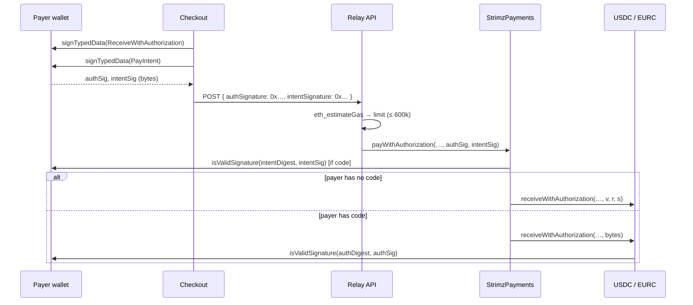

# ADR: Accept smart-contract wallet (ERC-1271) payers

- **Status:** Accepted 2026-10-23
- **Date:** 2026-10-23
- **Issue:** #287 (split out of #153, [ADR-2026-10-16-checkout-results-to-merchant-page](ADR-2026-10-16-checkout-results-to-merchant-page.md), decision 7)
- **Scope:** this change ships `StrimzPayments`, `StrimzSubscriptions` and their interfaces, `IERC3009` and `IERC2612`, a `PayerSignature` library, tests and `script/e2e.sh`. The API relay (DTO, ABI, gas limit) and the pay and subscribe checkouts switch with the #142 redeploy, like the 2026-10-03 intent-nonce change: the live testnet contracts still take `{v, r, s}`, so switching them now would break checkout. The BullMQ relay job carries calldata only, so its schema does not change. No Prisma, webhook or SDK change.

## Context

A payer whose wallet is a contract (Safe, most smart wallets) can't pay today:

- **Strimz intents:** both contracts check the payer's intent with `ECDSA.recover(digest, v, r, s)` and compare the result with the payer (`StrimzPayments._verifyPayIntent`, `StrimzSubscriptions._verifySubscriptionIntent`). A contract has no key, so nothing recovers to it.
- **Token signatures:** the contracts call the `(uint8 v, bytes32 r, bytes32 s)` overloads of `receiveWithAuthorization` and `permit`, and the relay API only accepts `{v, r, s}`. A contract wallet's signature is arbitrary `bytes` (a Safe signature is 65 bytes per owner, or empty when the hash is approved on-chain).
- **Checkout:** since #153 the pay page reads the payer's code and shows "Smart-contract wallets cannot pay here yet." The subscribe page has no such check, so a contract wallet gets a failed relay instead.

### What the Arc tokens accept (fork test against Arc testnet, 2026-10-23)

I deployed a minimal ERC-1271 wallet on a fork of Arc testnet. Its `isValidSignature` accepts its owner key's signature. Then I called the tokens' `bytes signature` overloads (FiatToken v2.2):

| Token                        | `version()` | `receiveWithAuthorization(..., bytes)` | `permit(..., bytes)` |
| ---------------------------- | ----------- | -------------------------------------- | -------------------- |
| USDC `0x3600…0000`           | 2           | moved 1 USDC from the wallet           | allowance set        |
| EURC `0x89B5…D72a` (testnet) | 2           | accepted (zero value, wallet unfunded) | allowance set        |

I also tested an EIP-7702 account whose delegate has no `isValidSignature`. The token rejects its signature on **both** overloads ("FiatTokenV2: invalid signature"), because FiatToken treats any account with code as a contract. So 7702 payers work today only when their delegate implements ERC-1271 (MetaMask's does), and that is unchanged by this ADR. OpenZeppelin's `SignatureChecker` makes the same choice: no code means ECDSA, code means ERC-1271.

## Decision

1. **Signatures become `bytes` in both contracts.** `IStrimzPayments.Sig` and `IStrimzSubscriptions.Sig` are removed. `payWithAuthorization` takes `bytes authSig, bytes intentSig`. `permitAndCreateSubscription` takes `bytes permitSig, bytes intentSig`. Function names, intent typehashes, digests, events and errors stay the same.

2. **Intents are checked by `PayerSignature.isValid(payer, digest, sig)`.** A payer with code is checked with OpenZeppelin's `SignatureChecker.isValidERC1271SignatureNowCalldata`, a `staticcall`, so a wallet can't re-enter. A payer without code must send 65 bytes, which are split as in decision 3 (including the `v` fix) and recovered with `ECDSA.tryRecover`. A failed check reverts with the existing `Payments__InvalidIntent` or `Subscriptions__InvalidIntent`. OpenZeppelin's own ECDSA branch would reject a `v` of 0 or 1, which the checkout fixes today.

3. **The token call depends on the payer's code:**
   - **No code (EOA):** the contract splits the 65-byte signature into `v, r, s`, adds 27 to a `v` of 0 or 1, and calls the same `v, r, s` overload as today. A signature of any other length reverts with `Payments__InvalidSignature` / `Subscriptions__InvalidSignature`. EOA payments behave exactly as before, and a whitelisted ERC-2612 token without the `bytes` overload keeps working for EOAs.
   - **Code (contract wallet or 7702 account):** the contract passes the bytes unchanged to the `bytes` overload, and the token runs ERC-1271. A wallet's own signature encoding (Safe uses `v` values 0, 1 and above 30) is never rewritten.
   - `IERC3009` and `IERC2612` gain the `bytes` overloads.

4. **The relay API accepts either shape** (ships with #142). `authSignature`, `permitSignature` and `intentSignature` accept the existing `{v, r, s}` object or a `0x` hex string of 0 to 4,096 bytes. The object is encoded as `r ‖ s ‖ v`. Merchant servers that send `{v, r, s}` keep working.

5. **Relay gas comes from an estimate** (ships with #142). An ERC-1271 check runs the wallet's code twice (intent and token), so a fixed limit can't cover every wallet. The relay's pre-flight `eth_call` becomes `eth_estimateGas`, still with the same revert decoding. The job's limit is `max(fixed limit, ceil(estimate × 1.3))`. An estimate above **600,000** gas is refused with `relay_gas_too_high` (400), so a wallet with an expensive `isValidSignature` can't make the relayer pay for it. Today a relay uses about 185,000 gas.

6. **Checkout sends the wallet's signature as is** (ships with #142). Both hooks post the raw hex from `signTypedData` instead of splitting it. The pay page drops the contract-wallet block: `isContractAccount`, the `unsupported_wallet` result and its copy are removed.

7. **Lands before the #142 testnet redeploy.** The two money contracts are immutable, so this needs a redeploy anyway. It goes into the #147 re-review scope with the rest of the frozen set. Decisions 4 to 6 join the "Ships with #142" list in the release note, next to the intent-nonce items.

## Consequences

- **Payers:** Safe and other ERC-1271 wallets can pay and subscribe. Subscription charges already use `transferFrom` with an allowance, which works for any wallet.
- **Multi-owner wallets:** a Safe with several owners needs each owner to approve both messages before the checkout gets the signatures. The token authorization still expires at `validBefore`. A slow approval means the payer signs again; nothing is charged.
- **Revocable signatures:** an ERC-1271 wallet can change its answer between the relay's estimate and the broadcast. Then the transaction reverts and the relayer pays for a failed transaction, as with any revert today. The nonce is not used, so the payer isn't charged.
- **Relay cost:** EOA relays keep the fixed limit unless the estimate is higher. Contract-wallet relays cost what they use, capped at 600,000 gas (about 0.012 USDC at 20 gwei).
- **ABI change:** both contracts get new ABIs and need the #142 redeploy. The indexer reads only events, which don't change.
- **Public API:** the relay endpoints accept a new hex form; the old form still works.

## Alternatives considered

- **Always use the `bytes` overloads.** This is simpler, but a whitelisted ERC-2612 token without that overload would stop working even for EOAs. Routing on code keeps the EOA path identical.
- **Normalise `v` in the checkout instead of the contract.** The checkout can't tell an EOA signature from a single-owner Safe signature, which is also 65 bytes, so rewriting `v` would break Safe's encoding. The contract knows whether the payer has code.
- **Keep the `Sig` struct and add separate `…WithBytes` functions.** This doubles the surface the auditors review and the relay maps, with no gain for EOAs.
- **Leave it until after mainnet.** Safe users would stay blocked at launch, and the contracts would need a second redeploy later.

## Verification plan

- **Contracts:**
  - New unit tests with a mock ERC-1271 wallet: pay and subscribe succeed; a wrong wallet signature reverts with `InvalidIntent`; a wallet that returns false for the token signature reverts in the token; an EOA with `v` 0/1 succeeds; an EOA signature of the wrong length reverts with `InvalidSignature`.
  - Existing EOA tests are updated to pass `bytes`.
  - Fork tests on Arc testnet USDC: an ERC-1271 wallet pays, and an ERC-1271 wallet subscribes and is charged.
- **API and web (with #142):** a unit test for the DTO union and its encoding, e2e tests for a hex-signature relay, the gas limit taken from the estimate, and `relay_gas_too_high`. Hook tests assert the raw hex is posted. The pay-page wiring test no longer expects the contract-wallet block.
- **Preflight** in full, including the fork suite.
