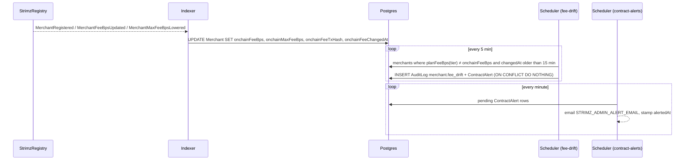

# ADR: Project the on-chain merchant fee and alert on drift from the plan

- **Status:** Accepted 2026-10-23
- **Date:** 2026-10-23
- **Scope:**
  - **Changes:** a Prisma migration on `Merchant`, and the Go indexer's registry projections. In `apps/scheduler`, a new `fee-drift` cron, and the contract-alert email learns one new action.
  - **No change:** contracts, the API, webhooks, the SDKs or the web app.

## Context

- **What the indexer writes today:**
  - `MerchantFeeBpsUpdated` goes only into an audit entry (`merchant.fee_bps_changed_onchain`), and `MerchantMaxFeeBpsLowered` only into a governance entry (`projector.go`, `projections.go`).
  - `MerchantRegistered` carries `feeBps` and `maxFeeBps`, but only the merchant id is linked.
  - Nothing stores the fee the chain charges, so a merchant whose registry fee no longer matches its plan goes unnoticed. ADR-2026-10-10-merchant-tier-control (D9) deferred this to #226.
- **What the plan fees are** (`@strimz/shared-config` `PLANS`): Free 0 bps, Starter 50, Growth 40. Enterprise has no fixed fee (`planFeeBps` returns `null`).
- **Who changes the fee, and in what order:**
  - **The scheduler's `plan-upgrade` cron:** it calls `setFeeBps` on-chain first, waits for the receipt, then moves `Merchant.tier`.
  - **The admin's `setMerchantTier`:** it reads the registry fee and records it, and its error text says the contract fee is set first.
  - **The gap:** in both paths the chain leads the database by seconds. A check made the moment the fee event arrives would raise a false alarm. For example, Starter → Growth: the chain says 40 while the row still says Starter (50).
- **Contract versions:**
  - **The removed `setMaxFeeBps`** (on the current testnet deployment until the #142 redeploy) emitted `MerchantFeeBpsUpdated` whenever lowering the ceiling also lowered the fee. So the fee event alone tracks the fee on both contract versions.
  - **The current contract** has no ceiling event after registration.
- **How operators get alerts today:** the indexer writes `AuditLog` plus `ContractAlert` rows, and the scheduler's `contract-alerts` cron emails `STRIMZ_ADMIN_ALERT_EMAIL` every minute and stamps `alertedAt`.
- **Why the comparison can't live in the indexer:** the plan table exists only in TypeScript, and copying it into Go would be a second source that drifts.

## Decision

1. **Migration:** add four nullable columns to `Merchant`:
   - `onchainFeeBps Int?`
   - `onchainMaxFeeBps Int?`
   - `onchainFeeTxHash String? @db.VarChar(66)`
   - `onchainFeeChangedAt DateTime?`, the **block time** of the last fee or ceiling event, so a replay doesn't reset it.
2. **Indexer projections** (absolute values, so a replay is idempotent):
   - **`MerchantRegistered`:** the existing link update also sets fee, ceiling, tx hash and time.
   - **`MerchantFeeBpsUpdated`:** sets fee, tx hash and time. The audit entry stays.
   - **`MerchantMaxFeeBpsLowered`** (old contract only): sets ceiling, tx hash and time. The governance entry stays.
   - **No matching row:** an event that matches no merchant logs a warning, like registration does today.
3. **The check: a new scheduler cron `fee-drift`, every 5 minutes, overridable with `FEE_DRIFT_CRON`.**
   - **It considers merchants where:**
     - `onchainFeeBps` is set;
     - the tier has a plan fee (not Enterprise);
     - `planFeeBps(tier) ≠ onchainFeeBps`;
     - `onchainFeeChangedAt` is more than 15 minutes old. That grace covers the seconds between the chain change and the tier change.
   - **Both directions alert:**
     - **Below the plan:** Strimz collects less than it should.
     - **Above the plan:** the merchant is charged more than their plan says.
4. **One alert per drift.** For each drifting merchant the cron writes:
   - an `AuditLog` row: action `merchant.fee_drift`, category `merchant`, target the merchant, with metadata `{ tier, planFeeBps, onchainFeeBps, direction, onchainMerchantId, transactionHash }`;
   - a `ContractAlert` row for the configured chain.

   The audit id is `fee-drift:<merchantId>:<tier>:<onchainFeeBps>:<changedAt epoch>`, inserted with `ON CONFLICT DO NOTHING`. So one drift emails once, and a new fee or tier change produces a new alert.

5. **Email:** the contract-alert email learns `merchant.fee_drift`.
   - **Title:** "Merchant fee differs from plan".
   - **Details:** merchant, plan and its fee, chain fee, and direction.
   - **Link:** the transaction that set the chain fee.
6. **Existing merchants:** their columns stay empty until their next fee event. The #142 redeploy re-registers every merchant, which fills them. Empty rows are skipped, never guessed.

## Diagram

## Consequences

- **Gained:**
  - A wrong fee is noticed within about 20 minutes, in either direction, through the alert email operators already get.
  - The row carries the chain's fee, which later work can show in the admin console or use instead of a live registry read.
- **Grace period:** a real drift is reported no sooner than 15 minutes after the chain change.
- **Enterprise:** not checked, because it has no plan fee to compare.
- **Shared email:** the `ContractAlert` table and email now carry one merchant-level action next to the contract-level ones. The name is kept rather than renamed, to avoid a migration of existing rows.

## Alternatives considered

- **Alert in the indexer when the event arrives:** wrong-footed by the chain-before-database order above, and it needs the plan table in Go.
- **Read the registry from the scheduler instead of projecting:** one RPC call per merchant every run, and it skips the projection the issue asks for.
- **Alert only below the plan (the issue's wording):** an overcharged merchant is at least as serious and costs one more comparison.
- **Backfill existing merchants from the chain now:** it adds a second writer to the columns. The #142 redeploy re-registers everyone anyway.

## Verification

- **Go tests (red first):**
  - registration, fee update and ceiling-lowered events each set the columns;
  - a replay leaves them unchanged;
  - an unknown merchant only warns.
- **Scheduler tests (red first):**
  - a drift below and a drift above each create one audit row and one alert;
  - a second run creates none;
  - a drift inside the 15-minute grace, Enterprise and an empty column create none;
  - a later fee change creates a new alert.
- **Contract-alerts test:** `merchant.fee_drift` renders with its title, details and tx link.
- **Migration** applies on a fresh database. **Preflight** passes in full.
