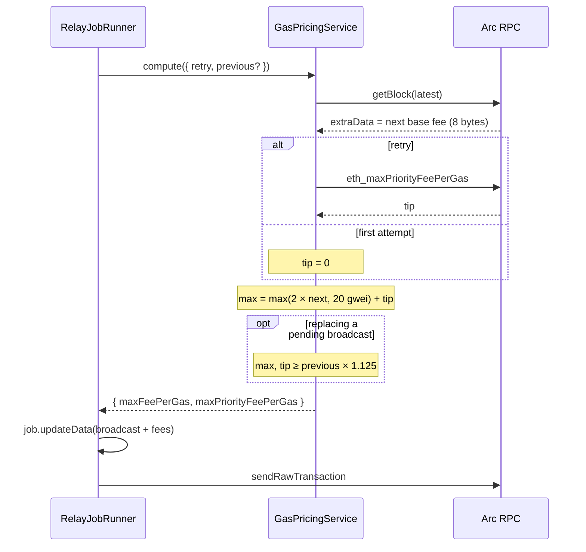

# ADR: Relay tip and fee headroom per Arc's fee guidance

- **Status:** Accepted 2026-10-23
- **Date:** 2026-10-23
- **Scope:** `apps/api` relay pricing (`GasPricingService`, `RelayJobRunner`) and the relay job's `broadcast` record in `@strimz/queue-contracts` (private package, optional fields only). No contract, Prisma, webhook or SDK change.

## Context

The relayer prices every transaction as follows. The tip is `1 + attemptsMade` gwei, and the max fee is `maxFeePerGas = max(2 × latestBaseFee + tip, 20 gwei + tip)` (`gas-pricing.service.ts`, `relay-job-runner.ts`).

Arc's docs ([stable fee design](https://docs.arc.io/arc/concepts/stable-fee-design), [gas and fees](https://docs.arc.io/arc/references/gas-and-fees), [EIP-3009 relayer](https://docs.arc.io/integrate/relayers-and-paymasters/eip-3009-relayer)) say:

- **Tip:** set `maxPriorityFeePerGas` to 0 for most transactions. Use a small tip only when load is high, and read `eth_maxPriorityFeePerGas` for a recommended value.
- **Who gets the fees:** the base fee is not burned, and base fee and tip both go to the block producer.
- **Base fee:** it follows an EWMA of block use and moves gradually. It has a protocol floor of 20 gwei and a ceiling of 20,000 gwei.
- **Next block's fee:** it is published in the parent header's `extra_data` as 8 bytes, big-endian. Relayers should read it there rather than derive it.
- **Execution client:** Arc runs on Reth. Reth's default `--txpool.pricebump` is **10%** (Reth CLI docs): a replacement with the same nonce must raise both the max fee and the tip by at least 10%, or the pool rejects it as underpriced. Arc does not document its own setting.

### What testnet shows (read 2026-10-23)

| Reading                          | Value                                                      |
| -------------------------------- | ---------------------------------------------------------- |
| Latest base fee                  | 20 gwei (`0x4a817c800`), flat across the last 1,024 blocks |
| `extra_data` of the latest block | `0x00000004a817c800` = 20 gwei                             |
| `eth_maxPriorityFeePerGas`       | 0.5 gwei                                                   |
| Block use (last 1,024 blocks)    | at most 15%                                                |

Our relayer (`0x8b9370663E68C247Eb1c7fE23e7ea321F146c121`) paid an effective 21 gwei on every relay, 20 base plus 1 tip:

| Tx                                                                   | Call                 | Gas used | Fee paid         | Fee at tip 0    |
| -------------------------------------------------------------------- | -------------------- | -------- | ---------------- | --------------- |
| `0x6418306716ac44486a43e9cf637718c1a2d727e465ff85096b8c9086ddc7b631` | payWithAuthorization | 185,361  | 0.003892581 USDC | 0.00370722 USDC |
| `0x4d328b9b2590614e51c9401a06b3b643e401965972a2494ce593edf71b251907` | payWithAuthorization | 185,341  | 0.003892161 USDC | 0.00370682 USDC |
| `0x387d96f80c402efb…`                                                | registerMerchant     | 84,420   | 0.00177282 USDC  | 0.0016884 USDC  |

So the tip is 4.8% of every relay's cost. The same relayer also sent retries at 4 and 5 gwei tips (`0xceabe0bc…`, `0x1874e54c…`). Both reverted, so the larger tip bought nothing.

### A defect found while reading the retry path

When a job retries and its recorded broadcast is still pending, the runner reuses the same nonce, which makes the retry a **replacement**. Today the max fee for a retry rises only by the extra 1 gwei of tip. At a 20 gwei base fee that is 41 → 42 gwei, about 2.4%, below Reth's 10%. The node rejects the replacement as underpriced, the attempt fails, and the job burns its retries until the original transaction lands or drops. The fees used for the original broadcast are not recorded, so the runner cannot price a proper bump.

## Decision

1. **Tip 0 on the first attempt.** `compute()` takes no default 1 gwei.
2. **Retries use Arc's recommended tip.** From the second attempt on, the tip is `eth_maxPriorityFeePerGas`, read at that moment.
3. **Price from the next block's base fee.** Read it from the latest header's `extra_data` (8-byte big-endian). If `extra_data` is not 8 bytes, throw with the block number: no silent fallback to `baseFeePerGas`. The 20,000 gwei ceiling check moves to this value.
4. **Keep 2× headroom.** `maxFeePerGas = max(2 × nextBaseFee, 20 gwei) + tip`. Headroom does not change what we pay, since only base fee plus tip is charged. It raises the balance the node checks: gas limit × max fee, which is 0.0112 USDC for a 280,000-gas payment. Arc publishes no EWMA rate to size a smaller margin against a 60-second wait (about 120 blocks).
5. **Record the fees we broadcast.** `relayBroadcastSchema` gains optional `maxFeePerGas` and `maxPriorityFeePerGas` (decimal strings, wei). The runner writes them with `txHash` and `nonce` before sending.
6. **Bump replacements by 12.5%.** When the runner reuses a recorded nonce and the record has fees, both new values are at least `ceil(previous × 1.125)`. 12.5% clears Reth's 10% with room for rounding. A record from before this change has no fees and is priced as a fresh transaction (today's behaviour).
7. **Log the fees** on each broadcast as today: max fee and tip in wei.

## Diagram

## Consequences

- **Cost:** each relay costs about 4.8% less at today's 20 gwei base fee, e.g. 0.000185 USDC saved on a payment.
- **Speed:** under real congestion a tip-0 first attempt may wait longer. The retry then adds Arc's recommended tip and can actually replace the pending transaction.
- **Rejections:** a retry that replaces a pending transaction is no longer rejected as underpriced.
- **Extra call:** one more RPC call (`eth_maxPriorityFeePerGas`) on retries only.
- **Job payload:** the `broadcast` record gains two optional fields. The relay processor is both producer and consumer; old in-flight jobs still parse.
- **Arc dependency:** if Arc changes the `extra_data` layout, relays stop with a clear error instead of mispricing.

## Alternatives considered

- **`eth_maxPriorityFeePerGas` on every attempt:** it reads 0.5 gwei on a 15%-full chain, which is other senders' tips, not need. Arc's docs say 0 for most transactions.
- **A smaller multiplier (1.25×):** it saves only node-checked balance, not money. A too-tight cap risks the stuck-and-replace path this ADR is fixing. Revisit if Arc publishes its EWMA rate.
- **Bump retries by attempt number only (no recorded fees):** if the base fee drops between attempts, the computed max can fall below the original, so the replacement still fails. Recording the fees makes the bump exact.
- **Keep `baseFeePerGas` of the latest block:** Arc's docs say to read `extra_data`, which is the value the next block will charge.

## Verification

- **Unit tests (`gas-pricing.test.ts`, red first):**
  - tip 0 on the first attempt;
  - retry tip from `eth_maxPriorityFeePerGas`;
  - pricing from `extra_data` and the 20 gwei floor;
  - malformed `extra_data` throws;
  - the over-ceiling base fee throws;
  - a replacement is at least 112.5% of the previous max fee and tip;
  - a falling base fee still yields a valid replacement.
- **Runner tests:** the broadcast record carries the fees; a retry with a pending recorded broadcast passes the previous fees to pricing; an old record without fees still runs.
- **Schema test:** `relayBroadcastSchema` accepts records with and without fees.
- **Preflight** in full.
- **After deploy (maintainer, testnet):** relay one payment and note the tx hash. Expect `maxPriorityFeePerGas` 0, `maxFeePerGas` 40 gwei, effective price 20 gwei, and inclusion within the 60-second wait.
