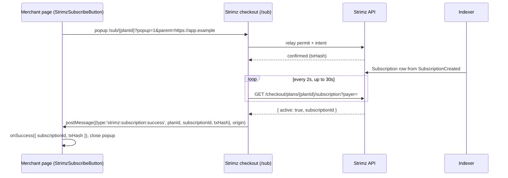

# ADR: Subscribe button, embed and return URLs for subscription plans

- **Status:** Accepted 2026-10-23
- **Date:** 2026-10-23
- **Issue:** #288 (split out of #153, [ADR-2026-10-16-checkout-results-to-merchant-page](ADR-2026-10-16-checkout-results-to-merchant-page.md), decision 8)
- **Scope:**
  - **Database:** a Prisma migration that adds two nullable columns to `SubscriptionPlan`.
  - **Shared types** (`@strimz/shared-types`, minor): plan schema, a plan update input and the subscription result message.
  - **API:** plan create accepts the URLs; new `PATCH /v1/subscription-plans/:id`.
  - **Server SDK** (`@strimz/sdk`, minor): `subscriptionPlans.update`.
  - **React SDK** (`@strimz/sdk-react`, minor): subscribe hook, button and embed.
  - **Web:** `/sub/[planId]` checkout, and the dashboard plan dialog and plan page.
  - **Docs.**
  - No contract, indexer, webhook or job payload change.

## Context

Checked against `main` at `6f8e451`.

1. **No SDK entry point for plans.** `@strimz/sdk-react` 0.3.8 opens `/pay/{sessionId}` only (`checkout-message.ts:checkoutUrl`). A merchant can link to `/sub/{planId}`, and nothing more.
2. **`/sub/[planId]` ignores its host.**
   - It doesn't read `embed`, `popup` or `parent`, and never calls `postMessage`.
   - Cancel shows the "Subscription cancelled" panel even when the page is embedded, and the embedding page is never told.
   - On success the payer stays on the Strimz receipt (`returnUrl={null}`, `hostMode="page"`).
3. **Plans have no return URLs.** `SubscriptionPlan` has no `successUrl` or `cancelUrl`. Plans can't be edited at all, apart from archiving.
4. **The subscription id comes later.** The indexer creates the `Subscription` row when it sees `SubscriptionCreated` (`UpsertSubscriptionFromOnchain`). The checkout's "confirmed" phase comes from the relay receipt. That's usually a few seconds earlier, so the id isn't known at that moment.
   - The public `GET /v1/checkout/plans/:id/subscription?payer=` (60 per minute per IP) already returns the payer's live subscription id for a plan.
5. **The recipe is honest today.** Since #154, `recipes/b2b-saas.mdx` says the checkout doesn't redirect back. It changes once this ships.

## Decision

1. **Plan return URLs.**
   - **Migration:** adds `successUrl TEXT NULL` and `cancelUrl TEXT NULL` to `SubscriptionPlan`, the same type as `PaymentSession`.
   - **Shared types:** `subscriptionPlanSchema` gains both as `callbackUrlSchema.nullable()`, and `createSubscriptionPlanInputSchema` takes them as optional.
   - **Placeholders:**
     - `{SUBSCRIPTION_ID}` becomes the Strimz subscription id.
     - `{ON_CHAIN_TX_HASH}` becomes the enrolment transaction hash.
     - Both are URL-encoded, and an unknown value becomes empty.

2. **Plans can change only their return URLs.**
   - **Endpoint:** `PATCH /v1/subscription-plans/:id` takes `{ successUrl?, cancelUrl? }` and needs the merchant's write scope. `null` clears a URL, and an omitted field stays the same.
   - **Unchanged rule:** price, interval and trial stay fixed after creation, as today.
   - **Archived plans:** they can still be edited, because the URLs don't affect billing.
   - **Server SDK:** `@strimz/sdk` gains `subscriptionPlans.update(id, input)`.

3. **One message contract for subscriptions, in `@strimz/shared-types`.**
   - **The messages:** `subscriptionResultMessageSchema` is a union:
     - `{ type: 'strimz:subscription:success', planId, subscriptionId: string | null, txHash }`;
     - `{ type: 'strimz:subscription:cancel', planId }`;
     - `{ type: 'strimz:subscription:error', planId, code, message }`.
   - **Error codes:** `load_failed`, `merchant_not_ready`, `payment_reverted` and `already_subscribed`.
     - `already_subscribed` lets the merchant page send a returning customer to their account instead of waiting.
     - As on `/pay`, a failure before submission stays on the page with "Try again" and posts nothing.
   - **Sending and receiving:** the `parent` origin rules, `targetOrigin` and the origin, source and schema checks are the same as for `/pay` (ADR-2026-10-16, decisions 2 and 6).

4. **`/sub/[planId]` reads its host the way `/pay` does.**
   - `?embed=1&parent=…` posts to `window.parent`, and `?popup=1&parent=…` posts to `window.opener`. Embed and popup never navigate.
   - **On success:**
     - The page polls the public subscription-status endpoint every 2 seconds, for up to 30 seconds, until it returns the subscription id. Meanwhile the receipt shows "Finishing up…".
     - It then posts `success` with that id. If 30 seconds pass first, it posts `success` with `subscriptionId: null`.
     - On a full page it then counts down and redirects to `successUrl`, if the plan has one. Without one, it keeps today's receipt.
   - **On cancel:**
     - A full page goes to `cancelUrl` if the plan has one.
     - Otherwise, and always in an embed or popup, it posts `cancel`. The panel then reads "Subscription cancelled. Nothing was charged."
   - **Already subscribed:** the page posts `error` with `already_subscribed`, then shows today's panel.

5. **`@strimz/sdk-react` 0.4.0:**
   - **`useStrimzSubscribe({ mode, onSuccess, onCancel, onError })`** returns `{ open(planId), close, status }`. It shares the popup and message code with `useStrimzCheckout` through a hook that is parameterised by path and message family.
   - **`<StrimzSubscribeButton planId />`:** default label "Subscribe with Strimz", same styling as `StrimzPayButton`.
   - **`<StrimzSubscriptionEmbed planId />`:** an iframe at `/sub/{planId}?embed=1&parent=…`.
   - **`onSuccess({ subscriptionId, txHash })`:** `subscriptionId` can be `null` (decision 4).
   - **Errors:** `onError` gets a new `StrimzSubscriptionError` with `code`, `planId` and `message`. Reusing `StrimzCheckoutError` would put a plan id in its `sessionId` field and mix the two code lists.
   - **Existing exports:** unchanged, so this is a minor version.

6. **Dashboard.**
   - **New-plan dialog:** two fields, "Success URL (optional)" and "Cancel URL (optional)", each with a one-line hint naming its placeholders.
   - **Plan page:** a new "After checkout" card shows both URLs or "Not set", with an Edit dialog that saves through the PATCH.
   - **Sign-up link card:** it gains a copyable `StrimzSubscribeButton` snippet.

7. **Docs.**
   - **Updated pages:** `subscriptions/plans.mdx` (return URLs, placeholders, editing), `sdks/react.mdx` (the new hook and components), `checkout/embed.mdx` and `checkout/callbacks.mdx` (the subscription messages), the b2b-saas recipe (button and redirect), and the API reference for the PATCH.
   - **Webhooks:** they stay the way to confirm a subscription, as for payments.

## Consequences

- **Merchants:**
  - They can put a subscribe button or embed on their own site and get a callback.
  - A full-page checkout can send payers back to their site, with the new subscription's id in the URL.
- **Waiting for the id:** success waits up to 30 seconds for the indexer. Usually it is a few seconds, and the payer sees "Finishing up…". If the indexer is behind, the merchant gets `subscriptionId: null` and still has the transaction hash and the `subscription.created` webhook.
- **Polling cost:** at most 15 calls per payer, well under the endpoint's 60 per minute.
- **Releases:** minor releases of `@strimz/shared-types`, `@strimz/sdk` and `@strimz/sdk-react`, with changesets.
- **No impact on #287:** the subscription message has no `unsupported_wallet` code, because `/sub` never blocked smart wallets. When #142 switches the relay, they simply work here.

## Alternatives considered

- **Post success at relay confirmation without the id.** This is simpler, but merchants would get no id in the redirect or the callback. Waiting a few seconds gives them something they can use.
- **Have the API create the `Subscription` row at relay time.** It would race the indexer for the same row and needs a schema change to the projection. Too much for this issue.
- **Reuse the `strimz:checkout:*` messages with a plan id in `sessionId`.** That's confusing for merchants, and the success message needs a different shape.
- **Let plans edit price or interval too.** Existing subscribers' on-chain terms can't change, so edits would only cause confusion. Out of scope.

## Verification plan

- **Red first:**
  - **API e2e:** create with URLs; PATCH sets, clears and validates; the public plan endpoint returns the URLs; PATCH is scoped to the merchant.
  - **Shared types:** message schema tests.
- **Web:** unit tests for the host, placeholder and polling helpers, plus a wiring test that `/sub` uses them. Dashboard tests for the new fields and the edit dialog.
- **React SDK:** tests for the hook and the embed, covering the origin, source and planId checks, cancel on popup close, and success with and without a `subscriptionId`.
- **Preflight** in full, then a check by hand on the dev server: a full-page redirect, the embed and the popup, in light and dark.
