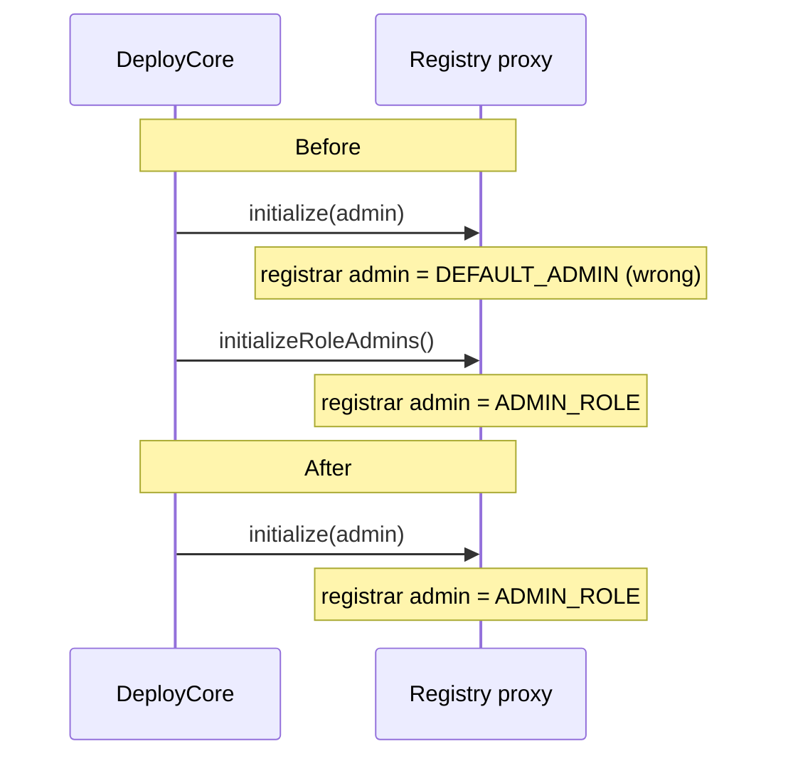

# ADR: Zero-address checks, setter consistency and one-step Registry init

- **Status:** Accepted 2026-10-29
- **Date:** 2026-10-28
- **Scope:**
  - `StrimzPayments` (immutable, so the change takes effect at the #142 redeploy).
  - `StrimzAgentEscrow` and `StrimzRegistry` (both UUPS).
  - `DeployCore.s.sol`, the contracts README and the affected tests.
  - Subscriptions, FeeCollector, TokenWhitelist, AgentRegistry, the apps and the indexer don't change.

## Context

Issue #381 collects four small findings from the 2026-10-28 audit.

1. **Wrong error in the Payments setters.** `setRegistry`, `setFeeCollector` and `setTokenWhitelist` (`StrimzPayments.sol:92-108`) revert with `Payments__InvalidAmount()` when given the zero address. An operator or a monitoring tool reading the revert is told the amount is wrong. `Payments__ZeroAddress()` already exists: #383 added it for `rescue`.
2. **No zero-address checks in the Payments constructor** (`:61`). A deploy with a zero registry, fee collector or whitelist succeeds. Every payment would then revert, and the contract is immutable, so the only fix is another deploy. A zero `admin` would leave the contract with no admin at all. `StrimzSubscriptions` already rejects all four (`Subscriptions__ZeroAddress`).
3. **The escrow lets the whitelist change while it is live.** `StrimzAgentEscrow.setTokenWhitelist` (`:83`) needs `DEFAULT_ADMIN_ROLE` but not `whenPaused`. Payments and Subscriptions allow a dependency change only while paused (`pause → set → unpause`). That stops a compromised admin from swapping a live contract's dependency in the middle of a block, and the escrow should follow the same rule. The escrow reads the whitelist only in `createJob`, so funded jobs aren't affected either way.
4. **A second init step left over from the old deployment.**
   - `StrimzRegistry.initializeRoleAdmins()` (`reinitializer(2)`, `:53`) was added in #130 so that an _existing_ Registry proxy could make `ADMIN_ROLE` the admin of `MERCHANT_REGISTRAR_ROLE` (ADR-2026-10-10-admin-timelock-handoff).
   - `DeployCore` calls it right after `initialize`. A fresh deploy therefore takes two steps, and the Registry is wrong until the second one runs.
   - I checked the live testnet Registry (`0x23bb…1ae3`). It is still at initializer version 1, and `getRoleAdmin(MERCHANT_REGISTRAR_ROLE)` is `DEFAULT_ADMIN_ROLE`, so the upgrade path was never used there.
   - #142 deploys a fresh set and pauses the old one, and mainnet is fresh too. Neither needs the upgrade step.

## Decision

1. **Payments setters:** the three setters revert with `Payments__ZeroAddress()` for a zero address.
2. **Payments constructor:** it reverts with `Payments__ZeroAddress()` when `admin`, `registry_`, `feeCollector_` or `tokenWhitelist_` is zero. This is the same check, in the same order, as `StrimzSubscriptions`.
3. **Escrow setter:** `StrimzAgentEscrow.setTokenWhitelist` gains `whenPaused`.
   - The operator flow becomes `pause → setTokenWhitelist → unpause`, sent as one Safe or timelock batch.
   - While paused, escrow exits are blocked too (#377 changes that). Doing all three in one batch means the escrow is paused for zero blocks.
4. **Registry init:**
   - `StrimzRegistry.initialize` also runs `_setRoleAdmin(MERCHANT_REGISTRAR_ROLE, ADMIN_ROLE)`, next to the existing `FEE_MANAGER_ROLE` line.
   - `initializeRoleAdmins()` is removed, and so is the `DeployCore` call.
   - The handoff's `_checkServiceRoleAdmins` guard stays. It's cheap, and it still refuses an old Registry such as the current testnet one.
5. **Tests:**
   - The three `AdminRoles` tests for `initializeRoleAdmins` are replaced by one test: a freshly initialised Registry already has `ADMIN_ROLE` as the admin of both `MERCHANT_REGISTRAR_ROLE` and `FEE_MANAGER_ROLE`.
   - `AdminHandoff.test_refusesRegistryWithoutRoleAdmins` now builds its "old Registry" from the `StrimzRegistryV1` fixture, because a current Registry can no longer be in that state.
   - `Upgradeability.test_registryUpgradesInPlaceAndKeepsStorage` stays and must still pass.

## Diagram

## Consequences

- Deploys can no longer leave Payments pointing at the zero address or with no admin.
- Reverts name the actual problem.
- All three money contracts change a dependency only while paused.
- The Registry is correct after one call, and there is one fewer step for a deploy script to forget.
- The current testnet Registry can't be fixed by upgrading to this version. Upgrading it would change nothing about the registrar role admin, and the handoff guard would still refuse it. That's acceptable because #142 retires it, and it is written in the release note.
- Payments bytecode grows by a few bytes, and nothing changes in storage.

## Alternatives considered

- **Keep `initializeRoleAdmins` for old proxies:** it only serves the testnet Registry that #142 retires. It would leave a second init step on mainnet that the deploy could forget or call out of order.
- **Make it a no-op instead of removing it:** a function that does nothing is still public surface, and it would confuse readers.
- **Allow the escrow whitelist change while live, since only new jobs read it:** it's safe today, but the rule stays simple only if it holds on every contract. A later escrow change that reads the whitelist on exits would quietly lose the protection.

## Verification

- **Red, on `main`:**
  - The Payments setter tests expect `Payments__ZeroAddress` and get `Payments__InvalidAmount`.
  - The Payments constructor tests expect a revert for each zero argument, and the deploy succeeds.
  - An escrow `setTokenWhitelist` while unpaused is expected to revert with `ExpectedPause`, and it succeeds.
  - A fresh Registry's `getRoleAdmin(MERCHANT_REGISTRAR_ROLE)` is expected to be `ADMIN_ROLE`, and it is `DEFAULT_ADMIN_ROLE`.
- **Green:**
  - All of the above pass.
  - The escrow setter works while paused.
  - The handoff tests pass with a fresh Registry and refuse the V1 one.
  - The Registry upgrade test passes.
- `./scripts/preflight.sh` passes in full.
