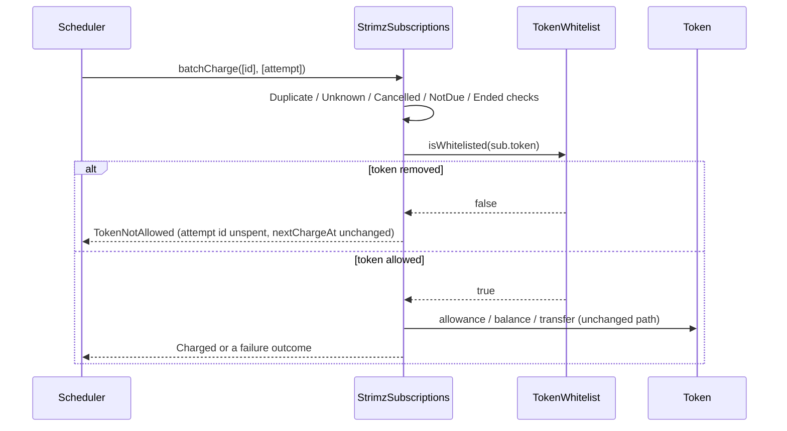

# ADR: Stop charging subscriptions in a token that is no longer whitelisted

- **Status:** Accepted 2026-10-28
- **Date:** 2026-10-28
- **Scope:** `StrimzSubscriptions` (immutable, so this takes effect at the #142 redeploy) and its tests. The indexer, the database enum, shared types and the scheduler take the new outcome in the app switch with #142. Payments, Registry and the escrow don't change.

## Context

Issue #375, found in the 2026-10-28 audit.

`TokenWhitelist` decides which tokens Strimz accepts. Two places check it:

- `pay` and `payWithAuthorization`, on every payment;
- `createSubscription` and `permitAndCreateSubscription`, once, when the subscription is created.

`_charge` (`StrimzSubscriptions.sol:361`) never checks it. Removing a token, for example after a depeg or an issuer incident, stops new payments and new subscriptions in it. The scheduler, though, keeps pulling every existing subscription in that token each period. The audit proof is `test_poc_delistedTokenStillCharged`: after `whitelist.remove(usdc)`, `batchCharge` returns `Charged` and moves the amount.

So the whitelist can't act as an emergency stop for recurring billing. The only stop is pausing all of Subscriptions, which blocks every token.

How the apps handle a new outcome value today:

- **Indexer:** `ChargeOutcome.DBString()` maps any value it doesn't know to `skipped`, and `IsPaymentFailure()` returns false for it (`apps/indexer/internal/abi/events.go`). A new value is recorded as a plain skip and doesn't move the subscription to `at_risk`.
- **Scheduler:** it doesn't read outcomes. It sends the batch, and the indexer projects the events. `isChargeDue` reads `getSubscription` and doesn't know about the whitelist, so it keeps proposing the subscription each sweep.

## Decision

1. `ChargeOutcome` gains `TokenNotAllowed` at the end (value 11). Existing values don't move.
2. `_charge` checks `$.tokenWhitelist.isWhitelisted(sub.token)` after the `Ended` check and before the allowance check. When it's false, it emits `SubscriptionChargeSkipped(..., TokenNotAllowed)` and returns.
   - The attempt id is not spent, the same as every other skip before the transfer.
   - `nextChargeAt` doesn't move.
3. When the token is added back, the next charge follows the existing catch-up rule. It charges one period and emits `SubscriptionPeriodsSkipped` for the periods missed. The payer is never billed for the time the token was off the list.
4. The check is a plain view call to our own whitelist proxy, not wrapped in `try`. `isWhitelisted` doesn't revert. If the proxy were broken, failing the whole batch is right: we can't tell which tokens are allowed.
5. App half, recorded under "Ships with #142" in the release note:
   - **Database:** a `token_not_allowed` value in `SubscriptionChargeOutcome`, as a Prisma migration.
   - **Indexer:** a `ChargeOutcomeTokenNotAllowed = 11` constant and its `DBString`. It's not a payment failure: the payer did nothing wrong, so the subscription doesn't go `at_risk`.
   - **Shared types:** the outcome list in `packages/shared-types/src/subscriptions.ts`.
   - **Scheduler:** `isChargeDue` (or the due query) leaves out subscriptions whose token isn't whitelisted, so a delisted token doesn't cost a wasted transaction every sweep.

## Diagram

## Consequences

- Removing a token now stops recurring charges in it within one sweep. Adding it back resumes them without back-billing.
- Each charged row costs one more view call to the whitelist proxy. That's a few thousand gas for the first row in a batch, while the proxy and its storage are cold, and much less after that. The release note records the measured cost per row, and it must stay inside the scheduler's batch gas limit at `MAX_BATCH_SIZE`.
- A token removed for good leaves its subscriptions open but never charged. Merchants see `token_not_allowed` on them after the app switch. Cancelling them is a product decision for when it happens. The contract doesn't cancel on its own, because a removal may be temporary.
- An old indexer would record the new value as `skipped`, so the contract can ship before the app half without a crash.

## Alternatives considered

- **Cancel the subscription on the first `TokenNotAllowed`:** this can't be undone. A temporary removal, such as a few hours during an incident, would end every subscription in the token for good.
- **Reuse `MerchantInactive` or `TransferFailed`:** both mean something else. `TransferFailed` spends the attempt id and counts as a payment failure, which would push healthy payers into `at_risk`.
- **Rely on pausing Subscriptions:** that stops every token and every charge, not only the affected one.
- **Check in the scheduler only:** the scheduler key is a hot key and the check would be off-chain. The contract is the only place the stop can't be skipped.

## Verification

- **Red:** `test/SubscriptionDelistedToken.t.sol` on `main`. After `whitelist.remove(usdc)`, a due subscription:
  - should return `TokenNotAllowed`, but returns `Charged`;
  - should keep the payer's balance, but it drops by the amount.
- **Green:** the same tests pass, plus:
  - the attempt id stays unspent, and `nextChargeAt` and the merchant balance don't change;
  - `SubscriptionChargeSkipped` is emitted with outcome 11;
  - when the token is added back after two intervals, the next charge takes one period and emits `SubscriptionPeriodsSkipped(2)`;
  - a batch mixing a delisted-token row and a normal row charges only the normal row;
  - the enum order test pins `TokenNotAllowed == 11`.
- The existing subscription, invariant and fork suites pass.
- `./scripts/preflight.sh` passes in full.
