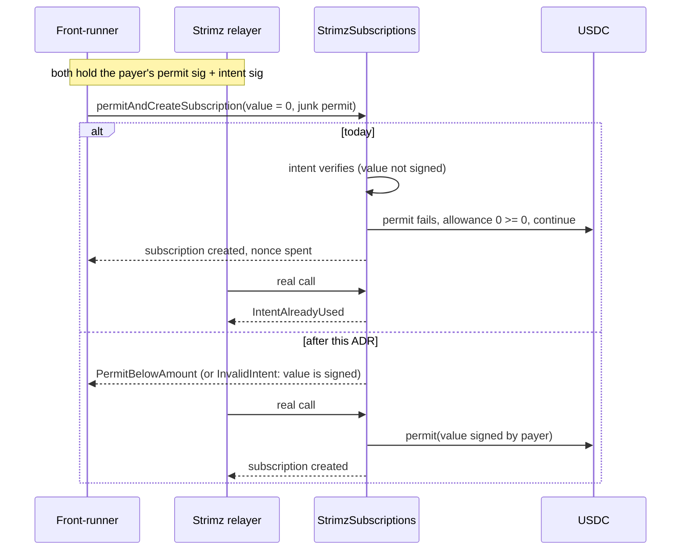

# ADR: Sign the permit amount in SubscriptionIntent

- **Status:** Accepted 2026-10-28
- **Date:** 2026-10-28
- **Scope:** `StrimzSubscriptions` (immutable, so it takes effect at the #142 redeploy) and its tests. The SDK, checkout and relay take the new type in the app switch with #142, together with the deferred nonce and `bytes` signature work. `createSubscription`, charging, Payments, the indexer and the scheduler don't change.

## Context

Issue #374, found in the 2026-10-28 audit.

`permitAndCreateSubscription` takes two payer signatures:

- an ERC-2612 permit that approves Subscriptions to spend `permitData.value`;
- a `SubscriptionIntent` over the plan terms, so a permit alone can't enrol the payer in a plan they never chose.

The intent's type is:

```
SubscriptionIntent(uint256 merchantId,address token,uint256 amount,uint32 interval,
                   uint64 startAt,uint64 endAt,uint256 permitDeadline,bytes32 nonce)
```

It binds the permit's deadline but not its `value`. Since the 2026-10-03 change, a failed `permit` is accepted when the existing allowance already covers `permitData.value` (`_requireAllowance`, `StrimzSubscriptions.sol:287`). That exists so someone who front-runs the payer's permit into the token can't block enrolment.

Together those two let anyone who has seen the intent signature (in the mempool, or from the checkout request) enrol the payer without an approval:

1. Call `permitAndCreateSubscription` with the real intent signature, `permitData.value = 0` and any permit signature.
2. `permit` reverts, and `allowance >= 0` holds, so enrolment continues and the intent nonce is spent.
3. The relayer's real transaction reverts with `Subscriptions__IntentAlreadyUsed`.
4. The first charge returns `RevokedApproval`.

The payer loses no money, but the signup fails, and the payer sees a subscription that doesn't work. The audit proof is `test_poc_intentFrontRunSkipsPermit` (audit worktree, not shipped).

The comment above `SUBSCRIPTION_INTENT_TYPEHASH` claims the intent binds "every subscription parameter to the specific permit". That isn't true today.

## Decision

1. The type becomes

   ```
   SubscriptionIntent(uint256 merchantId,address token,uint256 amount,uint32 interval,
                      uint64 startAt,uint64 endAt,uint256 permitDeadline,uint256 permitValue,bytes32 nonce)
   ```

   `permitValue` goes after `permitDeadline`. `_verifySubscriptionIntent` hashes `permitData.value` into that slot, so any other value fails with `Subscriptions__InvalidIntent`. The domain stays `EIP712("StrimzSubscriptions", "1")`.

2. `permitAndCreateSubscription` reverts with the new `Subscriptions__PermitBelowAmount(uint256 value, uint256 amount)` when `permitData.value < amount`, checked before the intent. An approval that can't cover one charge only creates a subscription that fails its first charge.
3. `subscriptionIntentDigest` takes `uint256 permitValue` after `permitDeadline`, so the SDK test can keep pinning its digest to the contract's.
4. The `_requireAllowance` fallback stays. With the value signed, a front-runner can only submit the payer's own permit, which leaves the allowance the payer asked for.
5. The typehash comment is shortened to something that is true.
6. The function's selector doesn't change, because `permitData.value` is already an argument. The relay ABI is unaffected by this change (#372 changes it for other reasons).
7. App half, recorded in this change's release note under "Ships with #142": the SDK's `SubscriptionIntentParams` gains `permitValue: bigint` and the type entry, and `use-subscription-checkout.ts` passes the same `permitValue` it puts in the permit. This needs a `@strimz/sdk` changeset (a breaking change: new required field).

## Diagram



## Consequences

- An intent signed for one permit amount can't be used with another, and the payer's wallet shows the amount in the intent too.
- The signed type changes again before the redeploy. The SDK and checkout already change with #142 for the nonce, so the switch is one step, not two.
- A payer who wants a bounded approval must sign the bounded value in both the permit and the intent. #384 decides what the checkout signs.

## Alternatives considered

- **Only require `permitData.value >= amount`:** no type change. It stops the zero-value case, but a front-runner can still pick any value at or above `amount` and replace the payer's choice whenever an existing allowance covers it. Binding the value closes it completely. The check is kept anyway, as decision 2.
- **Remove the `_requireAllowance` fallback:** brings back the 2026-10-03 problem, where anyone who submits the payer's permit to the token first blocks the enrolment.
- **Bind a hash of the permit signature:** the payer can't know the permit signature when signing the intent in the same flow, and it rules out ERC-1271 wallets that approve hashes on chain.

## Verification

- Red: `test/SubscriptionIntentPermitValue.t.sol` on `main`:
  - the zero-value front-run enrols the payer (the audit PoC, asserting the fixed behaviour, so it fails);
  - an intent signed for value X with `permitData.value = Y` is accepted;
  - `permitData.value < amount` is accepted.
- Green: the same tests pass, plus:
  - the relayer's real call succeeds after a failed front-run;
  - a front-run that submits the payer's own permit to the token still enrols;
  - an ERC-1271 wallet subscribes with the new type;
  - the typehash equals the keccak of the type string above, and `subscriptionIntentDigest` matches the test's EIP-712 digest.
- Existing subscription, ERC-1271, fork and invariant suites are updated to sign `permitValue` and pass.
- `./scripts/preflight.sh` passes in full.
