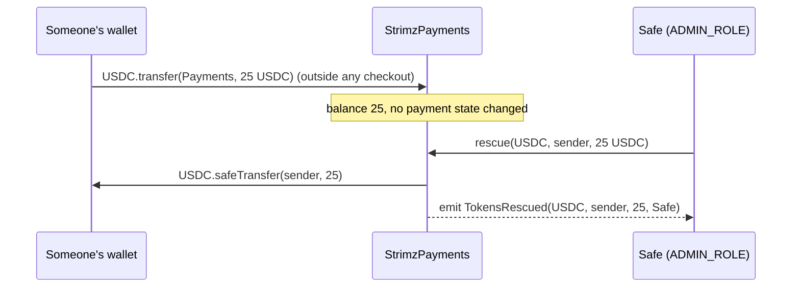

# ADR: Return tokens sent straight to Payments or Subscriptions

- **Status:** Accepted 2026-10-28
- **Date:** 2026-10-28
- **Scope:** `StrimzPayments` and `StrimzSubscriptions` (immutable, so this takes effect at the #142 redeploy), their interfaces, and their tests. The indexer records the new event in the app switch with #142. Registry, FeeCollector, the escrow, the scheduler and the API don't change.

## Context

Issue #383, found in the 2026-10-28 audit. The maintainer chose this option on the issue: add a rescue the Safe can call.

Anyone can call the token's `transfer` and send USDC or EURC straight to the Payments or Subscriptions address. For example, someone copies the address from the explorer and uses their wallet's Send button instead of paying a checkout. The token accepts the transfer, and neither contract has a function that moves a token out, so those funds are stuck for good. Native USDC sent as `value` already reverts, because neither contract has `receive` or `fallback`.

Neither contract keeps customer funds between transactions:

- `pay` moves the fee from the payer to `FeeCollector` and the net from the payer to the merchant's payout address. Payments never holds the money.
- `payWithAuthorization` receives the gross into Payments and forwards the fee and net in the same call. Its check uses only the balance change during the call (`StrimzPayments.sol:167-173`), so tokens already sitting in Payments don't affect a payment.
- `_settleCharge` moves the fee and net from the payer straight to `FeeCollector` and the payout address. Subscriptions never holds the money.
- `test/invariant/PaymentsInvariants.t.sol` already asserts `invariant_paymentsContractHoldsNoResidue`. Subscriptions has no matching invariant.

So whatever either contract holds at the end of a transaction arrived there outside the payment flow. Merchant balances live at merchant payout addresses, and Strimz fees live in `FeeCollector`.

## Decision

1. Both contracts get

   ```solidity
   function rescue(address token, address to, uint256 amount)
       external onlyRole(ADMIN_ROLE) nonReentrant
   ```

   - It moves `amount` of `token` from the contract to `to` with `safeTransfer`.
   - It emits `TokensRescued(address indexed token, address indexed to, uint256 amount, address indexed by)`.
   - It works whether or not the contract is paused.
   - It reverts on `to == address(0)` (`Payments__ZeroAddress()`, new, and the existing `Subscriptions__ZeroAddress()`) and on `amount == 0` (`Payments__InvalidAmount()` / `Subscriptions__InvalidAmount()`).

2. `ADMIN_ROLE` is held by the Safe and the timelock after the handoff (`script/utils/AdminHandoff.sol:137-138`), so the Safe can return a mistaken transfer without waiting for the timelock delay. No new role, so the handoff table and its verify step don't change.
3. `nonReentrant` shares the guard with `pay`, `payWithAuthorization` and `batchCharge`. A rescue is its own transaction, so it can't run while a payment is in flight.
4. A new `test/invariant/SubscriptionsInvariants.t.sol` asserts that Subscriptions holds no token balance after any sequence of creates, charges and cancels. The Payments invariant stays. Together they back the claim that `rescue` can only move tokens that arrived outside the payment flow.
5. How a rescue is run, written in the release note: confirm the stray transfer on the explorer (sender, amount, tx hash), and send it back to the sender's address from the Safe with that tx hash in the Safe transaction note.
6. App half, recorded under "Ships with #142": the indexer adds `TokensRescued` for both contracts as an on-chain audit row and an admin alert email, the same as role and pause events (ADR-2026-10-16-onchain-admin-monitoring).

## Diagram



## Consequences

- Mistaken transfers can be returned. The return is visible on chain and, after the app switch, in the admin alerts.
- The Safe gains one more power over these two contracts. It's limited to balances the invariants show are never customer funds. A compromised Safe can already pause and change admin settings, and with `rescue` it could take only tokens that someone sent by mistake.
- Two more functions, a little more bytecode, and no storage change.

## Alternatives considered

- **Only the timelock can rescue:** every return waits for the delay (48h is planned for mainnet, #379) and needs a scheduled operation. The maintainer preferred fast returns, since nothing at rest is customer money.
- **No rescue:** mistaken transfers stay stuck for good.
- **Send rescued tokens to a fixed address:** the right destination is the original sender, which only the admin can confirm off chain.

## Verification

- **Red:** `test/TokenRescue.t.sol` on `main`. It sends USDC straight to each contract, then tries to return it. It doesn't compile, because `rescue` doesn't exist on either contract. That is the defect: there's no way out.
- **Green:**
  - The admin returns the exact amount to the sender, with `TokensRescued`.
  - The call works while paused.
  - A caller without `ADMIN_ROLE` reverts, and so do the relayer, the scheduler and `DEFAULT_ADMIN_ROLE` alone.
  - Zero `to` and zero `amount` revert.
  - A `payWithAuthorization` made while stray tokens sit in Payments still pays the merchant exactly, and leaves the stray amount untouched for a rescue.
- `SubscriptionsInvariants` (new) and `PaymentsInvariants` pass.
- `./scripts/preflight.sh` passes in full.
