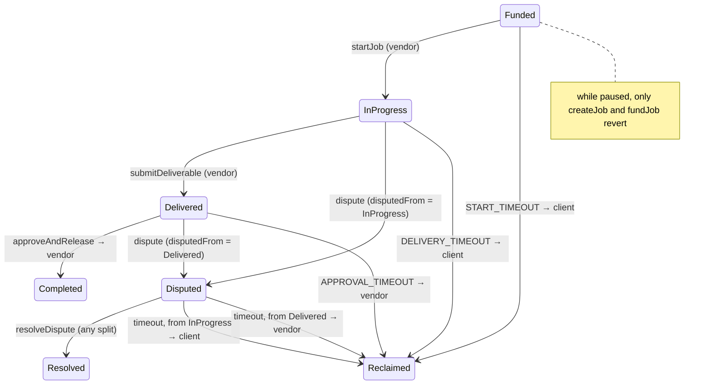

# ADR: Escrow disputes keep the pre-dispute default; pause stops only new escrow

- **Status:** Accepted 2026-10-29
- **Date:** 2026-10-29
- **Scope:** `StrimzAgentEscrow` (UUPS) and its interface and tests. The escrow is paused for launch and deploys with #142. The indexer, API and web don't change.

## Context

Issues #376 and #377 come from the 2026-10-28 audit. They are Findings 5 and 4 of ADR-2026-10-03-contract-permission-gaps, which were held back with the escrow (#257). The maintainer chose both rules on the issues: the pre-dispute default, and a pause that blocks new escrow only.

**#376: an unanswered dispute hands delivered work to the client.**

- The client can call `dispute` from `Delivered` (`StrimzAgentEscrow.sol:187`).
- After that, only the client can leave `Disputed` through `reclaimAfterTimeout`, with the whole amount, once `DISPUTE_TIMEOUT` (30 days) has passed (`:268-273`).
- Before the dispute, a `Delivered` job paid the vendor after `APPROVAL_TIMEOUT`. The dispute reverses that default instead of pausing it.
- So a client holding the deliverable can dispute and wait. If the resolver is silent, the client gets everything back and the vendor gets nothing.

**#377: pause blocks every exit while the clocks keep running.**

- Every lifecycle function has `whenNotPaused`, including the four that move funds out: `approveAndRelease`, `cancelJob`, `resolveDispute` and `reclaimAfterTimeout`.
- The contract header promises funds always have a way out. During a pause they have none.
- `startJob`, `submitDeliverable` and `dispute` are blocked as well, but the timeouts still compare `statusChangedAt` with `block.timestamp`.
- So a pause longer than a window decides who wins. For example, a vendor blocked from delivering for 30 days loses the job to the client's reclaim.

## Decision

1. **Disputes remember where they came from.**
   - Append `mapping(uint256 jobId => JobStatus) disputedFrom` to the end of `Storage` (ERC-7201, so the layout stays upgrade-safe). `dispute` writes the status it leaves, which is `InProgress` or `Delivered`.
   - New view: `disputedFrom(uint256 jobId) returns (JobStatus)` on `IStrimzAgentEscrow`.
2. **An unanswered dispute keeps the pre-dispute default.** In the `Disputed` branch of `reclaimAfterTimeout`, after `DISPUTE_TIMEOUT`:
   - **From `Delivered`:** the vendor is paid, and only the vendor can call. Other callers revert with `AgentEscrow__NotVendor`.
   - **From `InProgress`:** the client is refunded, and only the client can call. Other callers revert with `AgentEscrow__NotClient`. This is today's rule.
   - **Anything else (`None`):** treated like `InProgress`. A fresh deploy can't reach this. An upgrade over a job already disputed keeps today's rule for that job.
   - Raising a dispute never improves the raiser's outcome when the resolver is silent. `resolveDispute` is still the way to split, and it works any time before a reclaim.
   - `JobReclaimed(jobId, to, amount, fromStatus)` keeps its signature. `to` can now be the vendor when `fromStatus` is `Disputed`.
3. **Pause stops new escrow only.**
   - `whenNotPaused` stays on `createJob` and `fundJob`.
   - It comes off `startJob`, `submitDeliverable`, `approveAndRelease`, `dispute`, `cancelJob`, `resolveDispute` and `reclaimAfterTimeout`.
   - No party is blocked while the other's clock runs, so the clocks don't need freezing and no paused-time storage is added.
   - `cancelJob` from `Proposed` moves no money, and from `Funded` it refunds the client, so it is safe while paused.
4. **Comments:** the standing table above `reclaimAfterTimeout` and the escrow test file header are updated to the new rule.
5. **Invariant:** new `test/invariant/AgentEscrowInvariants.t.sol`.
   - The handler creates, funds, starts, delivers, approves, disputes, resolves, cancels and reclaims jobs, warps time, and toggles pause.
   - It asserts that the escrow's token balance always equals the sum of `amount` over jobs in `Funded`, `InProgress`, `Delivered` or `Disputed`.
   - It also asserts that, at the end of a run, every such job has a caller and a time at which an exit succeeds, checked by warping past the longest window.

## Diagram

## Consequences

- **Delivered work:** a slow resolver can't cause the client to receive it for free. A vendor who disputes from `Delivered` waits 30 days instead of 14, so disputing never helps them either.
- **Pause:** funds in escrow always have an exit, and a pause no longer changes who wins.
- **Pause is not an emergency stop for existing jobs.** If an exit itself had a bug, the fix is an upgrade through the timelock, not a pause. Pause still stops new money from entering.
- **Storage:** one new mapping. One new view in the ABI. No event changes.

## Alternatives considered

- **50/50 on timeout:** a client holding delivered work still gets half back, and a vendor who never delivered still gets half.
- **Keep the current rule and promise a resolver response time:** the outcome would depend on Strimz never being late.
- **Freeze the clocks during a pause:** this needs paused-time accounting in storage and in every window check. Once no lifecycle step is blocked by pause, it protects nothing.

## Verification

- **Red, on `main`:**
  - `test_clientCannotReclaimDeliveredJobAfterSilentDispute`: the client's reclaim succeeds (`next call did not revert as expected`).
  - `test_vendorClaimsDeliveredJobAfterSilentDispute`: the vendor gets `AgentEscrow__NotClient`.
  - `test_exitsWorkWhilePaused`: each of `startJob`, `submitDeliverable`, `approveAndRelease`, `dispute`, `cancelJob`, `resolveDispute` and `reclaimAfterTimeout` reverts with `EnforcedPause`.
- **Green:**
  - All of the above pass.
  - `createJob` and `fundJob` still revert while paused.
  - A dispute from `InProgress` still refunds the client.
  - `disputedFrom` reads back correctly.
  - The existing escrow tests pass.
  - The invariant suite passes.
- `./scripts/preflight.sh` passes in full.
