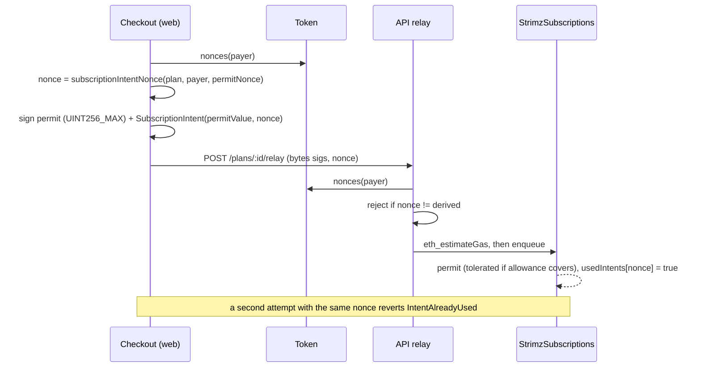

# ADR: Point the apps at the redeployed contracts

- **Status:** Accepted 2026-10-30
- **Date:** 2026-10-30
- **Scope:**
  - API relay, SDK, checkout, shared-crypto, shared-types, indexer, scheduler, dashboard, docs.
  - Database: one enum value, with a Prisma migration.
  - Webhooks: one new event type, `subscription.reactivated`.
  - No contract change. This is the app half of every contract change made for #142.

## Context

Epic #387 changed `StrimzPayments` and `StrimzSubscriptions` (both immutable) and the upgradeable contracts in source. The apps still match the contracts deployed on testnet today, so every app change that follows the new source was deferred to "Ships with #142". Switching early breaks the live testnet; switching late breaks every checkout after the redeploy.

The deferred work is listed in these release notes:

- `2026-10-03-subscription-intent-nonce`
- `2026-10-23-erc1271-payers`
- `2026-10-28-subscription-intent-permit-value`
- `2026-10-28-delisted-token-charges`
- `2026-10-28-token-rescue`
- `2026-10-29-scheduler-key-limits`
- `2026-10-30-generated-indexer-abis`

Their designs were approved in their own ADRs. Two decisions were still open:

- **#384, the permit amount.** The checkout signs an unlimited permit (`UINT256_MAX`).
- **Duplicate enrolment.** `assertAttemptReplaceable` lets a new subscription attempt replace a failed job whose transaction is still pending. That was safe only because both attempts signed the same token permit nonce. Under the new contract a failed permit is tolerated when the allowance already covers the amount, so the second attempt could create a second subscription.

Both were decided on 2026-10-30, and this ADR records them.

## Decision

Everything ships in one pull request to `main`. It is merged when the contracts are redeployed and the new addresses are set, so `main` never points the apps at contracts they don't match.

1. **Relay ABIs come from the build (#372).**
   - `scripts/generate-abis.sh` also writes `apps/api/src/modules/relay/abi.generated.ts`. It contains:
     - the `payWithAuthorization` and `permitAndCreateSubscription` function entries;
     - every custom error from Payments, Subscriptions, Registry and TokenWhitelist.
   - `--check` covers it, so drift fails CI.
   - The hand-written `abi.ts` is deleted. `relay-revert.ts` builds its revert ABI from the generated errors plus the OpenZeppelin and built-in ones.
   - A test pins each relay selector to the contract's (`0x08aeff48`, `0x54d2fac0`).
2. **Signatures are `bytes` (ERC-1271, #287).** This applies the approved `2026-10-23-erc1271-payers` list:
   - **Relay DTO:** each signature field accepts a `{v, r, s}` object or a `0x` hex string of up to 4,096 bytes, and outputs hex.
   - **Gas:** the relay uses `eth_estimateGas`. The job's limit is `max(fixed, ceil(estimate × 1.3))`, and an estimate above 600,000 gas returns `relay_gas_too_high`.
   - **Checkout:** the hooks post the raw signature.
   - **Pay page:** the `unsupported_wallet` block is removed.
3. **SubscriptionIntent gains `permitValue` and `nonce` (#373, #374).**
   - **SDK:** `SUBSCRIPTION_INTENT_TYPES` matches the contract typehash exactly, and a test pins the SDK typehash to the contract's `SUBSCRIPTION_INTENT_TYPEHASH`. A breaking `@strimz/sdk` changeset is added.
   - **Relay:** the DTO, types and calldata carry `nonce`.
   - **Revert decoding:** comes from the generated ABI (point 1), so `IntentAlreadyUsed`, `PermitBelowAmount` and `InvalidSignature` decode by name.
4. **Permit amount (#384): stays unlimited.**
   - The checkout keeps `UINT256_MAX`. A bounded permit would run out on open-ended subscriptions. Because ERC-2612 replaces an allowance rather than adding to it, it would also shrink a payer's other subscription in the same token.
   - The checkout copy beside the approve step says that the approval lets Strimz charge only the amount and schedule shown, and that the payer can cancel at any time.
   - The value signed in the permit is the value bound in the intent.
5. **One intent nonce per checkout.**
   - `@strimz/shared-crypto` gains `subscriptionIntentNonce(planId, payer, permitNonce)`. It is the keccak256 of a domain string, the plan id, the lowercased payer address and the token's current EIP-2612 `nonces(payer)`.
   - A re-sign while the first attempt is pending reads the same permit nonce, so it gets the same intent nonce, and the contract rejects the second enrolment with `Subscriptions__IntentAlreadyUsed`.
   - After an enrolment lands the permit nonce moves on, so a later resubscription to the same plan gets a new intent nonce.
   - The relay reads `nonces(payer)` and rejects a subscription whose nonce isn't the derived one (`intent_nonce_mismatch`), the same way `checkoutPaymentNonce` is enforced for payments.
   - `assertAttemptReplaceable` stays as it is: the contract now stops the duplicate.
6. **Delisted tokens (#375).** This applies the approved `2026-10-28-delisted-token-charges` list:
   - **Database:** `token_not_allowed` is added to `SubscriptionChargeOutcome`, with a migration.
   - **Indexer:** outcome 11 is stored as `token_not_allowed`. It doesn't count as a payment failure, so the subscription stays active.
   - **Shared types:** `token_not_allowed` is added to the outcome list.
   - **Scheduler:** `isChargeDue` also reads `tokenWhitelist().isWhitelisted(token)`, so the worker doesn't send a charge that can only be skipped.
   - **Dashboard:** the charge shows as "Skipped: token not accepted" (#400).
7. **Scheduler key limits (#378).** This applies the approved list:
   - **plan-upgrade:** a fee increase is now two steps. One tick calls `setFeeBps`, which schedules it. A later tick calls `commitFeeBps` once `pendingFeeOf` is due. `Merchant.tier`, the audit row and the email change only after the fee on chain matches the plan. Decreases stay one step.
   - **Indexer, `SubscriptionReinstated`:** moves the subscription back to `active`, writes an audit row and an admin alert, and queues a `subscription.reactivated` webhook to the merchant.
   - **Indexer, `MerchantFeeIncreaseScheduled` and `MerchantFeeIncreaseCancelled`:** each writes an audit row and an admin alert.
   - **Webhooks:** `subscription.reactivated` is a new event type in `@strimz/shared-types`, with its payload schema, docs and a changeset. The payload is the same subscription object as `subscription.cancelled`.
8. **Token rescue (#383).** `TokensRescued` from Payments and Subscriptions writes an audit row and an admin alert.
9. **Removed and fixed.**
   - **ABIs:** `apps/indexer/internal/abi/deployed-only/` is deleted and the ABIs are regenerated.
   - **`e2e.sh` stage 4:** signs the intent with `permitValue` and `nonce`.
   - **Runbooks:** cover token rescue and a leaked scheduler key.
   - **Docs:** the concept and SDK docs describe the new intent fields and ERC-1271.

## Diagram

## Consequences

- After the merge and the new addresses, hosted checkout and subscription signup work against the redeployed contracts, including for smart-contract wallets.
- Relay ABIs and revert names can't drift from the contracts without failing CI.
- A payer can't be enrolled twice by a retried signup.
- `@strimz/sdk` takes a breaking change: `SubscriptionIntentParams` has two new required fields.
- `@strimz/shared-types` and `@strimz/shared-crypto` get minor changes.
- Merchants receive a new webhook type. Endpoints that reject unknown types will see `subscription.reactivated` fail and retry.
- Fee upgrades take at least 24 hours to apply. The plan change and the email arrive when the fee does.
- A large PR. Each item keeps the tests named in its original release note.
- The PR can't be merged before the redeploy. Merging it early breaks the live testnet.

## Alternatives considered

- **An integration branch with one PR per issue:** easier review, but declined in favour of a single PR.
- **Bounded permit:** declined for #384, for the reasons in point 4.
- **Making a pending subscription broadcast non-replaceable:** it also prevents the duplicate. Payers would have to wait for a stuck transaction to drop before retrying.
- **Intent nonce from the plan and payer only:** it would block a legitimate resubscription to the same plan after a cancel.
- **A random nonce per signature:** a re-sign gets a new nonce, so it doesn't prevent the duplicate.

## Verification

- **Red, before the change:**
  - the relay selector test and the SDK typehash test fail against the contract build;
  - the nonce mismatch, the `token_not_allowed` projection, the reinstate projection with its webhook, the fee-increase and rescue alerts, the plan-upgrade two-step test, and the scheduler whitelist test each fail on `main`.
- **Green:**
  - all of the above pass;
  - the existing relay, checkout, indexer and scheduler suites pass with the new shapes;
  - `scripts/generate-abis.sh --check` passes.
- `./scripts/preflight.sh` passes in full.
- **After the redeploy (#142, then #326):**
  - `e2e.sh` runs on testnet: a hosted payment, a subscription signup, a retried signup that is rejected as a duplicate, and a charge;
  - the transaction hashes are recorded in the release note.
