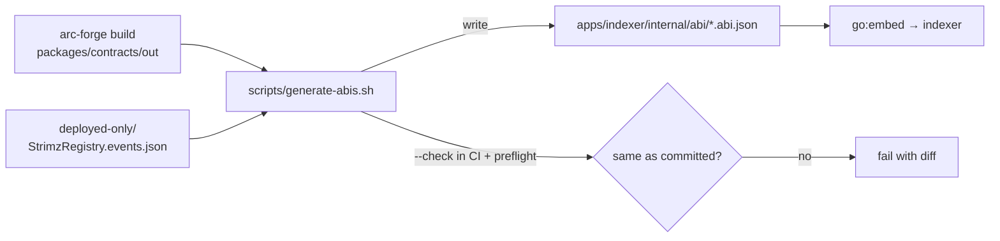

# ADR: Generate the indexer's ABI files from the contract build and fail CI on drift

- **Status:** Accepted 2026-10-30
- **Date:** 2026-10-30
- **Scope:**
  - A new `scripts/generate-abis.sh`, the indexer `Makefile` and its embedded ABI files.
  - A new folder for events that only the deployed contracts emit.
  - The CI `foundry` job, `scripts/preflight.sh` and the indexer README.
  - No contract change. No change to what the indexer projects.

## Context

Issue #386, from the 2026-10-28 audit. `apps/indexer/internal/abi/*.abi.json` are embedded into the indexer with `//go:embed`. The indexer uses only the events in them: it builds a topic-to-decoder map and the `eth_getLogs` filter. `make abi` exists, but nothing runs or checks it, so the files have drifted. Compared with the current contract build:

| File                  | Only in the source build                                       | Only in the committed copy |
| --------------------- | -------------------------------------------------------------- | -------------------------- |
| `StrimzRegistry`      | `MerchantFeeIncreaseScheduled`, `MerchantFeeIncreaseCancelled` | `MerchantMaxFeeBpsLowered` |
| `StrimzPayments`      | `EIP712DomainChanged`, `TokensRescued`                         | `Upgraded`                 |
| `StrimzSubscriptions` | `SubscriptionReinstated`, `TokensRescued`                      | —                          |
| other six             | —                                                              | —                          |

Two other findings:

- **Mixed formats.** `StrimzRegistry` and `StrimzAgentEscrow` are committed as full ABIs, with functions and errors. The rest contain only events, which is what `make abi` writes.
- **One event the live testnet still needs.**
  - `MerchantMaxFeeBpsLowered` belongs to the deployed testnet Registry. The source removed `setMaxFeeBps` in #251.
  - The indexer projects that event (`merchant.max_fee_bps_lowered_onchain`) and must keep decoding it until #142 retires that Registry.
  - `Upgraded` on Payments can go: the deployed Payments isn't a proxy (its deployment entry lists the same address as implementation), so it never emits it.

The events that are only in the source build come from contracts that aren't deployed yet. Adding them now is harmless: the projector only acts on `SubscribedEvents`, and it will be ready for #142.

## Decision

1. **`scripts/generate-abis.sh`** writes, for each of the nine contracts the indexer embeds, `apps/indexer/internal/abi/<Contract>.abi.json`. Each file has:
   - the `event` entries of `packages/contracts/out/<Contract>.sol/<Contract>.json`, in the build's order;
   - followed by the entries in `apps/indexer/internal/abi/deployed-only/<Contract>.events.json`, if that file exists.

   The output is formatted by `jq` with two-space indents, so it is the same on every machine.

2. **Deployed-only events:** `apps/indexer/internal/abi/deployed-only/StrimzRegistry.events.json` holds `MerchantMaxFeeBpsLowered` and nothing else. It is not embedded on its own: `go:embed *.abi.json` doesn't reach subfolders. The #142 app switch deletes the folder and regenerates.
3. **`--check`:**
   - `scripts/generate-abis.sh --check` writes to a temporary folder and compares it with the committed files.
   - On any difference it prints the diff and exits 1, with a message to run `scripts/generate-abis.sh`.
   - It fails if `out/` is missing, rather than building silently.
4. **Where it runs:**
   - The CI `foundry` job runs `--check` right after `arc-forge build`, because it is the only job with the build output.
   - `scripts/preflight.sh` runs it after its contracts build.
   - `make abi` calls the script, so there's one way to regenerate.
5. **Regeneration:** the nine files are regenerated in this PR. Registry and escrow become events-only. Payments loses `Upgraded`, and the source-only events are added.
6. **Wiring test:** a new Go test checks that every name in `SubscribedEvents` resolves to a topic in the embedded ABIs. `SubscribedTopics` silently skips a missing name today (`continue // contract change in flight`), so a dropped event would otherwise stop being indexed without any error.
7. **Later work:** the relay ABI fix (#372, at #142) adds its TypeScript output to the same script, so the apps and the indexer read one source.

## Diagram

## Consequences

- A contract change that adds, removes or changes an event fails CI until the ABI files are regenerated.
- The live testnet Registry's `MerchantMaxFeeBpsLowered` keeps being decoded until #142.
- Every ABI file has the same shape: events only.
- The indexer's log filter gains a few topics that the current contracts never emit.

## Alternatives considered

- **Generate from source with no deployed-only list:** the indexer would stop decoding an event the live testnet Registry can still emit.
- **Run the check in the Go job:** that job has no Foundry and no build output.
- **Leave it until #142:** the drift check is what stops the files drifting again during the redeploy itself.

## Verification

- **Red:** on `main`, `scripts/generate-abis.sh --check` exits 1 and shows the differences in the table above.
- **Green:**
  - After regenerating, `--check` exits 0.
  - The new Go test passes.
  - The indexer's existing decode tests pass, including those for `MerchantMaxFeeBpsLowered` and for every subscribed event.
- **Mutation check:** removing an event from a regenerated file makes `--check` fail.
- `./scripts/preflight.sh` passes in full.
