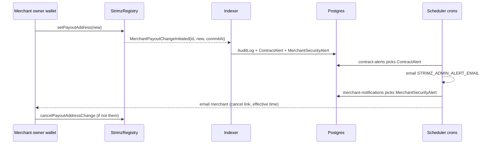

# ADR: Alert merchants and admins when a payout or ownership change starts

- **Status:** Accepted 2026-10-30
- **Date:** 2026-10-30
- **Scope:**
  - Indexer: governance logging for two Registry events.
  - Database: one new table, with a Prisma migration.
  - Scheduler: a new merchant-notification lane, and two new admin alert titles.
  - Email templates: one new template.
  - Docs: a new runbook.
  - No contract change. It works with the deployed contracts and with the #142 ones, since both emit these events with the same signatures.

## Context

Issue #380, from the 2026-10-28 audit. `StrimzPayments` and `StrimzSubscriptions` read every settlement's payout address from `StrimzRegistry`. A payout change takes effect 24 hours after the merchant owner initiates it (`PAYOUT_CHANGE_DELAY`). The same delay applies before a nominated owner can accept ownership, and a new owner can then set any payout address.

That window only protects a merchant if someone notices. Today:

- `MerchantPayoutChangeInitiated` and `MerchantOwnershipTransferInitiated` are written as governance audit rows (`projector.go:120-155`) and a warning log line. Nobody is emailed.
- Admin alerts (`ContractAlert` rows, sent by the scheduler's `contract-alerts` cron to `STRIMZ_ADMIN_ALERT_EMAIL`) cover role, pause, upgrade and timelock events only.
- The merchant can cancel a pending payout change in Settings → On-chain policy ("Cancel pending", `cancelPayoutAddressChange`).
- The dashboard has no button to cancel a pending ownership transfer. The owner can call `cancelOwnershipTransfer` directly, or an admin can call `adminCancelOwnershipTransfer`.
- There is no runbook for an unexpected `Upgraded` or `CallScheduled` alert.

## Decision

1. **Admin alert:**
   - `store.MerchantGovernanceInput` gains `Alert bool`. When it is set, `LogMerchantGovernance` also inserts a `ContractAlert` row, the same way `LogContractOperation` does. The insert is idempotent on the audit row.
   - The projector sets `Alert` for `merchant.payout_change_initiated_onchain` and `merchant.ownership_transfer_initiated_onchain`.
   - The `contract-alerts` cron gets a title for each, and details: merchant, on-chain id, new payout address or pending owner, and when the change can take effect.
2. **Merchant alert row:**
   - New table `MerchantSecurityAlert`: `id`, `auditLogId` (unique), `merchantId`, `createdAt`, `notifiedAt?`, with an index on `(notifiedAt, createdAt)`.
   - For the same two actions, when the on-chain merchant is linked to a `Merchant`, the indexer inserts a row in the same transaction as the audit row. It's idempotent on `auditLogId`, so a re-indexed block doesn't email twice.
   - An event for an unlinked merchant still raises the admin alert.
3. **When the change can take effect:**
   - For a payout change, the event carries `commitAt`.
   - For an ownership transfer, the event doesn't carry the time. The indexer records `acceptableAt` = block time + 24 hours, which matches the Registry's `PAYOUT_CHANGE_DELAY`.
4. **Merchant email:**
   - A fifth lane in `merchant-notifications` picks up `MerchantSecurityAlert` rows where `notifiedAt IS NULL`. It renders a new `MerchantSecurityAlertEmail` to the merchant's email and stamps `notifiedAt`. Failures stay unstamped and retry, like the other lanes.
   - The email states what changed (the new payout address, or the nominated owner), when it takes effect, and that it was started from the merchant's owner wallet.
   - It also says: "If this wasn't you, cancel it before then."
     - **Payout change:** a button links to `/app/settings#onchain-policy`, where "Cancel pending" is.
     - **Ownership transfer:** the email says to contact support, who can cancel it, because the dashboard has no cancel button yet. That button is logged as #397.
5. **Runbook:** `docs/runbooks/unexpected-admin-alert.md` covers what to do when an unexpected `Upgraded`, `CallScheduled`, role, payout or ownership alert fires:
   - confirm it on the explorer;
   - for a queued timelock operation, the guardian calls `cancel(id)` (#379);
   - pause the affected contracts;
   - for a payout or ownership change, contact the merchant and call `adminCancelPayoutChange` or `adminCancelOwnershipTransfer` from the Safe;
   - rotate the keys involved.

## Diagram

## Consequences

- A merchant hears about a payout or ownership change within about a minute, with a whole day left to stop it. So does Strimz.
- One new table and migration, with no changes to existing rows.
- Every merchant who changes their own payout address gets this email too. That's intended, and the wording covers both cases.
- An ownership transfer still can't be cancelled from the dashboard until #397 ships.

## Alternatives considered

- **Add a `merchantNotifiedAt` column to `ContractAlert`:** most alerts have no merchant, so the column would be null forever for them, and the admin queue and merchant queue would be mixed in one table.
- **Send from the indexer:** the indexer is Go and has no email stack. The other merchant emails already go through the scheduler.
- **Email only the admin:** the merchant is the one who can tell whether they started the change.

## Verification

- **Red, before the change:**
  - The indexer store e2e test checks that a `MerchantPayoutChangeInitiated` or `MerchantOwnershipTransferInitiated` for a linked merchant creates a `ContractAlert` and a `MerchantSecurityAlert`, and that a replay doesn't duplicate them. On `main` neither row exists.
  - The scheduler test checks that the new lane emails a pending row once and stamps it, and that a failed send stays pending. On `main` there's no lane.
- **Green:**
  - The above pass.
  - An unlinked merchant gets only the admin alert.
  - The `contract-alerts` describe test covers both new titles.
  - The email template renders both kinds.
- `./scripts/preflight.sh` passes in full, and the CI e2e job runs the store and scheduler e2e suites.
