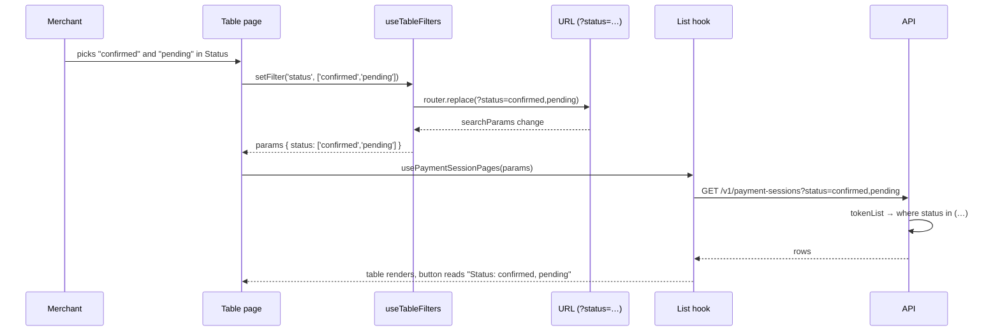

# ADR: One standard filter bar for every dashboard table

- **Status:** Proposed, awaiting maintainer approval
- **Date:** 2026-11-12
- **Scope:**
  - Web: a shared filter bar, a `Popover` primitive in `@strimz/ui`, filter state in the URL, every merchant table page and the admin merchants table.
  - API: list filters accept several values; date ranges on more list endpoints.
  - No schema, migration, job payload, webhook payload or contract change.

## Context

Issue #426. Each dashboard table builds its own filter chips and passes them into `DataTable`'s `toolbar` slot:

- **Transactions:** three rows of chips. That's 6 kinds, 4 statuses and 5 dates, each group with its own "All/Any" chip: 15 chips over two lines before the table starts.
- **Payment links:** 8 status chips. **Plans and Subscriptions:** a row of status chips.
- **API keys:** chips in a separate row above the table, at a different size.
- **No filters:** Invoices, Refunds, Customers, AutoPay activity and both webhook tables.
- **Admin merchants:** a hand-built table with its own chips.
- **No shared chip component:** the same chip classes are copied into each page. Filter state is `useState`, so a reload or a shared link loses it.

What the API supports today (`apps/api/src/common/schemas/list-query.ts`):

- **One value per filter:** every list filter (`status`, `kind`, `tier`, `outcome`, `eventName`, `audience`) is a single token matching `^[a-zA-Z0-9._-]+$`, so `status=a,b` is rejected with 400. Services filter by equality.
- **Date ranges:** only `GET /v1/transactions` and `GET /v1/agents/activity` accept `from`/`to`.
- **Search:** client-side over loaded rows (`DataTable` `globalFilter`), except admin merchants, which search on the server.
- **Missing primitives:** `@strimz/ui` has `DropdownMenu` with checkbox items, but no `Popover` and no date picker. `@radix-ui/react-popover` is only a transitive dependency.

The maintainer chose the layout on 2026-11-12: one row with search, then a button per filter that opens a small menu, with the chosen values shown on the button.

## Decision

### 1. API: several values per filter, and date ranges where the table shows one

- **Several values:** `list-query.ts` gains a `tokenList` parser: a comma-separated list of tokens, 1 to 20 entries, each matching the current token rule, de-duplicated. `status`, `kind`, `outcome` and `eventName` switch to it. A single value parses to a one-item list, so every existing caller keeps working. Services filter with `{ in: [...] }` instead of equality, and enum values are still checked against the Prisma enum, so an unknown status is still a 400.
- **Date ranges:** `datedListQuerySchema` (`from` inclusive, `to` exclusive, `from < to`) is added to:
  - payment sessions (`createdAt`), subscriptions (`createdAt`), invoices (`createdAt`), refunds (`createdAt`) and webhook deliveries (`createdAt`)
  - transactions keep `blockTimestamp`; agents activity keeps `createdAt`
- **Typed clients:** the merchant and admin clients send arrays as one comma-joined value. Their param types take `T | T[]`. The web client's webhook deliveries type gains the `status` it is missing.
- **Out of scope:** search stays client-side for merchant tables; server search is a separate change. Customers keep their exact-match lookups and get no status filter, since a customer has no status.

### 2. `@strimz/ui`: a `Popover`

- `Popover`, `PopoverTrigger`, `PopoverContent` and `PopoverAnchor`, wrapping `@radix-ui/react-popover`, added as a direct dependency of `@strimz/ui` at the version already in the lockfile.
- Styled like `DropdownMenuContent` (border, card background, radius, z-index above dialogs), with tokens for light and dark themes.

### 3. Web: the filter bar

New folder `apps/web/src/components/dashboard/filter-bar/`:

- **`FilterBar`:** one row that wraps on narrow screens. Search sits on the left, then one control per filter, then "Clear filters" (shown only when a filter is set), with the Columns button on the right.
- **`MultiSelectFilter`:** a button with a popover holding a checkbox per option and a "Clear" row.
  - Button text is the filter name ("Status") when nothing is chosen, or "Status: confirmed, pending" when values are chosen. More than two values shorten to "Status: 3 selected".
  - Status options show the same tone dot as the table's `StatusPill`, from one shared map per resource.
- **`DateFilter`:** presets (Any time, Today, Last 7 days, Last 30 days, This month, Last month) and Custom.
  - Custom shows two date inputs with `(optional)` labels. It reuses `lib/date-range.ts` and its validation ("From must be on or before To").
  - Days are local calendar days, sent as ISO with offset, as Transactions does today.
- **`useTableFilters(definition)`:** owns filter state in the URL query string (`useSearchParams` + `router.replace(..., { scroll: false })`, inside `Suspense`).
  - Parameter names match the API (`status`, `kind`, `date`, `from`, `to`). Values outside the definition are dropped on read, so a hand-edited URL can't send garbage to the API.
  - It returns the API params for the page's hook, plus `clear()`.
- **Shared status labels:** one module maps each resource's status to its label and tone. The table pill, the filter options and the filter button all read it, replacing the per-page maps.
- **`DataTable`:**
  - The `toolbar` slot is replaced by a `filters` slot rendered between search and Columns.
  - The empty state offers "Clear filters" when filters are active.
  - Columns are labelled with column headers, not ids.

### 4. Pages

| Page                             | Filters                                    |
| -------------------------------- | ------------------------------------------ |
| Transactions                     | Status, Kind, Date                         |
| Payment links                    | Status, Date                               |
| Plans                            | Status (default: Active)                   |
| Subscriptions                    | Status, Date                               |
| Invoices                         | Status, Date                               |
| Refunds                          | Status, Date                               |
| AutoPay activity                 | Capability, Outcome, Date                  |
| Webhook deliveries (both tables) | Status, Event, Date                        |
| API keys                         | Status: Active / Revoked (default: Active) |
| Customers, Webhook endpoints     | Search only                                |
| Admin merchants                  | Status, Tier (server search kept)          |

### 5. Delivery

Four PRs, each with tests first, a release note and a full preflight:

1. API multi-value filters and date ranges (api e2e tests per endpoint, client types).
2. `Popover`, `FilterBar`, `useTableFilters`, shared status labels, and Transactions moved onto them.
3. The remaining merchant pages.
4. Admin merchants.

## Sequence

## Trade-offs

- **Comma lists over repeated params:** Fastify and the existing `set()`-based clients handle one value per key. A comma list keeps that, stays readable in the URL, and is safe because tokens can't contain commas.
- **Per-filter buttons over one "Filters" panel:** one more control per filter, but each choice is one click and visible at a glance (the maintainer's pick).
- **Native date inputs, no calendar:** no new date-picker dependency. The browser's own picker is accessible and already used on Transactions. A styled calendar can come later without changing the URL or API contract.
- **Client-side search kept:** search still only covers loaded rows. That's unchanged from today and called out on the issue for a later server-search change.
- **New dependency:** `@radix-ui/react-popover`, from the same Radix family `@strimz/ui` already uses, and already in the lockfile.

## Impact

- **API contract:** additive. Single values still work, and new `from`/`to` params are optional. Clients that sent one value see no change. The SDK types these filters as plain strings, so it keeps working, and `status: 'confirmed,pending'` already sends a list. Typed arrays and the new date ranges in `@strimz/sdk` are a separate change with a changeset, out of scope here.
- **URLs:** filtered views can be bookmarked and shared.
- **Tests:**
  - api e2e for multi-value and date filtering on each endpoint, and rejection of unknown values
  - web unit tests for `useTableFilters` URL parsing and the date presets
  - source tests that each page uses `FilterBar`
- **Accessibility:** popovers are keyboard reachable and close on Escape. Checkboxes have labels. Button text says what's filtered.
- **Themes:** light and dark.
