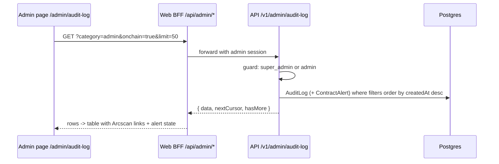

# ADR: Admin audit log page

- **Status:** Accepted 2026-11-13
- **Date:** 2026-11-13
- **Scope:** API (one admin read route), web (one admin page, admin nav). No schema, indexer, contract, queue, webhook or published-package change.

## Context

#260 is a follow-up to ADR-2026-10-16-onchain-admin-monitoring (D5). `AuditLog` already collects two kinds of rows:

- **On-chain, written by the indexer:**
  - contract operations: role grants and revokes, pauses, upgrades, timelock operations and token rescues, with category `admin` and target `Contract`;
  - merchant governance, such as payout and ownership changes, with category `merchant`;
  - agent registry events, with category `agent`.

  Their ids are `onchain:<chainId>:<txHash>:<logIndex>`, and `metadata` carries `transactionHash`, `blockNumber`, `logIndex` and often `contractName`, `roleName` and `account`. Alerting rows have a `ContractAlert` (`alertedAt` is null until the scheduler emails `STRIMZ_ADMIN_ALERT_EMAIL`).

- **Off-chain, written by the API:** admin actions such as invites, role changes, suspensions, tier changes and broadcasts. These carry `actorId`, `actorEmail`, `ipAddress` and `userAgent`.

Nothing reads these rows. Operators see alerts only by email, and can't look back at what happened. Admin roles are `super_admin`, `admin` and `read_only`. Off-chain rows hold personal data (admins' IP addresses and browsers).

## Decision

1. **New route `GET /v1/admin/audit-log`** on the existing admin guard, restricted with `@RequireAdminRoles('super_admin', 'admin')`. `read_only` admins get 403, because rows include IP addresses.
   - Query filters, all optional: `category` (one or more of the `AuditActionCategory` values), `action` (exact), `targetType` + `targetId`, `merchantId`, `onchain` (`true` for indexer rows, `false` for API rows, decided by the `onchain:` id prefix), and `from`/`to` dates.
   - Cursor pagination matches the other lists: `limit` up to 100, default 50.
   - Rows come newest first by `createdAt`, then `id`.
   - The response is `{ data, nextCursor, hasMore }`. Each row has `id`, `category`, `action`, `targetType`, `targetId`, `merchantId`, `actorEmail`, `ipAddress`, `metadata`, `createdAt`, `onchain` (boolean), and `alert` (`{ alertedAt }` or null).
   - Query values are validated with zod.
2. **Admin page `/admin/audit-log`** in the admin nav, using the standard filter bar (category, on-chain or admin action, date) and the shared `DataTable`.
   - **Columns:** time, action, target, actor or account, and alert state (pending, or emailed and when).
   - **On-chain rows** show the contract name, the role name where present, and an explorer link built with `arcExplorerTxUrl` for the deployment's environment.
   - **Row details:** a row expands to show its full `metadata` as formatted JSON.
   - It has loading, empty, error and load-more states, and supports light and dark.
3. **Page access matches the route.** The page and nav item are hidden for `read_only` admins.

## Diagram

## Consequences

- Operators can review every recorded admin and on-chain action in one place, and see whether each alert was emailed.
- One read route on existing indexes: `(category, createdAt)`, `(merchantId, createdAt)` and `(targetType, targetId)`. Filtering by `action` alone has no index; with the page size cap this is acceptable at current volume.
- `read_only` admins lose nothing they have today, but don't get this page.

## Alternatives considered

- **Open the page to `read_only` with IPs hidden.** This needs per-role field masking. Not needed for launch; it can come later.
- **On-chain events only.** Admin actions in the API are just as important to review, and they live in the same table.
- **A separate audit service or export.** More than v1 needs.

## Verification

- **API e2e:**
  - a `super_admin` and an `admin` can list rows, while `read_only` gets 403;
  - each filter (category, action, `onchain`, merchant, date range) narrows the results;
  - pagination works;
  - an alerting row returns `alert.alertedAt`, both as null and with a date.
- **Web tests:**
  - the page exists and uses the filter bar and table;
  - on-chain rows link to the explorer;
  - the nav item is hidden for `read_only`.
- **Full preflight and the full API e2e suite.**
- **By hand:** pause and unpause a contract on testnet from the Safe, or use rows the indexer already recorded, then see them on the page with an explorer link, in light and dark.
