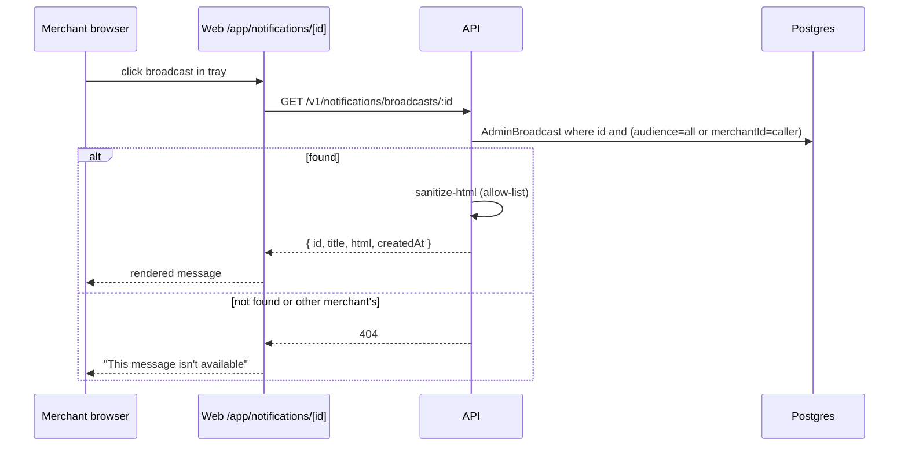

# ADR: A page for admin broadcasts, and invite links outside production

- **Status:** Accepted 2026-11-13
- **Date:** 2026-11-13
- **Scope:** API (notifications module, admin invite responses), web (new notification page, `?highlight=` on three lists, admin invite dialog), `@strimz/shared-types` (one new type). No schema, contract, queue or webhook change.

## Context

Items 1 and 7 of #406. The other six items of #406 are small fixes in the same PR and need no decision.

**Broadcasts (item 1).**

- Admins write broadcasts in a Tiptap editor. It emits `
`, `<strong>`, `<em>`, lists, `<h2>`, `<a href>` and ` `, stored as HTML in `AdminBroadcast.body`.
- The merchant notification tray links each broadcast to `/app/notifications/:id` (`notifications.service.ts:151`). No such page exists, and no merchant API returns one broadcast.
- The tray's other links carry `?highlight=<id>`, which no page reads.

**HTML safety.**

- The only existing sanitizer is `sanitiseBroadcastHtml` in `AdminBroadcastEmail.tsx`. It is a regex strip of `<script>`, `<iframe>` and similar tags, plus quoted `on*=` handlers and `javascript:`.
- That is acceptable for email, where clients strip HTML themselves. In a browser it can be bypassed. For example, an unquoted handler such as `` survives it.
- A broadcast reaches every merchant's dashboard, so a compromised or careless admin account would become stored XSS across all merchants.

**Admin invites (item 7).**

- `inviteAdmin` and `resendInvite` create a single-use token and send the accept link only by email.
- Without `RESEND_API_KEY`, the email service logs the recipient and subject and drops the link. So an invite can't be accepted in local or staging setups.
- `STRIMZ_DASHBOARD_URL`, which builds the link, is missing from the API `.env.example`.

## Decision

1. **New merchant route.** `GET /v1/notifications/broadcasts/:id` sits on the same guard and scope as `GET /v1/notifications`.
   - It returns `{ id, title, html, createdAt }` only when the broadcast's audience is `all`, or `merchant` with the caller's merchant id.
   - Any other broadcast returns 404, without saying whether it exists.
2. **Sanitize on the server, at read time, with `sanitize-html`** added to `apps/api`.
   - Allowed tags: `p`, `br`, `strong`, `b`, `em`, `i`, `u`, `s`, `h2`, `h3`, `ul`, `ol`, `li`, `blockquote`, `code`, `a`.
   - The only allowed attribute is `href` on `a`, with schemes `https`, `http` and `mailto`. Links get `rel="noopener noreferrer"` and `target="_blank"`.
   - Everything else is removed.
   - Sanitizing at read time also covers broadcasts stored before this change.
   - The response field is named `html` so the web page renders exactly what the API cleaned.
3. **Shared type.** `@strimz/shared-types` gains a `NotificationBroadcast` zod schema and type, with a changeset (minor).
4. **Web page.** `/app/notifications/[id]` shows:
   - a back link, the title, the relative date, and the sanitized HTML in the existing prose styles;
   - loading, error and not-found states;
   - light and dark modes.

   The tray link stays the same.

5. **`?highlight=`.** The payment sessions, subscriptions and refunds lists read `highlight` from the URL. If that row is on the loaded page, they scroll it into view and outline it for a few seconds. If it isn't, nothing happens.
6. **Invite links outside production.** When `NODE_ENV !== 'production'`, the responses of `POST /v1/admin/admins` (invite) and the resend-invite route include `acceptUrl`. In production the field is never present.
   - The URL is built by the same helper that builds the emailed link.
   - The admin invite dialog shows the URL with a copy button and a note that it appears only outside production.
7. **Example config.** `STRIMZ_DASHBOARD_URL=http://localhost:3000` is added to `apps/api/.env.example`.

## Diagram

## Consequences

- Merchants can read broadcasts in full, with formatting and working links, without a script ever reaching the page.
- One new API dependency, `sanitize-html`, which is widely used, maintained, and server-side only.
- The email keeps its own regex sanitizer. Moving the email onto the same allowlist would add a dependency to `@strimz/email-templates`, so it is filed as a follow-up.
- Outside production, anyone who can read the API response holds a working invite token. That response only reaches the super-admin who issued the invite, the same person who could already read the email. Production behaviour doesn't change.

## Alternatives considered

- **Plain text detail page.** Safe with no dependency, but it loses the links and formatting admins write. Rejected in favour of option 2.
- **Reuse `sanitiseBroadcastHtml` in the browser.** Bypassable, as shown above.
- **Sanitize in the browser with DOMPurify.** Workable, but every client would get the risky HTML first. Cleaning on the server keeps one trusted output for any future client, such as the SDK.
- **Sanitize at write time only.** This leaves already stored broadcasts unprotected. Read time covers both.
- **Log the invite link in the stub email logger.** It puts a credential in log output and is harder to find.

## Verification

- **API e2e:**
  - a merchant reads an `all` broadcast and its own `merchant` broadcast;
  - it gets 404 for another merchant's broadcast and for an unknown id;
  - `<script>`, `` (quoted and unquoted), `javascript:` links and `style` attributes are removed, while `<strong>` and `https` links remain;
  - the invite response includes `acceptUrl` in the test environment, and a unit test shows the helper returns nothing for `NODE_ENV=production`.
- **Web tests:**
  - the page exists and renders `html` only through the API field;
  - the three lists read `highlight`;
  - the invite dialog shows the link when it's present.
- **Full preflight.**
- **By hand:**
  - send a broadcast from the admin console, then open it from a merchant's tray in light and dark;
  - invite an admin locally, copy the link, and accept it.
