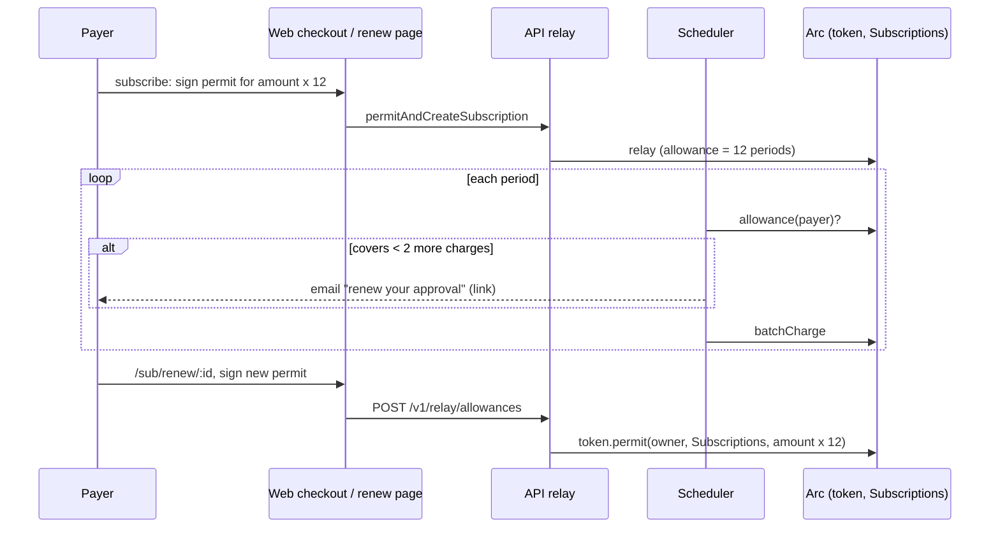

# ADR: Capped subscription allowance, with renewal

- **Status:** Accepted 2026-11-13
- **Date:** 2026-11-13
- **Scope:** web (checkout signing, a new payer renewal page), API (one relay reason, one public route), `@strimz/queue-contracts` (relay job union, private), scheduler (a low-allowance check and email), email templates. No contract, schema or published-package change.

## Context

At subscription checkout, the payer signs an EIP-2612 permit that lets `StrimzSubscriptions` pull their token. `use-subscription-checkout.ts` defaults `permitValue` to `UINT256_MAX`, so every subscriber grants an unlimited allowance. Testnet tx `0x4ec1…154f` shows the `Approval` for `0xfff…f`.

- **The contract** only pulls `amount` when a period is due, and it is immutable. It requires `permitValue >= amount`, and it has no function that only refreshes an allowance.
- **Wallets flag unlimited approvals**, and careful payers refuse them.
- **When the allowance runs out,** `_charge` emits `RevokedApproval`. The indexer then:
  - marks the charge failed;
  - moves the subscription to `at_risk`;
  - fires `subscription.charge_failed`;
  - starts the retry backoff, ending in `lapsed` after the grace period.
- **Renewal doesn't exist.** There is no payer page, relay reason or warning to top up an allowance. A cap without renewal would silently end every subscription when the cap is used.
- **Plain permits are relayable.** USDC and EURC on Arc implement `permit`, so the relayer can submit `token.permit(owner, StrimzSubscriptions, value, deadline, sig)` and the payer pays no gas.

## Decision

1. **Cap the allowance at checkout.**
   - **No end date:** `amount × 12`.
   - **With an end date:** `amount × the number of charges until then` (the first charge included).
   - **Trials:** the trial doesn't count, since charges only start when it ends.
   - `UINT256_MAX` stops being the default. The checkout says, next to the sign button, "You're approving up to N × amount. You'll be asked to renew before it runs out."
2. **Warn before it runs out.** Before each charge, the scheduler's subscription-due worker reads `allowance(payer, Subscriptions)`. If it covers fewer than 2 charges after this one, it emails the payer once per period: "Renew your approval to keep your subscription", with a link to the renewal page.
   - It only emails when the customer has an email address. The merchant gets the same notice in the dashboard notification tray.
   - The charge itself goes ahead unchanged.
3. **Renewal page `/sub/renew/[subscriptionId]`** (public; the payer proves ownership by signing). It shows the plan, the amount, and the remaining allowance.
   - The payer connects the wallet that subscribed and signs a new permit for `amount × 12` (or what's left until the end date). Nothing happens on chain until they sign.
   - The page refuses a wallet that isn't the subscription's payer.
4. **Relay the renewal.**
   - New relay reason `permitAllowance` in the `relayJobSchema` union, with the same fields as the existing reasons (`token`, owner, value, deadline, signature).
   - New route `POST /v1/relay/allowances`, which checks before queueing that:
     - the subscription exists and is active, at risk or trialing;
     - the owner is its payer;
     - the token matches;
     - the spender is the configured Subscriptions contract;
     - the value is at least `amount`.
   - The worker submits `token.permit(...)` and reports status through the existing `GET /v1/relay/submissions/:idempotencyKey`.
   - It is rate-limited like the other relay routes.
5. **After renewal,** an `at_risk` subscription is retried on the next sweep as today and recovers through the normal path. Nothing else changes.
6. **Existing subscribers** keep their unlimited allowance. Nothing is revoked.

### Amendment during build (#384)

All of a payer's subscriptions share one spender, the Subscriptions contract, and EIP-2612 `permit` replaces an allowance rather than adding to it. A bounded permit for a second subscription in the same token would therefore shrink the first one's allowance. So:

- **Checkout and renewal** read the payer's current allowance to Subscriptions, and sign `min(UINT256_MAX, current + cap)`. An existing unlimited approval stays unlimited.
- **The reminder** compares the allowance with this charge plus two more for every live subscription the payer has in that token (`3 × the sum of their amounts`), not with this subscription alone.

## Diagram

## Consequences

- No new subscription grants unlimited spending. A payer's maximum exposure is 12 periods, or the plan's total.
- Payers must renew about once a year, and get reminded by email at least two charges ahead. A payer who ignores it goes `at_risk`, then `lapsed`, through the existing flow, and can still renew while at risk.
- **More moving parts:** one relay reason, one route, one page, one email, and one allowance read per charge.
- Payers with no email get no reminder. The merchant still sees the notice and the `charge_failed` webhook.

## Alternatives considered

- **Keep unlimited.** Simplest, but it's what wallets warn about.
- **Cap with no renewal.** It silently ends subscriptions after 12 charges.
- **Approve exactly one period and re-sign every period.** That defeats subscriptions.
- **A contract-side spending cap.** The contract is immutable; that would need a redeploy.

## Verification

- **Web tests:**
  - the checkout computes the cap for open-ended, fixed-end and trial plans, and never uses `UINT256_MAX`;
  - the renewal page refuses a non-payer wallet and has loading, error and success states, in light and dark.
- **API e2e for `POST /v1/relay/allowances`:**
  - happy path;
  - wrong owner, wrong token, wrong spender, value below amount, and a cancelled or lapsed subscription are each rejected;
  - rate limit.
- **Scheduler e2e:**
  - a low allowance sends one email per period and charges as normal;
  - enough allowance sends nothing;
  - a customer with no email gets no email, but the merchant gets the notification.
- **Relay worker test:** `permitAllowance` submits `permit` and records the hash.
- **Full preflight and all e2e suites.**
- **By hand on testnet:** subscribe on a plan without a trial and check the approval is 12× in the explorer. Then sign a renewal and check the new allowance.
