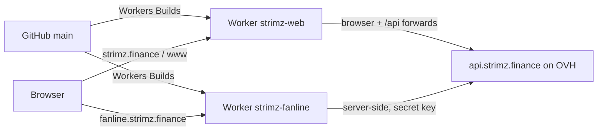

# ADR: Run the web app and the demo merchant on Cloudflare Workers

- **Status:** Superseded by ADR-2026-11-14-split-web-into-workers
- **Date:** 2026-11-13
- **Scope:** `apps/web` (marketing site, docs, dashboard, admin, hosted checkout) and `apps/demo-merchant` (Fanline). Build config, dev dependencies, a smoke script and a runbook. No contract, schema, queue, webhook or published package change.

## Context

Both frontends were deployed on Vercel. The domain `strimz.finance` now uses Cloudflare DNS, and the backend has moved to the OVH server (`api.strimz.finance`). The frontends move to Cloudflare as well.

Both apps are Next.js 15.5.15 (App Router). They use:

- `apps/web`: middleware (sets `x-pathname`), route handlers under `/api` (admin writes forwarded to the API, Uploadthing, Fumadocs search, CSP reports), `next/image`, and the Fumadocs MDX build. No ISR, `revalidate` or `unstable_cache`.
- `apps/demo-merchant`: two route handlers (`/api/tip`, `/api/subscribe`) that call the Strimz API with a secret key.

Cloudflare runs Next.js on Workers through OpenNext (`@opennextjs/cloudflare`). Its current release requires `next >=15.5.28 <16`. Solva already runs three apps this way on the same Cloudflare account (`infra/CLOUDFLARE.md` in that repo); this ADR follows the same layout.

Workers Free limits that matter here:

- 3 MiB compressed per Worker (Workers Paid: 10 MiB);
- 10 ms CPU per request (Paid: up to 30 s);
- no Cloudflare Images binding, so `next/image` can't be optimized on the server;
- server-side `fetch` can't target a bare IP (ours uses `api.strimz.finance`, so this is fine).

## Decision

1. **Two Workers, one per app**, built by Workers Builds from `main` of `StrimzLab/Strimz`:

   | App                  | Worker           | Domains                                |
   | -------------------- | ---------------- | -------------------------------------- |
   | `apps/web`           | `strimz-web`     | `strimz.finance`, `www.strimz.finance` |
   | `apps/demo-merchant` | `strimz-fanline` | `fanline.strimz.finance`               |

   The docs stay inside `apps/web` at `/docs`.

2. **Bump `next` to `^15.5.28`** in both apps (a patch release within 15.5) and add `@opennextjs/cloudflare` and `wrangler` as dev dependencies.

3. **Per app:**
   - `wrangler.jsonc`: `nodejs_compat` and `global_fetch_strictly_public`, the static assets binding, observability on, a self-reference service binding, `preview_urls: false`. The Worker name must match the dashboard.
   - `open-next.config.ts`: `defineCloudflareConfig()` with no incremental cache, because neither app uses ISR.
   - scripts: `build:cloudflare`, `preview:cloudflare`, `deploy:cloudflare`.
   - `.open-next/`, `.wrangler/` and `.dev.vars*` are gitignored.

4. **Images:** with no Images binding, `next/image` serves the original files (`images.unoptimized`). The files in `public/` are already sized for the web. If one turns out heavy, it is resized in the repo rather than adding a paid binding.

5. **Smoke test:** `scripts/worker-smoke.sh <web|fanline>` serves the build on workerd (`wrangler dev`) and checks the main routes, including `/docs`, `/api/search`, a checkout page shell and a 404. `next build` passing doesn't prove the Workers build works.

6. **Environment:**
   - `NEXT_PUBLIC_*` values are inlined at build time, so they are Workers Builds **build variables** (`NEXT_PUBLIC_API_URL=https://api.strimz.finance`, the Privy, Turnstile and Reown ids, the contract addresses).
   - Server-only values are **Worker secrets**: `UPLOADTHING_TOKEN` (web), `STRIMZ_SECRET_KEY` (Fanline). `STRIMZ_API_URL` is a plain Worker variable.
   - A secret never gets a `NEXT_PUBLIC_` prefix.

7. **Plan size:**
   - Measure both Workers with `wrangler deploy --dry-run` before the first deploy.
   - If `strimz-web` is over 3 MiB compressed, or pages hit the 10 ms CPU limit, the account moves to Workers Paid ($5 a month). The maintainer decides that from the measured numbers.

8. **Cutover:**
   - The Workers deploy first to `*.workers.dev`, and their flows are checked there.
   - Then the custom domains are attached in the Worker settings, which replace the old Vercel `A`/`CNAME` records.
   - The Vercel projects are deleted after a day with no problems.

9. **Runbook:** `docs/runbooks/cloudflare-workers.md` covers building, the smoke test, the variables and secrets per Worker, Workers Builds settings, custom domains and a manual deploy.

## Diagram

## Consequences

- No Vercel dependency. Deploys happen on merge to `main`, as before.
- The Next.js bump comes with the move. It's a patch release, and preflight plus the smoke test cover it.
- `next/image` no longer resizes on the server. The images are few and already sized.
- The size limit may force Workers Paid. That's known before the first deploy, not discovered after.

## Alternatives considered

- **Cloudflare Pages with `@cloudflare/next-on-pages`.** Deprecated in favour of OpenNext on Workers, and it needs the edge runtime everywhere.
- **Static export.** The dashboard, admin, checkout and route handlers need a server.
- **Stay on Vercel.** The maintainer chose Cloudflare.
- **Host the frontends on the OVH server.** That puts the site and the API on one machine shared with Solva, and loses the CDN.

## Verification

- `pnpm build:cloudflare` for both apps, `scripts/worker-smoke.sh web` and `fanline` pass on workerd.
- Measured sizes recorded in the runbook.
- Full `./scripts/preflight.sh`.
- By hand on `*.workers.dev`, then on the real domains: landing page, docs and search, sign-in, dashboard, a one-time payment and a subscription on the hosted checkout, a Fanline tip.
