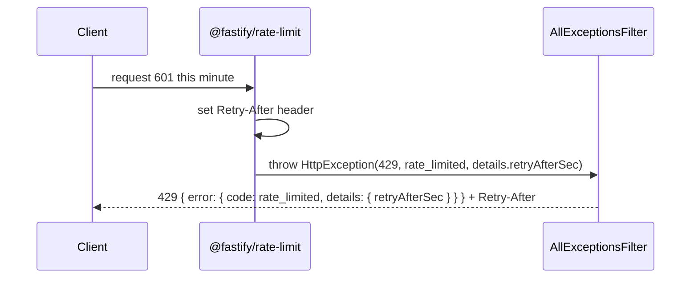

# ADR: The global rate limit answers 429 in the Strimz error envelope

- **Status:** Approved by the maintainer on 2026-11-13, with the recommended choices
- **Date:** 2026-11-13
- **Scope:** `apps/api` bootstrap (`main.ts`) and the api e2e test factory. The limit itself (600 a minute per client address) does not change. No contract, migration, job payload, webhook payload or published package changes.

## Context

The api has two rate limiters:

- the per-route `RateLimitInterceptor` (`@RateLimit(...)`), which throws an `HttpException`
  and answers `429 { error: { code: 'rate_limited', message, retryAfterSec } }`;
- the global `@fastify/rate-limit` plugin, `main.ts:45`, 600 requests a minute per address
  across every route.

When the global one trips, the plugin sets `Retry-After` on the reply and throws the result
of its default `errorResponseBuilder`: a plain `Error` with `statusCode = 429`.
`AllExceptionsFilter` only maps `HttpException`, so it logs the error at `ERROR` and answers:

```json
500 { "error": { "code": "api_error", "message": "Internal server error" } }
```

Effects:

- A merchant backend that makes more than 600 calls a minute from one address sees what
  looks like a Strimz outage.
- `@strimz/sdk` backs off and retries on `429` using `Retry-After`
  (`packages/sdk/src/http/fetcher.ts:114`). On `500` it retries only idempotent requests
  and otherwise throws `api_error`, so non-idempotent calls fail instead of waiting.
- Ops sees `ERROR` lines for normal throttling.

Seen under load: the 2026-11-12 stress run at 600 payments got `500` for about 45 s.
Proof: `apps/api/test/e2e/global-rate-limit.e2e.test.ts`, failing on `main` at `b23a88d`
(`expected 500 to be 429`).

The plugin is registered only in `main.ts`, so no test exercised it until now.

## Decision

1. **One registration.** A new `registerHttpPlugins(app, overrides?)` in
   `apps/api/src/common/http/http-plugins.ts` registers helmet and the global rate limit.
   `main.ts` calls it, and so does the e2e factory, so the tested setup is the real one.
   `overrides` exists only so a test can set `max` low.
2. **The global limit throws an `HttpException`.** Its `errorResponseBuilder` returns
   `new HttpException({ code: 'rate_limited', message, details: { retryAfterSec } }, 429)`,
   with `retryAfterSec = ceil(ttl / 1000)`. `AllExceptionsFilter` then sends the standard envelope
   without logging an error, and the plugin's `Retry-After` header stays on the reply.
3. **`retryAfterSec` goes in `details`**, as `relay_budget_exhausted` already does.
   `AllExceptionsFilter` keeps only `code`, `message`, `param` and `details`, so a top-level
   `retryAfterSec` is dropped. Found while implementing: the per-route limiter puts it at the
   top level, so its clients get `Retry-After` but never `retryAfterSec`. That limiter is
   left as it is here and noted in the release note.
4. **The ban response is not used.** The plugin answers `403` only when `ban` is configured,
   and it isn't. The builder still maps `statusCode` from the context, so a future `ban`
   setting would answer `403` in the envelope instead of `500`.
5. **The limit stays at 600 a minute.** Whether it is right for merchants calling from one
   server is a separate decision.

## Diagram



## Consequences

- Throttled clients get a correct, retryable answer. The SDK waits and retries instead of
  failing.
- Throttling no longer appears as errors in logs or error tracking.
- The e2e suite now runs with helmet and the global limiter, as production does. A suite
  that sends more than 600 requests a minute from the test address would trip it. The
  first green run shows whether any does; such a suite sets its own limit through the new
  option rather than the production one changing.

## Alternatives considered

- **Map `statusCode` on plain errors in `AllExceptionsFilter`.** It works, but it makes the
  filter trust a property any library can set, and it would still answer without
  `retryAfterSec`.
- **Remove the global limiter and rely on per-route limits.** Unannotated routes would have
  no limit at all.
- **Fix it only in `main.ts`.** Leaves the plugin untested, which is how this went unseen.

## Verification

- **Red, already written:** `global-rate-limit.e2e.test.ts` gets `500` where it expects
  `429 rate_limited` with `details.retryAfterSec > 0` and a `Retry-After` header.
- **Green:**
  - that test passes using `registerHttpPlugins` with `max: 2`;
  - a test that the bootstrap registers the limit with `max: 600`;
  - no `ERROR` log line is written for a throttled request;
  - the full api e2e suite passes with the plugins registered.
- `./scripts/preflight.sh` passes in full.
