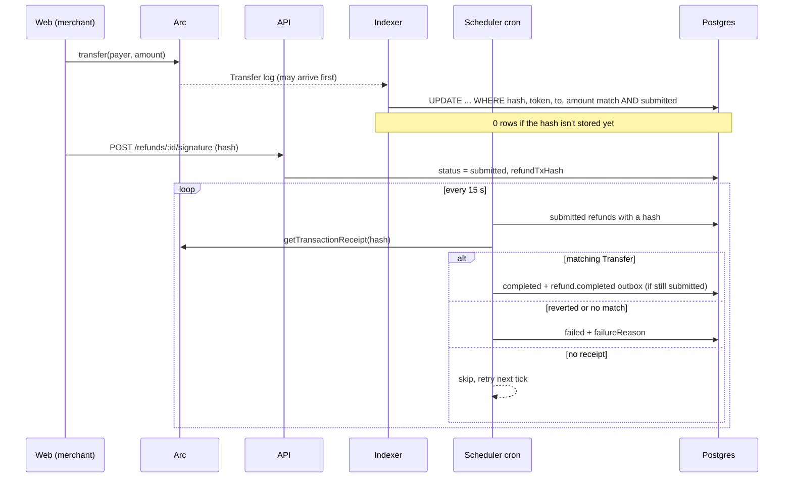

# ADR: Confirm refunds from the transfer, not from the hash alone

- **Status:** Accepted 2026-11-13
- **Date:** 2026-11-13
- **Scope:** Go indexer (refund projection), scheduler (new reconciliation cron). The API, web app, contracts, database schema, webhook payloads and queue payloads do not change.

## Context

A refund is a plain ERC-20 `transfer` from the merchant's embedded wallet to the payer. The web app (`use-refund-signer.ts`) broadcasts it, then calls `POST /v1/refunds/:id/signature` with the hash. The API stores `refundTxHash` and sets the status to `submitted`. The indexer watches `Transfer` logs on the configured stablecoins and runs `CompleteRefundByTxHash(txHash)`, which flips a `submitted` row with that hash to `completed` and writes a `refund.completed` outbox event.

Two defects, both seen in local testing (#435):

1. **Race.** Arc confirms in under a second. The indexer can read the `Transfer` before the browser's `POST /signature` lands. At that moment no row has the hash, so the update matches nothing, and the indexer never sees that log again. The refund stays `submitted` forever. Refund `cmwdybjd30001be7huw1nf3z2` hit this; it completed only after a manual cursor rewind.
2. **No verification.** The match is on the hash only. Any successful transaction with at least one stablecoin `Transfer` log completes the refund: the wrong token, the wrong recipient, the wrong amount, or a USDC fee log. AGENTS.md checklist item 6 requires amount, token and recipient to match before a money record is confirmed.

Related facts:

- Reverted transactions emit no `Transfer`, so today a reverted refund also stays `submitted` forever. Because `submitted` counts toward the refundable total, the payer can never be refunded again for that payment.
- `Refund` has no `updatedAt` or `submittedAt` column.
- The scheduler already has `ARC_RPC_URL` and the stablecoin addresses in its validated env, and runs other `@Cron` jobs.
- The signer is the merchant's Privy embedded wallet (`Merchant.walletAddress`), which can differ from `payoutAddress`.

## Decision

1. **One matching rule**, used by both the indexer and the scheduler. A transaction proves a refund only when its receipt has status `success` and contains a `Transfer` log where all of these hold:
   - the log address is the configured token for `refund.currency`;
   - `to` equals `refund.payerAddress` (case-insensitive);
   - `value` equals `refund.amount` exactly, compared as integer base units.

   `from` is not checked. The refund is signed by the embedded wallet, which may differ from the payout address, and checking it adds no protection to the payer. A merchant who submits someone else's matching transfer only harms themselves.

2. **Indexer.** `CompleteRefundByTxHash` takes the log's token address, `to` and `value`. The `UPDATE` adds `currency = <symbol for that token>`, `lower("payerAddress") = $to` and `amount = $value` to its `WHERE` clause. The token-to-symbol mapping comes from the existing `Stablecoins` config. A log that doesn't match is a no-op, because another log in the same transaction may match. The indexer never marks a refund failed, since it only sees one log at a time.
3. **Scheduler: new `refund-reconciler` cron.** It runs every 15 seconds by default, configurable as `REFUND_RECONCILER_CRON`. Each tick:
   - loads up to 50 refunds with `status = 'submitted'` and a non-null `refundTxHash`, oldest first;
   - fetches each receipt;
   - **if there is no receipt yet**, it skips the refund (it is still pending or was never mined) and logs it;
   - **if the receipt matches the rule**, it completes the refund the same way the indexer does: `UPDATE … WHERE status = 'submitted'`, sets `completedAt` to the block time, and writes the same `refund.completed` outbox row in the same database transaction;
   - **if the receipt reverted, or succeeded without a matching log**, it sets `status = 'failed'` and a `failureReason` (`transaction reverted`, or `transfer did not match token, recipient or amount`).

   An RPC error fails that one refund for this tick, and the error is logged with the refund id. The next tick retries it.

4. **Idempotency.** Both writers use the same conditional `UPDATE … WHERE status = 'submitted'`. Whichever runs first wins, and the other matches zero rows and emits nothing. So `refund.completed` fires at most once per refund.
5. **Existing stuck rows.** The cron's first run reconciles any refund already stuck in `submitted`. No migration or backfill script is needed.

## Diagram

## Consequences

- Refunds that lose the race complete within one cron tick (15 s by default) instead of never.
- Wrong-token, wrong-recipient, wrong-amount and reverted refunds end as `failed`. That frees the refundable balance so the merchant can retry.
- An RPC call per `submitted` refund per tick. In normal use the set is empty or one or two rows.
- **Dropped transactions stay `submitted`.** A transaction that never gets a receipt (dropped from the mempool) keeps its refund in `submitted`, and its amount stays reserved. Deciding when "no receipt" means "never will" needs its own rule, so it is left out here and filed as a follow-up issue.
- No `refund.failed` webhook exists. Failures are visible in the dashboard status and the API's `failureReason` field. A `refund.failed` event is a webhook payload change and a published-package change, so it is filed as a follow-up issue.
- The refunds page shows the `failed` status but not `failureReason`. Showing it is a UI change, filed as its own issue.

## Alternatives considered

- **API checks the receipt right after saving the hash.** Faster, since it completes in the same request. It would need the matching rule in the API and the scheduler (two TypeScript copies or a new shared package) plus a second outbox writer in the API. The cron already covers the race within seconds, so the extra surface didn't earn its place.
- **Indexer remembers unmatched stablecoin transfers.** This would mean storing every USDC and EURC transfer on the chain to match later. It costs too much for a rare race.
- **Indexer waits or retries a missed hash.** The indexer can't tell "hash not stored yet" from "not a refund", so it would retry every transfer on the chain.
- **Check `from` against `payoutAddress`.** This would reject legitimate refunds whenever the payout address differs from the embedded wallet that signs.

## Verification

- **Go, red then green.** Store tests for `CompleteRefundByTxHash`:
  - a matching log completes the refund and emits one outbox row;
  - a wrong token, wrong recipient or wrong amount each leave the refund `submitted` with no outbox row;
  - a second call is a no-op.
- **Scheduler, red then green.** Tests for the reconciler service with a stubbed receipt reader against the test database:
  - the race case (submitted, matching receipt) becomes completed with one outbox row;
  - a reverted receipt becomes failed;
  - a mismatched receipt becomes failed;
  - no receipt stays submitted;
  - an already-completed refund is untouched;
  - an RPC error on one refund doesn't stop the others.
- **Full preflight.**
- **By hand on Arc testnet with the local stack:**
  - Refund a payment with the indexer stopped, then start the indexer. The refund completes through the cron within about 15 s, and one `refund.completed` webhook is delivered.
  - Refund normally. The refund completes through the indexer, and there is still exactly one webhook.
  - The transaction hashes go in the PR.
