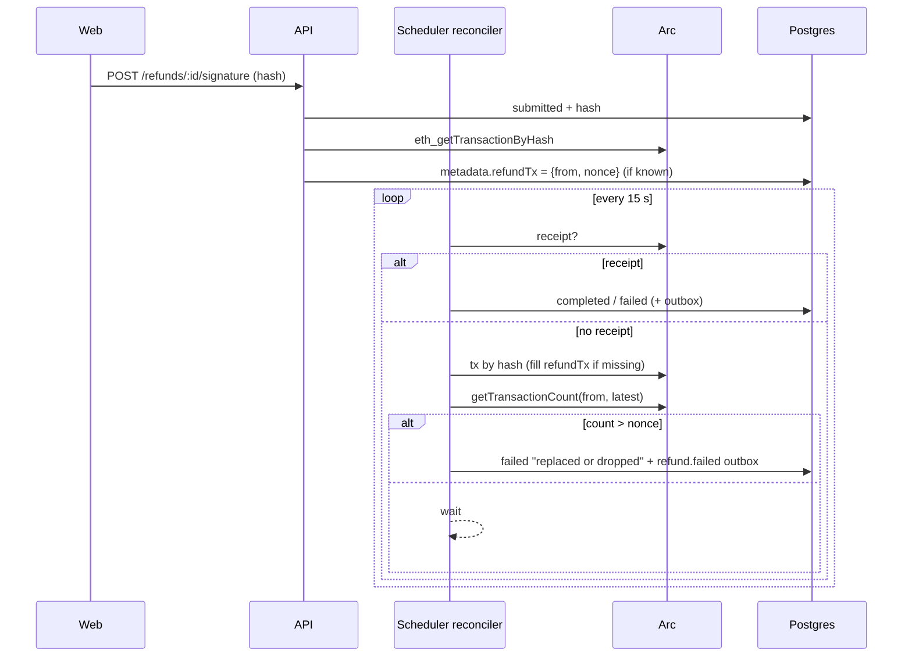

# ADR: When a refund fails, and telling the merchant

- **Status:** Accepted 2026-11-13
- **Date:** 2026-11-13
- **Scope:** scheduler (refund reconciler), API (refund signature route), Prisma (one enum value), `@strimz/shared-types` and `@strimz/shared-config` (one webhook event), web (webhook event list, docs). No contract or queue-payload change.

## Context

Since ADR-2026-11-13-refund-confirmation, the scheduler's `refund-reconciler` reads the receipt of every `submitted` refund every 15 seconds:

- a matching transfer completes it;
- a reverted or mismatched transfer marks it `failed`;
- no receipt yet means it waits.

Two gaps remain:

1. **#439, a transaction that never gets mined stays `submitted` forever.** Its amount stays counted against the payment's refundable total, so the merchant can never refund the payer again. Marking it failed just because time passed is unsafe. Whoever holds the signed transaction can still broadcast it later. If the merchant then refunds again, the payer is paid twice from the merchant's wallet. A transaction is permanently dead only once its sender's nonce has been used by another transaction.
2. **#440, merchants aren't told when a refund fails.** `refund.created` and `refund.completed` exist as webhooks, but `failed` is only visible in the dashboard and through the API.

Facts:

- `Refund.metadata` (JSON) exists and is unused by the refund flow.
- The API and the scheduler both have a read-only chain client.
- The refund is signed by the merchant's embedded wallet, and the browser sends only the hash.
- Webhook event names are mirrored in five places:
  - the Prisma enum `WebhookEventName`;
  - `webhookEventNameSchema` and the event envelopes in shared-types;
  - `WEBHOOK_EVENTS` in shared-config;
  - the scheduler's outbox ref schema and serialiser;
  - the web's endpoint event list and docs.

## Decision

1. **Record the transaction's sender and nonce.**
   - When the API accepts a refund signature, it saves the hash as today, then makes one `eth_getTransactionByHash` call. If the node knows the transaction, it stores `{ from, nonce }` in `Refund.metadata.refundTx`.
   - If the lookup fails or the transaction isn't known yet, the request still succeeds.
   - The reconciler fills the same field on a later tick, from the same lookup, while the transaction is pending.
2. **Fail a refund only when its transaction can never be mined.** On a tick with no receipt, if `refundTx` is known and the sender's confirmed nonce (`eth_getTransactionCount(from, 'latest')`) is greater than `refundTx.nonce`, another transaction used that nonce. The reconciler then marks the refund `failed` with the reason "transaction was replaced or dropped".
   - If the transaction has never been seen, the refund stays `submitted`. There is no time-based failure, because that is the double-refund risk.
3. **New webhook `refund.failed`.**
   - Prisma migration: `ALTER TYPE "WebhookEventName" ADD VALUE 'refund_failed'`.
   - shared-types: `refundFailedEventSchema = envelope('refund.failed', refundSchema)`, added to the event union and the name list. `refundSchema` already carries `failureReason`.
   - shared-config: `WEBHOOK_EVENTS.refund.failed`.
   - The scheduler outbox gets a ref kind `refund.failed` with `refundId`, serialised as the refund.
   - The web endpoint form lists it, and the webhook and refund docs describe it.
4. **Every move to `failed` emits it once.** The reconciler's fail path (reverted, mismatched, or replaced/dropped) uses a conditional `UPDATE … WHERE status = 'submitted'` and writes the `refund.failed` outbox row in the same transaction. A second writer matches zero rows and emits nothing.
5. **Changesets:** minor for `@strimz/shared-types` and `@strimz/shared-config`, and patch for `@strimz/sdk`, whose webhook types re-export the union.

## Diagram

## Consequences

- A refund whose transaction was replaced or dropped fails within one tick of the nonce moving on. Its amount is freed, and the merchant is told.
- A transaction no node ever saw still blocks its amount. This is deliberate: freeing it could pay the payer twice. It's rare on Arc, because the embedded wallet's provider broadcasts before returning the hash.
- Merchants can react to failures from their own systems.
- There's one more webhook type for integrators to ignore or handle.

## Alternatives considered

- **Fail after a timeout,** such as 30 minutes or 24 hours. Simple, but a late broadcast pays the payer twice.
- **Let the merchant mark a stuck refund as failed by hand.** Same risk, moved onto the merchant. It can come later with a strong warning if real cases appear.
- **Have the browser send the nonce.** That's untrusted input. Reading it from the chain is just as cheap.

## Verification

- **Scheduler e2e:**
  - a pending transaction with a known nonce is left alone while the nonce is current;
  - the refund fails with the reason once the sender's nonce passes it, writing one `refund.failed` outbox row;
  - a transaction never seen stays `submitted`;
  - reverted and mismatched failures also emit `refund.failed`;
  - the outbox dispatcher builds the `refund.failed` payload.
- **API e2e:** the signature route stores `refundTx` when the chain knows the transaction, and still succeeds when it doesn't.
- **Shared-types tests:** the new envelope parses.
- **Full preflight and all e2e suites.**
