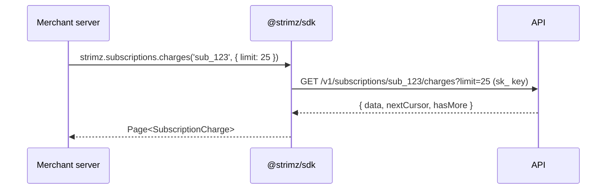

# ADR: `subscriptions.charges()` in the SDK

- **Status:** Accepted 2026-11-13
- **Date:** 2026-11-13
- **Scope:** `@strimz/sdk` (one public method), the SDK route-parity test, API docs. No API, schema or web change.

## Context

ADR-2026-11-13-subscription-charge-history (#400) added `GET /v1/subscriptions/:id/charges`. It needs `subscriptions_read`, returns `{ data, nextCursor, hasMore }` of `SubscriptionCharge`, newest first, and accepts `limit` and `cursor`. The dashboard uses it. `@strimz/sdk` has no method for it, so integrators must call the route by hand (#446).

Adding a method to a published package's public API is non-trivial by definition under AGENTS.md.

## Decision

1. Add `subscriptions.charges(id: string, params?: { limit?: number; cursor?: string }): Promise<Page<SubscriptionCharge>>` to the SDK's subscriptions resource. It uses the same request helper, auth and error mapping as `subscriptions.list`.
2. Export the `SubscriptionCharge` type from the SDK entry point, if it isn't already.
3. Add the method to `sdk-route-parity.e2e.test.ts`, so it is mapped to `GET /v1/subscriptions/:id/charges` and to a route a secret key may call.
4. Document it in `apps/web/content/docs/api/subscriptions.mdx`, with the route, parameters and an SDK example.
5. Changeset: minor for `@strimz/sdk`.

## Diagram

## Consequences

- Integrators can read failed and skipped charge attempts without a hand-written request.
- One more method to keep in step with the API, which the parity test enforces.

## Alternatives considered

- **Leave it out of the SDK.** Integrators lose a typed path to the one place charge failures are visible.
- **An auto-paginating iterator.** The other list methods return a page, so this one does too.

## Verification

- **SDK unit test:** the method sends `GET /v1/subscriptions/:id/charges` with `limit` and `cursor`, and URL-encodes the id.
- **The SDK route-parity e2e test passes** with the new entry.
- **Full preflight.**
