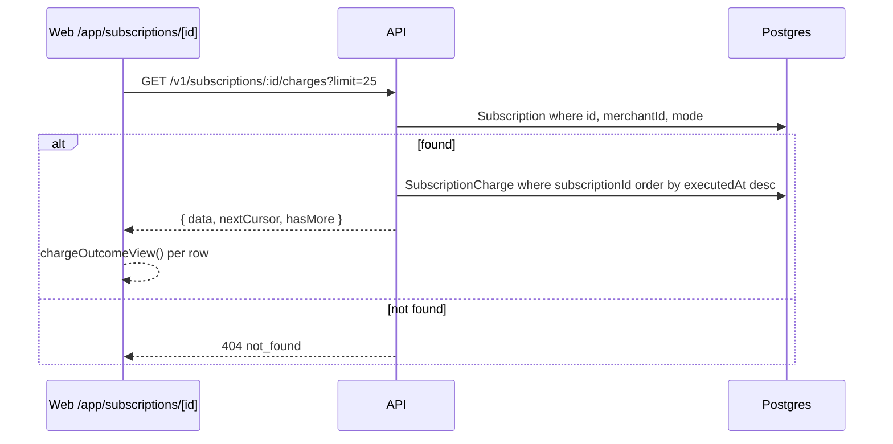

# ADR: Show each subscription's charge attempts

- **Status:** Accepted 2026-11-13
- **Date:** 2026-11-13
- **Scope:** API (one read route), web (subscription detail page, merchant API client). No schema, contract, queue, webhook or published-package change.

## Context

#400 asked the dashboard to show a charge skipped because the token was removed from the whitelist (`token_not_allowed`) as "Skipped: token not accepted" instead of a failure. Checking the code found there is nothing to relabel:

- The indexer stores every `SubscriptionChargeSkipped` as a `SubscriptionCharge` row with `status = failed` and an `outcome`. A charge that succeeds also gets a row, plus a `Transaction`.
- No API route returns `SubscriptionCharge` rows, and no dashboard page reads them. The subscription page's "charges" list is built from `Transaction` rows, which only exist for successful charges.
- `token_not_allowed` isn't a payment failure (`IsPaymentFailure` is false). So it doesn't fire `subscription.charge_failed` or move the subscription to `at_risk`, and the merchant sees nothing at all.

The same blind spot hides every other outcome: insufficient funds, revoked approval, merchant inactive and transfer failed. The merchant only learns about those through the `subscription.charge_failed` webhook.

`@strimz/shared-types` already defines `subscriptionChargeSchema` with `status`, `outcome`, `attemptNumber`, `executedAt` and `onchainTxHash`.

## Decision

1. **New route `GET /v1/subscriptions/:id/charges`.**
   - Scope `subscriptions_read`, available to API keys and dashboard sessions like `GET /v1/subscriptions/:id`.
   - It first loads the subscription by `(id, merchantId, mode)`, returning 404 when not found, then returns its `SubscriptionCharge` rows newest first, by `executedAt` and then `createdAt`.
   - Cursor pagination matches the other lists: `limit` defaults to 25 with a maximum of 100, plus `cursor`, and the response is `{ data, nextCursor, hasMore }`.
   - Rows are serialised to the existing `SubscriptionCharge` type.
2. **One label per outcome, in the web app.** `chargeOutcomeView(outcome, status)` returns `{ label, tone }`:
   - `charged`: "Charged", positive.
   - `insufficient_funds`: "Failed: not enough balance", danger.
   - `revoked_approval`: "Failed: approval revoked", danger.
   - `merchant_inactive`: "Failed: merchant inactive", danger.
   - `transfer_failed`: "Failed: transfer reverted", danger.
   - `token_not_allowed`: "Skipped: token not accepted", neutral.
   - `not_due`, `duplicate`, `ended`, `cancelled`, `unknown` and `skipped`: "Skipped" with a short reason, neutral.
   - Rows with no outcome use their status, such as pending, in-flight or retrying, in an info tone.
3. **"Charge attempts" card on the subscription page.**
   - Each row shows the period, the attempt number, when it ran, the outcome label, and an Arcscan link when there's a transaction hash.
   - It has loading, empty ("No charge attempts yet") and error-with-retry states, in light and dark, and a "Load more" button when `hasMore`.
   - The existing transaction-based list stays as the record of money received.
4. **No SDK method in this change.** `@strimz/sdk` is published, and adding `subscriptions.charges()` there is a public API change, so it is filed as a follow-up.

## Diagram

## Consequences

- Merchants can see why a period wasn't charged, including the delisted-token case, without reading webhooks.
- One more read route, through an existing index (`subscriptionId, attemptNumber`), with a page size cap.
- The SDK lags the API for this route until the follow-up lands.

## Alternatives considered

- **A banner for the latest attempt only.** Smaller, but it hides the history and still needs a new API field.
- **Write `Transaction` rows for skipped charges.** That would mix money that moved with money that didn't, and skew every revenue total built from transactions.
- **Close #400.** It leaves merchants blind to every failed or skipped charge.

## Verification

- **API e2e:**
  - a merchant lists its subscription's attempts, newest first, with outcome and status;
  - pagination works;
  - another merchant's subscription, or one in the other mode, returns 404;
  - an API key without `subscriptions_read` gets 403.
- **Web unit tests:**
  - every `SubscriptionChargeOutcome` has a label;
  - `token_not_allowed` reads "Skipped: token not accepted" in the neutral tone, not danger;
  - the subscription page renders the card with loading, empty and error states.
- **Full preflight.**
- **By hand:** a subscription with a successful charge and a failed one shows both rows, in light and dark.
