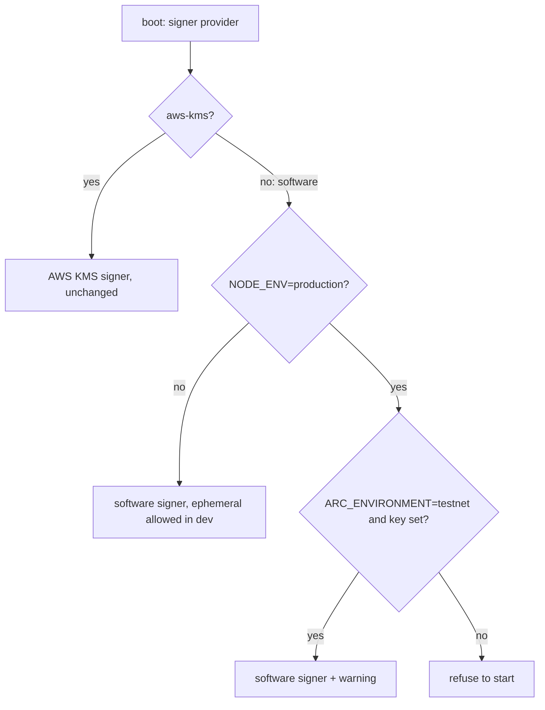

# ADR: Plain signing keys in production, on Arc testnet only

- **Status:** Accepted 2026-11-13
- **Date:** 2026-11-13
- **Scope:** API relayer signer (`apps/api/src/infra/kms/kms.module.ts`), scheduler env validation (`apps/scheduler/src/config/env.schema.ts`), `infra/lightsail/env.example`, `docs/runbooks/kms-signers.md`. No contract, schema, queue or webhook change.

## Context

The API relayer and the scheduler send transactions. Under `NODE_ENV=production` both refuse a plain private key and require AWS KMS (ADR-2026-10-11-aws-kms-signers):

- the API's `KmsModule` throws for `KMS_PROVIDER=software`;
- the scheduler's env schema rejects `SCHEDULER_SIGNER_PROVIDER=software`.

The AWS account that held those keys is suspended, so production can't start. Strimz is moving to an OVH VPS, with no AWS or GCP account available.

On Arc testnet, the current contracts already grant their roles to two plain keys:

- the relayer `0x8b93…c121` has `MERCHANT_REGISTRAR_ROLE` on the Registry;
- the scheduler `0xAD70…b41b` has `CHARGER_ROLE` on Subscriptions.

Both are funded with gas. Testnet USDC has no value.

## Decision

1. **Allow `software` in production only on testnet.** Both services accept it under `NODE_ENV=production` when `ARC_ENVIRONMENT=testnet` and the key is set explicitly (`KMS_SOFTWARE_PRIVATE_KEY`, `SCHEDULER_PRIVATE_KEY`).
2. **Mainnet keeps the refusal unchanged.** `ARC_ENVIRONMENT=mainnet` with `software` fails at boot, naming the mainnet signer issue.
3. **No generated keys in production, ever.** An auto-generated ephemeral key stays refused in production, on testnet too.
4. **Unchanged guards:**
   - the scheduler's key must differ from the relayer's;
   - the configured address must match the key;
   - a plain key next to AWS KMS settings stays refused.
5. **Each service logs one warning at boot** when it signs with a plain key in production: "signing with a plaintext key on testnet; not allowed on mainnet".
6. **Docs:** `env.example` and the KMS runbook describe the testnet setup. The `.env` on the server is mode 600, owned by root.

## Diagram

## Consequences

- Strimz can run in production on testnet from the OVH server with the keys that already hold their roles. No Safe transactions or funding are needed.
- On testnet, someone who gets into the server gets the keys. The exposure is testnet gas money and the ability to register merchants and charge subscriptions with testnet tokens. Both keys can be rotated through the Safe if that happens.
- Mainnet can't launch until a hardware-backed signer is chosen. That choice is tracked as its own issue and ADR.

## Alternatives considered

- **Lift the production guard entirely.** That would also allow plain keys on mainnet, which is what the guard exists to stop.
- **Run with `NODE_ENV=development`.** That turns off every other production check (CORS, Turnstile, chain id), not just the signer one.
- **Add a new KMS provider now.** There's no cloud account to host it, and it isn't needed for testnet.

## Verification

- **API unit tests:**
  - `software` + production + testnet + key starts and warns;
  - `software` + production + mainnet is refused;
  - `software` + production with no key is refused.
- **Scheduler unit tests:** the same three cases on the env schema. The separate-key and address checks still hold.
- **Full preflight.**
- **By hand:** the OVH deploy boots, and the logs show both warnings and the two expected addresses.
