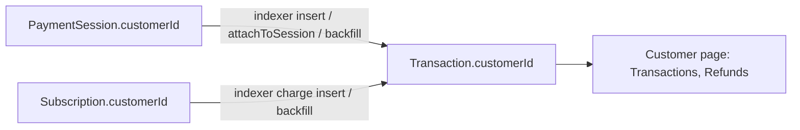

# ADR: Link every transaction to its customer

- **Status:** Accepted 2026-11-13
- **Date:** 2026-11-13
- **Scope:** Go indexer (two transaction inserts), API (checkout payer binding), Prisma (one data-only migration). No schema shape, contract, queue or webhook change.

## Context

A customer's page (`/app/customers/:id`) loads each section by `customerId`:

- **Payments:** payment sessions.
- **Subscriptions:** subscriptions.
- **Transactions:** `Transaction.customerId`.
- **Refunds:** refunds whose transaction belongs to the customer.

Locally, customer `cmwdeut1…a16` shows two confirmed payments, but empty Transactions and Refunds. Both `Transaction` rows (the 2 USDC and 2 EURC one-off payments) have `customerId = NULL`, while their `PaymentSession.customerId` is that customer.

The cause:

- **One-off payments:** `InsertOneShotTransaction` links the session (`sessionId`) but never copies the session's `customerId`.
- **Subscription charges:** `InsertSubscriptionCharge` writes the `Transaction` without the subscription's `customerId`.
- **Late customer:** checkout binds the customer to the session in `attachToSession`. If that happens after the indexer has already written the transaction, nothing updates the row.

The result: the customer's transactions are missing, refunds are missing (they're found through transactions), and anything else that counts revenue per customer is undercounted.

## Decision

1. **One-off payments.** `InsertOneShotTransaction` sets `customerId` from the linked `PaymentSession.customerId` in the same statement.
2. **Subscription charges.** `InsertSubscriptionCharge` sets the transaction's `customerId` from `Subscription.customerId`.
3. **Late binding.** `attachToSession` also sets `customerId` on any `Transaction` already linked to that session and still `NULL`, in the same database transaction. It never overwrites a set value.
4. **Backfill.** A data-only Prisma migration `…_backfill_transaction_customer` fills `Transaction.customerId` where it is `NULL`:
   - from `PaymentSession.customerId` via `sessionId`;
   - for subscription charges, via `SubscriptionCharge → Subscription.customerId`.

   It's idempotent (`WHERE "customerId" IS NULL`) and adds no columns.

## Diagram

## Consequences

- Customer pages show every transaction and refund. Per-customer revenue is complete, for old rows too, once the migration runs.
- A transaction whose session never got a customer (the payer skipped the email step) stays unlinked, which is correct.

## Alternatives considered

- **Have the API query join through sessions and subscriptions.** It fixes this page only and leaves the column wrong for everything else that reads it.
- **Backfill with a script instead of a migration.** It's easy to forget on deploy, and the migration runs everywhere automatically.

## Verification

- **Go store e2e:**
  - a one-off payment for a session with a customer gets that `customerId`;
  - a subscription charge gets the subscription's `customerId`;
  - a session with no customer leaves the transaction unlinked.
- **API e2e:** binding a payer after the transaction exists links it, and never overwrites an existing value.
- **Migration test:** on seeded rows, the backfill fills both cases and leaves the rest.
- **Full preflight and all e2e suites.**
- **By hand:** the customer page for `cmwdeut1…a16` lists both transactions after the migration runs.
