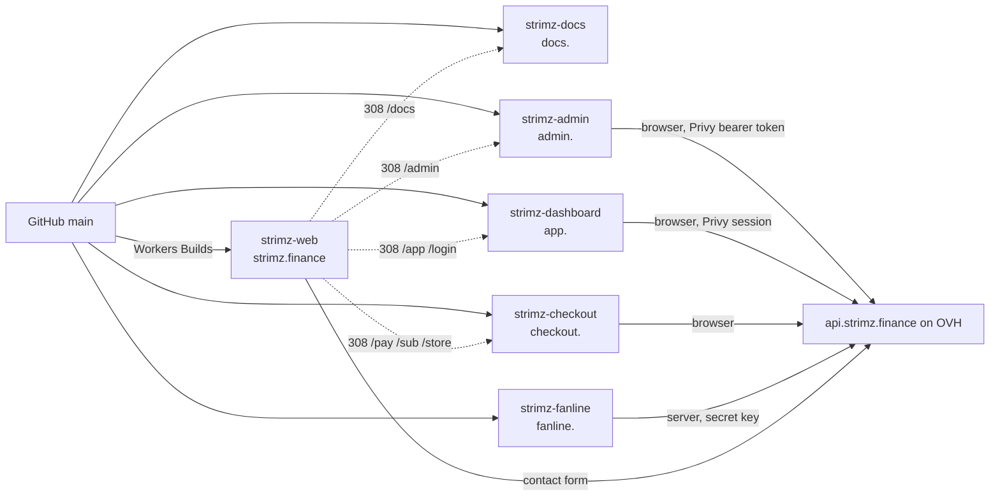

# ADR: Split the web app into five apps on Cloudflare Workers Free

- **Status:** Accepted 2026-11-14
- **Date:** 2026-11-14
- **Supersedes:** ADR-2026-11-13-cloudflare-workers-frontends (decisions 1, 2's scope, and 7). Its OpenNext setup, smoke test and runbook carry over.
- **Scope:**
  - `apps/web` is split into `apps/web` (marketing), `apps/docs`, `apps/dashboard`, `apps/admin` and `apps/checkout`;
  - `@strimz/sdk-react` changes its default checkout origin;
  - the scheduler's allowance-reminder link and the API's admin links change;
  - API and scheduler env values change, plus Worker config, runbook and smoke tests.

  No contract, schema, queue or webhook payload change.

## Context

The approved plan put all of `apps/web` on one Worker, `strimz-web`. Measured with `wrangler deploy --dry-run`, it is **5.7 MiB gzipped**. Workers Free allows 3 MiB per Worker, and the maintainer won't use Workers Paid.

Where the size comes from (gzipped):

| Part                                                                                                            | Size     |
| --------------------------------------------------------------------------------------------------------------- | -------- |
| Wallet libraries in server chunks (Privy, and through it Coinbase, MetaMask and WalletConnect; Reown and wagmi) | 1.4 MiB  |
| Other shared server chunks (dashboard, admin, checkout code)                                                    | 1.3 MiB  |
| Route bundles and client reference manifests (47 pages)                                                         | 1.5 MiB  |
| Next.js runtime and the rest                                                                                    | ~1.5 MiB |
| Docs only (Shiki highlighting, the docs page)                                                                   | 0.3 MiB  |

How the wallet code is mounted today:

- The root layout wraps every page, marketing and docs included, in `PrivyProvider`, so Privy and the wallet SDKs it pulls in are in every server bundle.
- Reown and wagmi are already mounted only on checkout (`CheckoutProviders`).

Solva runs the same way on the same account, with three small apps on three free Workers:

- the website and the docs are prerendered and served from Workers Static Assets;
- its console has no wallet libraries.

## Decision

### 1. Five apps, one Worker each

| App                    | Routes moved in                                                                | Worker             | Domain                                                 |
| ---------------------- | ------------------------------------------------------------------------------ | ------------------ | ------------------------------------------------------ |
| `apps/web` (marketing) | `(marketing)`, legal pages                                                     | `strimz-web`       | `strimz.finance`; `www.strimz.finance` redirects to it |
| `apps/docs` (new)      | `docs/[[...slug]]`, `content/docs`, `/api/search`                              | `strimz-docs`      | `docs.strimz.finance`                                  |
| `apps/dashboard` (new) | `(auth)`, `(dashboard)`, `/api/uploadthing`, `/api/csp-report`                 | `strimz-dashboard` | `app.strimz.finance`                                   |
| `apps/admin` (new)     | `(admin)`, `(admin-auth)`, `(admin-invite)`, `/api/admin/*`, `/api/csp-report` | `strimz-admin`     | `admin.strimz.finance`                                 |
| `apps/checkout` (new)  | `(checkout)` (`/pay`, `/sub`, `/sub/renew`), `store/[slug]`                    | `strimz-checkout`  | `checkout.strimz.finance`                              |
| `apps/demo-merchant`   | unchanged                                                                      | `strimz-fanline`   | `fanline.strimz.finance`                               |

- **Paths stay the same on each host.** `/app/...`, `/admin/...`, `/login`, `/pay/...` and `/store/...` keep their paths, so only the origin changes in links and emails.
- **Local dev ports:** web 3000, dashboard 3001, checkout 3002, docs 3003, admin 3004, Fanline 3200 (unchanged).
- **Admin is separate from the merchant dashboard.** Merchant code never ships admin pages, and admin can be locked down on its own (for example with Cloudflare Access later). Both sign in through the same Privy app; admin sends the Privy token as a bearer header, so no cookie is shared across hosts.

### 2. Wallet code out of server rendering

- **Dashboard and admin:** `PrivyProvider` moves out of the root layout and is mounted only in these two apps, loaded in the browser (`next/dynamic` with `ssr: false`). Its pages render a loading shell on the server. They already need a signed-in session in the browser, so nothing visible is lost.
- **Checkout:** `CheckoutProviders` (wagmi, Reown) is loaded the same way. Checkout pages render a loading shell, then the wallet UI in the browser.
- **Marketing and docs** mount no wallet or auth provider at all.

### 3. Prerendering

Marketing and docs use OpenNext's static-assets incremental cache with cache interception, as Solva does. Their pages are built once and served as static assets, which:

- don't count toward the Worker size;
- use almost no CPU.

Dashboard and checkout render per request with no incremental cache.

### 4. Shared code

- **UI** used by more than one app (theme toggle and provider, brand, toasts, the Turnstile widget, SEO helpers) moves into `packages/ui`.
- **Plain helpers** shared by dashboard and checkout move into a new private package, `packages/web-shared`.
- Apps never import each other.

### 5. Cross-origin changes

- **Marketing redirects (308):**
  - `/pay/*`, `/sub/*` and `/store/*` go to `checkout.strimz.finance`;
  - `/app/*`, `/login`, `/signup`, `/onboarding` and `/callback` go to `app.strimz.finance`;
  - `/admin/*` goes to `admin.strimz.finance`;
  - `/docs/*` goes to `docs.strimz.finance`.
- **API env:**
  - `CHECKOUT_ORIGIN=https://checkout.strimz.finance`;
  - `STRIMZ_DASHBOARD_URL=https://app.strimz.finance`;
  - a new required `STRIMZ_ADMIN_URL=https://admin.strimz.finance`. The admin invite-accept link and the `/admin` links in admin emails are built from it instead of `STRIMZ_DASHBOARD_URL`, with a failing test first;
  - `CORS_ORIGIN` lists the browser origins that call the API: app, admin, checkout and the marketing apex for the contact form.
- **Scheduler:** the allowance-reminder email builds `/sub/renew/...` from `STRIMZ_DASHBOARD_URL` today. It switches to a new required `CHECKOUT_ORIGIN` env value. This is a bug-shaped change, so a failing test comes first.
- **`@strimz/sdk-react`:**
  - `DEFAULT_CHECKOUT_ORIGIN` becomes `https://checkout.strimz.finance`, released as a minor version with a changeset.
  - Older SDK versions still point at `www.strimz.finance`, where the redirect sends payers on. Embedded flows that check the message origin need the new version.
  - Fanline uses the workspace version.
- **Privy:**
  - the allowed origins become `app.strimz.finance` and `admin.strimz.finance`;
  - Turnstile hostnames include the hosts that render the widget.

### 6. Size gate

`scripts/worker-size.sh <app>` runs `wrangler deploy --dry-run` and fails above 3 MiB gzipped. It is run with the smoke test for every app, so a later change can't push a Worker over the free limit unnoticed.

### 7. Rollout

1. All six Workers deploy to `*.workers.dev` and are checked there.
2. The custom domains are attached; Cloudflare creates the DNS records.
3. The API and scheduler env values change on the OVH server, which is then redeployed.
4. The Vercel projects are deleted after a day with no problems.

The new database is empty, so no live payment link uses the old origin.

## Diagram

## Consequences

- Every Worker fits Workers Free, and the size gate keeps it that way. There are no credits and no paused sites.
- One app can be deployed or rolled back without the others.
- Dashboard and checkout show a loading shell before the wallet UI appears. Both already depended on the browser for the session or the wallet.
- A payer's wallet connection and a merchant's session live on different origins. Neither flow shares state today, so nothing breaks.
- Shared code needs a package boundary, which is more structure to maintain.
- This is a large move. Tests move with their code, and the Playwright suite is split per app.

## Alternatives considered

- **Workers Paid ($5 a month), one Worker.** No code change. The maintainer declined.
- **Netlify free.** No size limit, but it is credit-based: free sites can be paused when credits run out, and in 2026 users reported deploys stuck paused. That doesn't fit a payment site.
- **Keep admin inside the merchant dashboard.** It would fit, but merchant bundles would carry admin code, and admin couldn't be locked down on its own.
- **Only move the docs out.** That saves about 0.3 MiB; the web Worker stays near 5.4 MiB.
- **Host the frontends on the OVH server.** The maintainer prefers that the site not depend on the monthly server.

## Verification

- Per app:
  - `pnpm build:cloudflare`;
  - `scripts/worker-smoke.sh <app>`;
  - `scripts/worker-size.sh <app>` under 3 MiB, with the measured sizes recorded in the runbook.
- Scheduler unit test: the renewal link uses the checkout origin. It fails first.
- API unit test: admin invite and email links use `STRIMZ_ADMIN_URL`. It fails first.
- `@strimz/sdk-react` test for the new default.
- Full `./scripts/preflight.sh`, and the scheduler e2e suite.
- By hand on `*.workers.dev`, then on the real domains:
  - marketing pages and every redirect;
  - docs and search;
  - sign-up, sign-in and the dashboard;
  - admin sign-in, an admin invite and the admin pages;
  - a one-time payment, a subscription and a storefront purchase on checkout;
  - a Fanline tip.
