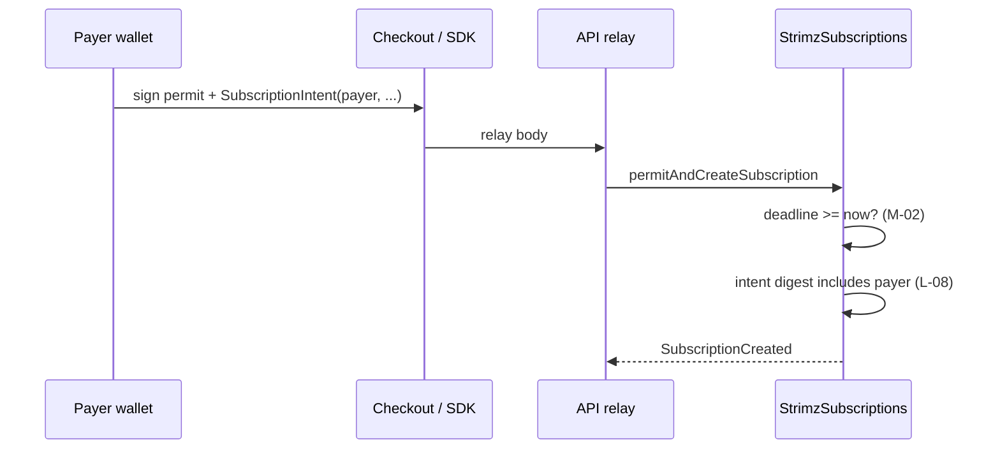
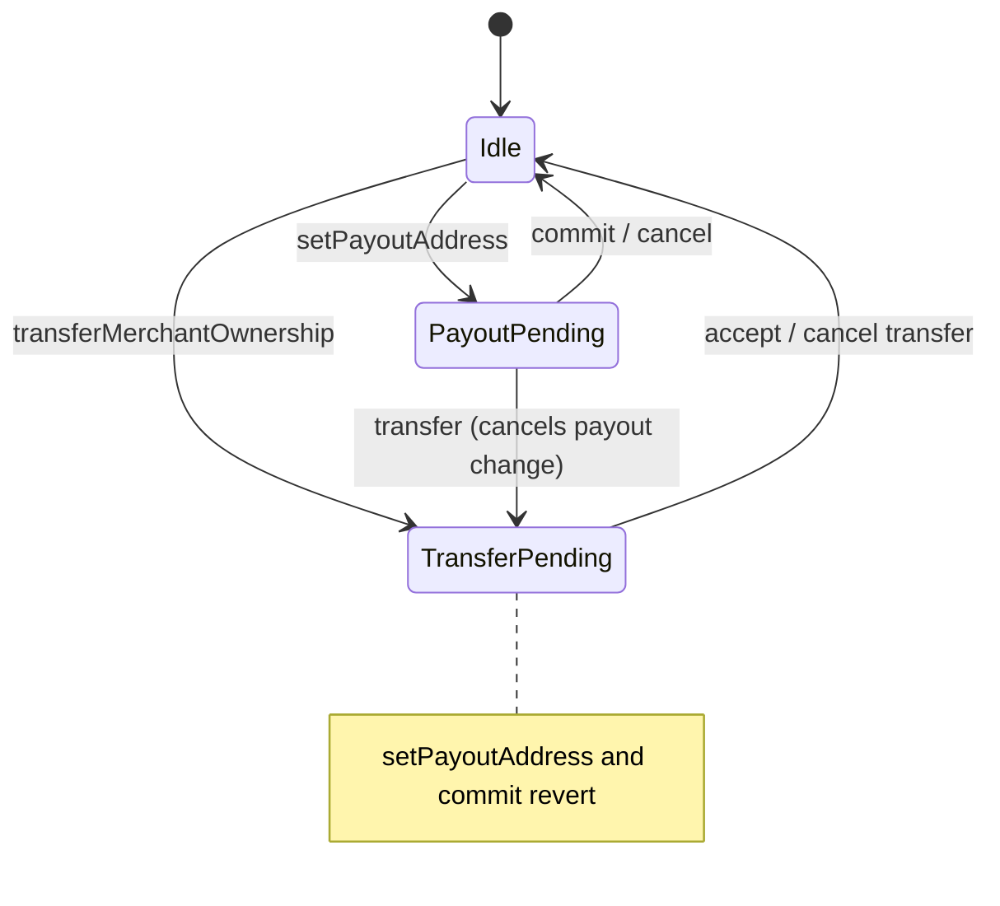

# ADR: Contract changes before the mainnet deploy (audit M-02, L-08, L-03/L-06, L-12, plus #497 and #499)

- **Status:** Accepted 2026-11-20 by the founder.
- **Date:** 2026-11-19
- **Issues:**
  - audit fixes #480, #481, #482, #483 (tracker #484);
  - the on-chain parts of #497 (plan attribution) and #499 (subscribers cancel without gas).
- **Scope:**
  - `StrimzSubscriptions`, which is immutable: the change takes effect with a fresh deploy.
  - `StrimzRegistry` (UUPS), deployed fresh on testnet and mainnet.
  - Everything that signs `SubscriptionIntent`:
    - `@strimz/sdk` (`eip712/subscription-intent.ts`);
    - checkout (`subscription-signing.ts`, `use-subscription-checkout.ts`);
    - `contracts/script/Digests.s.sol` and `e2e.sh`;
    - the full-stack e2e helpers.
  - Indexer ABIs, regenerated. The indexer keeps decoding the old `SubscriptionCreated` signature, so the old testnet contract's history still projects.
  - The docs pages that print the intent struct.
- **Out of scope:**
  - #479, the fee ceiling. The founder kept `MAX_FEE_BPS = 500` (5%), so it's a docs-only change, shipped with this PR.
  - The escrow findings (#257). The escrow stays paused for the beta.
  - L-09/L-10, fee rounding. Rounding down is deliberate (#382).

## Context

The 2026-11-19 audit found one Medium and three Low issues in contracts that go to mainnet. Mainnet isn't deployed yet, so an immutable contract can still change at no migration cost.

1. **M-02 (#480): the permit deadline isn't enforced.**
   - `permitAndCreateSubscription` signs `permitDeadline` into the intent but never checks it.
   - When `permit` fails, for example because it expired, the `try/catch` falls back to `_requireAllowance`, which only checks the allowance.
   - So a payer who already has a standing allowance can be enrolled from an old, never-submitted intent long after its deadline. The first charge is then due at once.
2. **L-08 (#481): the intent doesn't name the payer.**
   - `SUBSCRIPTION_INTENT_TYPEHASH` has no payer field.
   - Some smart-contract wallets accept the owner key's raw signature through ERC-1271 `isValidSignature`. For those, one intent signature can enrol a sibling wallet of the same owner, as long as that wallet has the allowance.
3. **L-03/L-06 (#482): a payout change can outlive an ownership transfer.**
   - `commitPayoutAddress` is permissionless and ignores `pendingOwner`.
   - A seller can queue payout X, start a transfer, and commit X before the buyer accepts. `acceptMerchantOwnership` only clears a change that is still pending, so the buyer inherits X.
4. **L-12 (#483): an operator cancel blocks the payer's cancel.**
   - After an operator cancel, the payer's `cancel` reverts with `AlreadyCancelled`, so the payer's wish to leave is never recorded.
   - An admin can then `reinstate` the subscription within 7 days, and billing resumes.

## Decision

1. **M-02:** `permitAndCreateSubscription` reverts with `Subscriptions__PermitExpired(deadline)` when `block.timestamp > permitData.deadline`. The check runs before the intent is verified, so it covers both the permit path and the allowance path.
2. **L-08:**
   - The intent gains a payer field: `SubscriptionIntent(address payer,uint256 merchantId,address token,uint256 amount,uint32 interval,uint64 startAt,uint64 endAt,uint256 permitDeadline,uint256 permitValue,bytes32 nonce)`.
   - `_verifySubscriptionIntent` hashes `permitData.owner` into it.
   - `subscriptionIntentDigest` takes `payer` as its first argument.
   - Every signer changes in the same PR: `buildSubscriptionIntentTypedData` takes `payer`, and checkout passes the connected address.
   - `@strimz/sdk` gets a minor changeset. The signed payload changes, and merchants who sign intents themselves must upgrade together with the redeploy.
3. **L-03/L-06:** a pending ownership transfer freezes payout changes.
   - `transferMerchantOwnership` cancels any pending payout change and emits `MerchantPayoutChangeCancelled`.
   - `setPayoutAddress` and `commitPayoutAddress` revert with `Registry__OwnershipTransferPending()` while `pendingOwner != 0`.
   - The buyer therefore sees the payout address that will be live when they accept. Cancelling the transfer unfreezes payout changes.
   - The admin cancel paths are unchanged.
4. **L-12:**
   - When the payer calls `cancel` on a subscription an operator already cancelled, the call no longer reverts. It deletes `operatorCancelledAt` and emits `SubscriptionCancelConfirmedByPayer(subscriptionId, payer)`.
   - `reinstate` then fails with `NotReinstatable`.
   - A second cancel by anyone else still reverts with `AlreadyCancelled`.
   - The indexer ignores the new event because the row is already cancelled. Its ABI is regenerated, so it decodes the event instead of logging it as unknown.
5. **#497, plan attribution:**
   - `SubscriptionCreated` gains `bytes32 intentNonce` as its last field. `permitAndCreateSubscription` emits the signed nonce, and `createSubscription` emits `bytes32(0)`.
   - The API already requires the nonce to equal `subscriptionIntentNonce(planId, payer, permitNonce)`, so the nonce names the plan. The off-chain half is in ADR-2026-11-20-subscription-plan-attribution.
6. **#499, gasless subscriber cancel:**
   - New `cancelWithSig(uint256 subscriptionId, uint256 deadline, bytes signature)`. It verifies an EIP-712 `CancelSubscription(uint256 subscriptionId,uint256 deadline)` signature from the subscription's payer, through `PayerSignature.isValid`, so ERC-1271 wallets work too.
   - It records a payer cancel: no `operatorCancelledAt`, so `reinstate` can't undo it.
   - It reverts after the deadline, and a second cancel reverts with `AlreadyCancelled`.
   - Anyone may submit it, and the Strimz relayer pays the gas.
   - The signature can't be replayed: a cancelled subscription can't be cancelled again.
   - The off-chain half is in ADR-2026-11-20-subscriber-self-cancel.
7. **Tests (red first):**
   - M-02: an expired intent plus a standing allowance is refused.
   - L-08: the audit's sibling-wallet replay is refused.
   - L-03/L-06: the audit's `Disproof_C004` sequence (set, transfer, commit, accept) ends with the buyer on the original payout.
   - L-12: operator cancel, then payer cancel, then reinstate reverts.
   - The SDK typed-data snapshot is updated, and a checkout test asserts that the payer is in the signed message.
   - The full-stack e2e (contracts, API relay, indexer, scheduler) passes against the new digest.
   - `SubscriptionCreated` carries the signed nonce on the permit path and zero on the direct path.
   - `cancelWithSig`:
     - accepts the payer's signature, from an EOA and from an ERC-1271 wallet;
     - refuses a stranger's signature and an expired deadline;
     - a later `reinstate` reverts.

## Rollout

- **Mainnet:** deployed fresh with these contracts (#490).
- **Testnet:**
  - The core set (Registry, Payments, Subscriptions, FeeCollector, TokenWhitelist) is redeployed with `docs/runbooks/testnet-redeploy.md`. The old set is paused, and merchants re-register on the new Registry when they next create a session.
  - Subscriptions on the old testnet contract stop renewing, and testers subscribe again. It's test money; the dashboard keeps their history.
  - The app changes in this PR go live in the same release as the new addresses: checkout signs the new intent, which the old contract refuses.
- **Merchants who build their own signing UI** must update `@strimz/sdk` at the switch. Hosted checkout and `@strimz/sdk-react` update with the deploy.

## Trade-offs

- **Freezing payout changes during a transfer.** A seller in the middle of a sale can't move the payout. That's the point: they can cancel the transfer first. A permissioned commit, the alternative, would still let the seller commit before the buyer accepts.
- **A new event, rather than a second `SubscriptionCancelled`.** A second `SubscriptionCancelled` would tell the indexer about a transition that didn't happen.
- **Breaking the intent shape costs one SDK minor release.** It's cheapest now, before any mainnet merchant has signed an intent.

## Diagram

