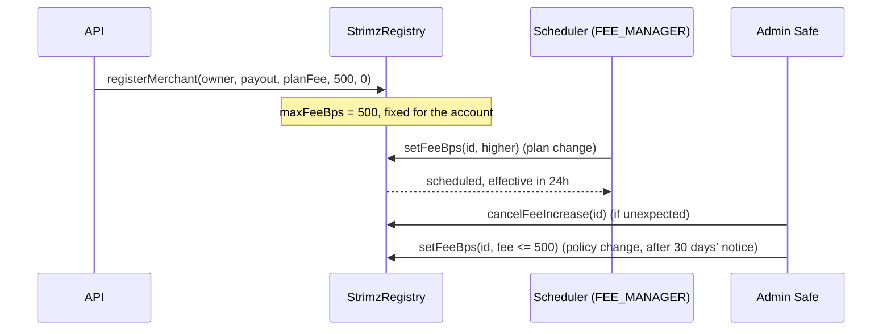

# ADR: Register merchants with a 5% fee ceiling

- **Status:** Accepted 2026-11-20 by the founder
- **Date:** 2026-11-20
- **Issue:** #479
- **Scope:**
  - `@strimz/shared-config`: new `MERCHANT_FEE_CEILING_BPS`.
  - API: `registerMerchantCallData` passes it as `maxFeeBps`.
  - Dashboard: the copy of the Fees panel in Settings.
  - Docs: `dashboard/settings`, `guides/subscriptions` and the contracts README.
  - No contract change. `MAX_FEE_BPS` stays 500.

## Context

- `StrimzRegistry.registerMerchant` stores a per-merchant `maxFeeBps`, which no function can change later.
  - `setFeeBps` reverts above it, for every role.
  - Only a registry upgrade could change it.
- The API registers every merchant with `PLAN_FEE_CEILING_BPS`, the highest volume-plan fee: 50 bps.
- So no merchant's fee can ever pass 0.5%, although the contract allows up to 5% (`MAX_FEE_BPS = 500`).
- The founder's plan is a low entry fee that can rise over time, for example with network costs. Raising fees later through a registry upgrade would break the promise the stored ceiling makes.

Two more facts matter here.

- **The scheduler's hot key can schedule increases.** The scheduler holds `FEE_MANAGER_ROLE` for volume-plan changes (ADR-2026-10-29-scheduler-key-limits). An increase from that role waits 24 hours, and the admin Safe can cancel it (`cancelFeeIncrease`). That ADR sized the risk at 0.5%, because that was the ceiling.
- **The dashboard copy is wrong today.**
  - The Fees panel says merchants "can lower [the cap] from your wallet" and that "the ceiling can only go down". The registry has no function that lowers a ceiling.
  - It also says only that admin can lower the fee, but admin and the fee manager can raise it too, up to the ceiling.

## Decision

1. **New constant** in `packages/shared-config/src/tiers.ts`: `MERCHANT_FEE_CEILING_BPS = 500`, equal to the registry's `MAX_FEE_BPS`.
   - `PLAN_FEE_CEILING_BPS` stays. It still means "the highest plan fee", and `audit-merchant-tiers` still flags a ceiling below it.
   - Changeset: `@strimz/shared-config` minor.
2. **`registerMerchantCallData`** passes `MERCHANT_FEE_CEILING_BPS` as `maxFeeBps`. The registration fee stays the plan fee: 0 bps on Free.
3. **Fee policy, in the docs:**
   - The current fee is the plan fee on the pricing page. The ceiling is the most Strimz can ever charge that account.
   - Moving between Free, Starter and Growth follows the published plans.
   - Any other increase gets at least 30 days' notice by email before it is scheduled on-chain.
4. **Dashboard Fees panel copy:**
   - It shows "Current fee" and "Most Strimz can charge".
   - It says Strimz can raise the fee up to the ceiling, with notice, and that the ceiling can't be raised.
   - It drops the false claims about lowering the ceiling.
   - Logged as a GitHub issue, per the UI rule.
5. **Every merchant gets 500.** Testnet and mainnet both deploy a fresh registry, and merchants register on it again (`docs/runbooks/testnet-redeploy.md`). This change ships with PR #504 and waits with it.

## Diagram

## Consequences

- **Pricing room:** Strimz can raise fees up to 5% without a contract change.
- **Larger blast radius for a leaked scheduler key.** It could schedule every merchant up to 5% instead of 0.5%.
  - The 24-hour delay and `cancelFeeIncrease` still apply.
  - The indexer already raises a governance alert on every `MerchantFeeIncreaseScheduled` (`projector.go`). Before mainnet, someone must actually receive it.
- **Admin increases apply at once.** The 30-day notice is a promise kept by process (the Safe signers), not by code.
- **Merchants see a 5% maximum.** The panel and the docs lead with the current fee.

## Alternatives considered

- **Keep 50 bps.** Rejected: no fee can ever rise above 0.5% without a registry upgrade.
- **A middle ceiling such as 1% or 2%.** Rejected: the founder chose 5%, and any value still caps future pricing.
- **A contract setter so a merchant can opt in to a higher ceiling.** Rejected for now: it needs a registry change and a merchant signature each time.

## Verification

- **Red, then green:** `registration-fee.test.ts` expects a 500 bps ceiling for Free, Starter and Growth.
- **shared-config:** a test pins `MERCHANT_FEE_CEILING_BPS` to 500.
- **Forge:** `StrimzRegistry.t.sol` already registers at 500/500 and refuses fees above `MAX_FEE_BPS`.
- **Preflight:** the full `./scripts/preflight.sh` passes.
